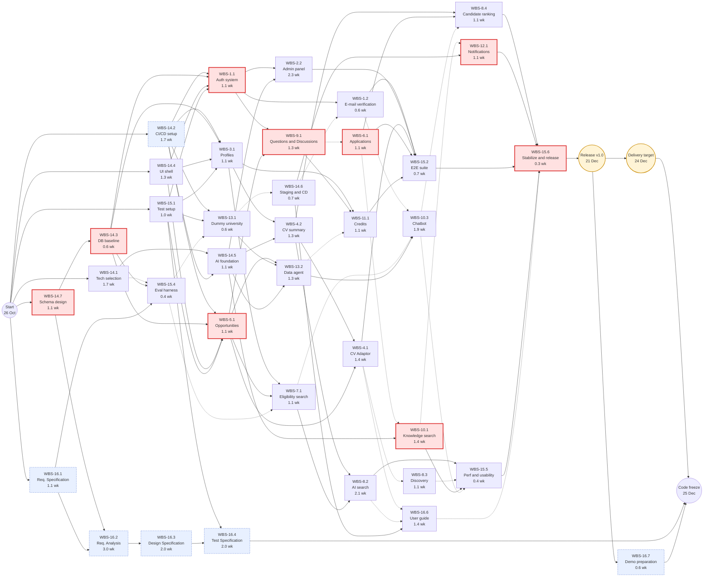
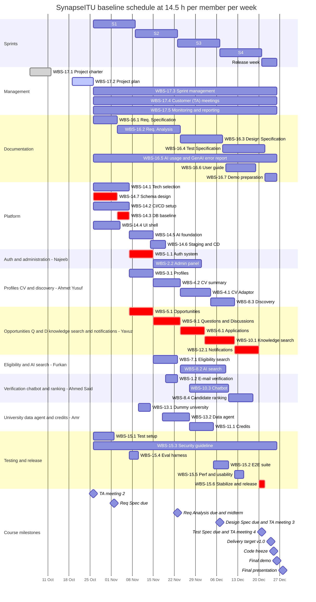

# Software Engineering — Project Plan

## Cover Page

| Field | Details |
|---|---|
| **Course** | BLG411E Software Engineering (2026–2027 Fall) |
| **Report name** | Project Plan |
| **Project title** | SynapseITU |
| **Group name / number** | The Goats |
| **Group members** | Yavuz Selim Yağlıca — 150220103, Furkan Yalçın — 150220116, Ahmed Said Gülşen — 150220044, Ahmet Yusuf Kurukız — 150240716, Najib Attar — 150220905, Amr Naweel Zuhdi Taweel — 150220937 |
| **Instructor** | Assoc. Prof. Dr. Ayşe Tosun |
| **Submission date** | 2026-10-25 |
| **Document version** | 1.0 |
| **Repository** | https://github.com/yalcinfu22/SynapseITU |

---

## 1. Introduction

### 1.1 Scope

**Project overview:**  
Students and early-career researchers struggle to find research opportunities that fit them (lab positions, research assistantships, MSc/PhD programs, clinical and industry research projects). Opportunity owners struggle to reach suitable candidates, and general platforms such as LinkedIn do not handle academic requirements or eligibility rules. SynapseITU is a web platform that connects students with opportunity owners (academics, lab leaders, clinicians, industry R&D teams). It filters opportunities by eligibility rules and adds an AI search over the opportunities a student is eligible for. It also has a university chatbot that answers only from platform data, a data agent that keeps university data up to date, Questions & Discussions boards open to everyone with an AI search over past answers, a CV Adaptor that adapts a student's CV to a chosen opportunity, and a credit system that rewards contributions and limits AI use. Six students build it for BLG411E in Fall 2026 with supervised AI coding assistants.

**In scope (Essential requirements):**
- **Accounts and access:** registration, login/logout with sessions, password reset and account deletion; institutional e-mail verification, with limited access until verified; Student, Opportunity Owner and Admin roles, for which basic authorization tests will be performed; an admin panel for users, user reports, moderation actions and settings such as the monthly AI limit.
- **Profiles and CVs:** education, skills, projects, interests and CV upload; a CV summary of skills and interests for the AI search and the candidate ranking; a CV Adaptor that adapts the CV to an opportunity the student selects: it shows which requirements are met, partly met or missing, suggests changes without ever adding experience the student does not have, and the student accepts or rejects each suggestion and downloads the adapted CV.
- **Opportunities:** creating, updating, opening and closing opportunities; requirements marked must-have or plus; applications with status tracking and two-way interest requests.
- **Search and matching:** eligibility search with filters that explains unmet requirements; a "Most fitting for me" AI search that ranks only the opportunities the user is eligible for and shows at most the missing optional (plus) qualifications; search with the CV summary, showing the source of each result; an interest-based finder that lists opportunities matching the user's interests, whether or not the user is eligible and whether they are open or closed; it belongs to the AI search but is built as an independent discovery service; AI ranking of candidates with reasons, where the owner always makes the final decision.
- **Questions & Discussions:** boards open to everyone, a general one and one for every opportunity and every institution, each with Questions and Discussions tabs; asking, answering, discussing, voting, best answers and highlighted owner answers; post reports resolved by admins, visible author roles, and a label on posts by current or former members of that opportunity or institution.
- **AI knowledge search:** an AI search over past questions and discussions that returns answer snippets, each linked to its post.
- **University chatbot:** a chat in Turkish or English that helps students find suitable opportunities and graduate programs; it answers only from platform data, asks a clarifying question when a request is vague and links every answer to its source.
- **Credits:** credits for upvoted and accepted answers, with no self-voting; boosting a question with credits, which go to the author of the accepted answer; credits for a complete profile and for posts by verified users, extra CV Adaptor runs for credits, and a monthly AI limit.
- **Notifications:** in-app notifications for application status, answers, interest requests and deadlines; e-mail delivery is optional (WBS-12.2).
- **University data agent:** collects the programs, labs and positions of universities on a schedule (the dummy university's API and public university program pages) and keeps the database up to date.
- **Engineering work:** one database and schema design shared by all modules, cloud deployment with CI/CD, automated tests, a living security and authorization guideline, and the course documents.

**Optional scope:**
- *Desirable, only if sprint velocity allows:* announcements to followers (WBS-5.2); an opportunity calendar and events (WBS-5.3); matching that also uses the profiles of consenting team members (WBS-8.5); AI access to open-web (internet) data (WBS-10.2).
- *Optional:* real-time chat that runs alongside the active application workflow as a concurrent companion, not as a separate step afterwards (WBS-6.2); teammate ratings, where users rate their teammates and owners may use the ratings as one input when selecting candidates (WBS-8.8); CV autofill, where an uploaded CV fills the profile and the user confirms it (WBS-3.2); e-mail notifications (WBS-12.2).

**Out of scope:**
- Native Android and iOS apps (the web interface is responsive).
- Payments and subscriptions; credits cannot be bought.
- Integration with real institutions' internal systems (shown only with the dummy university); the data agent reads only public program pages.
- Data collection from sources other than universities, such as OpenAlex.
- Proactive recommendations: the platform never pushes suggestions; the optional teammate ratings (WBS-8.8) are the only peer input.
- Detailed role-based access control (permission matrices, role hierarchies); basic authorization tests will be performed.
- A shared search service across features.
- AI moderation of posts before publishing; admins review reported posts.
- Training our own LLM; pre-trained models are used through APIs.
- Autonomous AI decisions: the AI never accepts or rejects applicants and never applies for a student.
- Languages other than Turkish and English.

**Assumptions and constraints:**

*Constraints:*
- Course dates: Requirements Specification 2026-11-02, Requirements Analysis 2026-11-23, Design Specification 2026-12-07, Test Specification 2026-12-21, code freeze 2026-12-25, final demo 2026-12-26, final presentation 2026-12-28.
- Delivery target for v1.0 (team decision): 2026-12-24, one day before code freeze.
- Minimum course technologies: web frontend and backend, service-based APIs, a structured database, cloud hosting, authentication and authorization.
- Six members, each with at least one technical and one management role. AI agents may open pull requests, but nothing reaches `dev` or `main` without human review.

*Assumptions (checked at every sprint review):*
- **Availability: 14.5 hours per member per week (0.36 FTE) from 2026-10-26 to 2026-12-25.** That is about 126 h per member, which fits the course's 8-ECTS workload (200–240 h) together with lectures and exams. The plan uses 11.5 h of it per week on average (8.0 h development and testing, 2.7 h documents, 0.8 h management); the rest is slack for waiting on dependencies and for busy document weeks.
- Every member works with AI coding agents (GPT-Sol–class and Claude Sonnet–class models) that draft code and tests for human review. All estimates are human effort with AI help.
- Before 2026-10-26, only the charter, this plan and the repository exist.
- The team's requirements list of 2026-10-24, which ranks every requirement as Essential, Desirable or Optional, is the scope baseline and replaces the charter where they differ: comments became Questions & Discussions boards (a general one and one per opportunity and per institution) with an AI knowledge search; posts are published without an AI check; CV autofill and e-mail notifications became optional; the data agent collects from universities only. Further changes are agreed with the customer (TA) first. The technology choices in WBS-14.1 (Claude API, Voyage embeddings, AWS) also replace the charter's technology section.

### 1.2 Deliverables

| Deliverable ID | Deliverable name | Description / contents | Acceptance criterion |
|---|---|---|---|
| D-01 | Access, Roles and Administration Module | Auth system with sessions and standard access control, institutional e-mail verification, admin panel with user reports, moderation actions and administrative management endpoints: frontend, backend and tests | The module's acceptance tests pass in CI; basic authorization tests pass; every admin action is recorded in the audit log |
| D-02 | Profile, CV and Discovery Module | Profiles and CV upload, CV summary, CV Adaptor, CV-summary search and the independent interest-based discovery service | The module's acceptance tests pass; on 10 sample CVs, every skill and interest in the summary appears in the CV and no CV Adaptor suggestion adds experience that is not in the CV; discovery results link to their source opportunity |
| D-03 | Opportunity, Application and Q&D Module | Opportunities and requirements, applications and interest requests, Questions & Discussions boards with post reports, author roles and member labels, AI candidate ranking for owners | The module's acceptance tests, including reporting a post, pass on staging |
| D-04 | Eligibility and AI Search Module | Eligibility search and the "Most fitting for me" AI search | The module's acceptance tests pass; on the labelled set, the AI search reaches higher precision@5 than keyword-only and embedding-only baselines; results contain only eligible opportunities and list at most the missing optional (plus) qualifications |
| D-05 | Knowledge Search, Chatbot and Notification Services | Knowledge search with citations, the university chatbot, in-app notifications | The acceptance tests of the three services pass; every returned snippet links to its source post; every chatbot answer links to the platform records it used; in-app notifications are delivered for all four event types |
| D-06 | University Data and Credit Services | Dummy university service and the university data agent, credit system | The acceptance tests of both services pass; after a scheduled run, every stored university record matches its source; ledger invariants hold (no negative balance, transfers balance) |
| D-07 | Deployed Platform and CI/CD Pipeline | CI/CD environment, repository workflow, database and schema design, database baseline, UI shell, AI services foundation, staging and production on the cloud | `main` and `dev` are protected; every PR runs lint and tests; merges to `dev` deploy to staging automatically; v1.0 runs in production over HTTPS by the delivery target (2026-12-24) |
| D-08 | Test Suite and Quality Reports | Unit, integration and end-to-end suites; the living security and authorization guideline; security-scan, performance, usability and matching-evaluation results | All critical-flow E2E scenarios pass; every merged PR has the security checklist ticked; no open high-severity security finding; performance and usability results are recorded for each concern in Section 1.4 |
| D-09 | Documentation and Project Records | Requirements Specification, Requirements Analysis, Design Specification, Test Specification and report, user guide, README and API docs, AI usage and GenAI error report, project plan, meeting minutes, demo and presentation material | Each course document is submitted by its deadline and accepted by the customer (TA); a new member can run the system from the README; the AI report covers every AI-assisted PR |

### 1.3 Functional Requirements / Tasks

| Task ID | Functional requirement / task | Description | Related deliverable ID(s) |
|---|---|---|---|
| T-01 | Auth system and verification | Authentication, session management, standard access control with basic authorization tests, and institutional e-mail verification | D-01 |
| T-02 | Admin panel and content reports | Administrative interface, user reports and moderation actions, administrative management endpoints | D-01 |
| T-03 | Profiles | Profile management and CV upload; CV autofill is optional (WBS-3.2) | D-02 |
| T-04 | CV summary and CV Adaptor | Summary of the skills and interests in the CV for the AI search and the AI candidate ranking; adaptation of the CV to a chosen opportunity | D-02 |
| T-05 | Opportunity and requirement management | Opportunity lifecycle and structured must-have and plus requirements | D-03 |
| T-06 | Applications and interest requests | Application status workflow and two-way interest requests | D-03 |
| T-07 | Logic-based search and eligibility | Rule checks with reasons; filtered full-text search | D-04 |
| T-08 | AI search and discovery | "Most fitting for me" AI search over eligible opportunities, CV-summary search, the independent interest-based discovery service, AI candidate ranking | D-04, D-02, D-03 |
| T-09 | Questions & Discussions | Boards open to everyone (general, per opportunity, per institution) with votes, best answers, post reports, author roles and member labels | D-03 |
| T-10 | AI knowledge search and university chatbot | Search over past Questions & Discussions posts returning linked answer snippets; a chatbot that answers only from platform data | D-05 |
| T-11 | Credit system | Credit ledger, earning and spending rules, monthly AI limit | D-06 |
| T-12 | Notifications | Event-driven in-app notifications; e-mail delivery is optional (WBS-12.2) | D-05 |
| T-13 | University data | Dummy university API and the data agent that keeps university data up to date | D-06 |
| T-14 | Platform, CI/CD and cloud deployment | CI/CD environment and repository workflow, database and schema design, database baseline, UI shell, AI services foundation, staging and production | D-07 |
| T-15 | Testing, evaluation and release | Test automation, E2E tests, living security and authorization guideline, performance and usability tests, matching evaluation, v1.0 release | D-08, D-07 |
| T-16 | Analysis, design and documentation | Course documents, AI usage report, user documentation, demo material | D-09 |
| T-17 | Project management | Charter, plan, sprints, customer meetings, monitoring and reporting | D-09 |

### 1.4 Non-functional Issues

| Quality attribute | Requirement / concern | How it will be assessed |
|---|---|---|
| Security | Short-lived JWT access tokens with rotating refresh tokens; passwords stored with a standard hashing algorithm; standard access control for user roles; basic authorization tests will be performed; HTTPS only; secrets kept outside the repository; common web security risks addressed | Basic authorization tests; OWASP ZAP baseline scan, dependency audit and the PR security checklist |
| Privacy (KVKK) | CVs and profiles are personal data: explicit consent before CV processing, private storage, account deletion removes personal data, only necessary data sent to LLMs; the LLM provider (Anthropic), the embedding provider (Voyage AI) and the tracing service (Langfuse) are named in the consent text; personal fields are masked in traces | Consent and deletion acceptance tests; review of prompts and logs for personal data |
| Performance | Non-AI API calls stay fast under concurrent use; the AI search, the knowledge search and the chatbot respond quickly; main pages load quickly | Load test on staging with k6 or Locust and Lighthouse audits; Langfuse latency traces |
| Usability | Responsive layout on phone and desktop screens; basic accessibility (contrast, keyboard navigation, labels); Turkish and English content | Lighthouse accessibility audit; a short usability questionnaire with users; language completeness check |
| Reliability | If the LLM fails, the AI search falls back to the eligible list ranked by embedding similarity; if the embedding API fails, searches fall back to full-text search; failed background jobs are retried; every API error returns a unified error format with a user-facing message and is logged without personal data; daily database backups; high uptime in the demo week | Fault-injection tests with LLM and embedding-API timeouts; API error tests; a backup restore test and an uptime monitor on production |
| AI quality and safety | Every LLM output validated against a JSON schema; no skill or interest in a CV summary and no experience in a CV Adaptor suggestion that is not in the CV; chatbot answers come only from platform data; humans make every accept/reject decision; an admin can switch any AI feature off | Evaluation scripts on labelled sets; schema-validation tests |
| Maintainability | Feature-based module structure; automated tests for every module; lint and formatting in CI; no direct commits to `main` or `dev` | CI checks and branch protection |

---

## 2. Project Plan — Work Breakdown Structure (WBS)

The tasks in Section 1.3 are split into activities. Sizes use the five-level scale **XS = Tiny (the template's T) · S = Small · M = Medium · L = Large · XL = Extra-large**; Section 3 gives the effort behind each size. Each activity's completion condition is its Definition of Done (DoD).

| WBS activity ID | Parent task ID | Activity / subtask | Description | Completion condition (Definition of Done) | Size (XS/S/M/L/XL) |
|---|---|---|---|---|---|
| WBS-1.1 | T-01 | Auth system | Authentication: registration as Student or Opportunity Owner, login and logout, password hashing, password reset by e-mail link (the e-mail integration built here is reused by 1.2), account deletion with personal-data removal. Session management: short-lived JWT access tokens with rotating refresh tokens, expiry, and revocation on logout or password change. Standard access control for the Student, Opportunity Owner and Admin roles. Basic authorization tests will be performed. | Acceptance tests pass in CI; basic authorization tests pass; token expiry, refresh rotation and revocation tests pass. | M |
| WBS-1.2 | T-01 | Institutional e-mail verification | Verification link sent to a school or institution address, domain allow-list, restricted (read-only) mode for unverified users; uses the e-mail integration of 1.1. | Acceptance tests pass, including the restrictions for unverified users; a verification e-mail sent from staging reaches a real @itu.edu.tr inbox. | S |
| WBS-2.2 | T-02 | Admin panel | Administrative interface: user list and search, role changes, suspension and reactivation. User reports and moderation actions: queue of user reports on posts and users with actions (hide or remove the post, warn or suspend the author, dismiss the report) and an audit log of every admin action. Administrative management endpoints (Admin-only API and UI): monthly AI-usage limit and credit parameters, switches that turn an AI feature off, and a read-only view of AI usage. | Admin acceptance tests pass on seeded reports; every admin action is in the audit log; basic authorization tests confirm that only admins reach the admin endpoints. | L |
| WBS-3.1 | T-03 | Profile management | Education, skills, projects, interests and preferences; CV upload to private storage with explicit consent before processing; profile-completeness indicator used by the credit rules. | Acceptance tests pass, including the consent and private-storage checks; a CV can be uploaded, replaced and deleted, and deletion removes the stored file. | M |
| WBS-3.2 | T-03 | CV autofill *(contingent — not in baseline)* | Uploading a CV fills the profile fields (LLM extraction into the profile schema); the user confirms them before saving. | Acceptance tests pass; nothing is saved without the user's confirmation. | M |
| WBS-4.1 | T-04 | CV Adaptor | Adapts the CV to an opportunity the student selects: the AI compares the CV with the opportunity's requirements, shows which are met, partly met or missing, and suggests concrete changes (sections to reorder, projects and skills to highlight, missing keywords, wording). It never adds experience that is not in the CV. The student accepts or rejects each suggestion and downloads the adapted CV. | Acceptance tests pass; on 10 sample CV and opportunity pairs no suggestion adds experience that is not in the CV (no-fabrication check); every requirement is marked met, partly met or missing; the downloaded CV contains only the accepted suggestions. | M |
| WBS-4.2 | T-04 | CV summary | Extracts the skills and interests in the uploaded CV (PDF text extraction, LLM extraction validated against a JSON schema) into a summary that is the input of the AI search (8.2, 8.3) and the AI candidate ranking (8.4); it adds nothing that is not in the CV. The CV Adaptor (4.1) reuses the extracted text. | Acceptance tests pass; on 10 sample CVs every skill and interest in the summary appears in the CV (no-fabrication check); every output validates against the JSON schema. | M |
| WBS-5.1 | T-05 | Opportunity and requirement management | Owner creates, edits, opens/closes and archives opportunities; structured requirements (type, threshold, must-have or plus, weight). | Acceptance tests pass; requirements are stored in the structured form of the 14.7 schema. | M |
| WBS-5.2 | T-05 | Announcements to followers *(contingent — not in baseline)* | Owner announcements shown to users who follow the opportunity. | Acceptance tests pass; every follower sees each new announcement of the opportunity. | S |
| WBS-5.3 | T-05 | Opportunity calendar and events *(contingent — not in baseline)* | Application, interview and result dates, plus separate events. | Acceptance tests pass; the application, interview and result dates and the events of an opportunity appear in its calendar. | M |
| WBS-6.1 | T-06 | Applications and interest requests | Apply, application status workflow and tracking (student and owner views), two-way interest requests (send, accept, decline). | Acceptance tests pass; every status change and interest request emits the event that notifications (12.1) use. | M |
| WBS-6.2 | T-06 | Real-time chat alongside the application workflow *(contingent — not in baseline)* | A real-time chat that runs alongside the active application and interest-request workflow as a concurrent companion of the two parties; it is not a separate or asynchronous step after the workflow. | Acceptance tests pass; messages arrive in real time and are visible only to the two parties. | M |
| WBS-7.1 | T-07 | Eligibility engine and filtered search | Rule checks of hard requirements with a reason per requirement; full-text search with filters; reasons shown for ineligible results. | Acceptance tests pass; every requirement type in the 14.7 schema has a rule test; the eligible pool is available to the AI search (8.2) through one interface. | M |
| WBS-8.2 | T-08 | AI search: most fitting for me | Searches only the opportunities the user is eligible for (pool from 7.1) with the CV summary (4.2): embedding similarity to shortlist, then LLM ranking in parallel calls. Shows at most the missing optional (plus) qualifications; there is no must-have gap analysis. | Acceptance tests pass; outputs validate against the JSON schema; precision@5 on the 15.4 labelled set beats both baselines; the fault-injection test with LLM and embedding timeouts passes; the search works with the discovery service switched off. | M |
| WBS-8.3 | T-08 | CV-summary search and interest-based discovery service | Search with the CV summary and an interest-based opportunity finder that lists opportunities matching the user's interests regardless of eligibility or open/closed status. The finder is functionally part of the AI search pipeline but architecturally decoupled: an independent discovery service with its own API. The AI search page shows its results in a separate section through an API contract fixed in the Design Specification and keeps working when the service is off. | Acceptance tests pass; every result links to its source opportunity; the discovery service runs as a separate service and passes its API contract tests; it falls back to full-text search when the embedding API times out. | M |
| WBS-8.4 | T-08 | Candidate ranking for owners | AI ranking of an opportunity's candidates with reasons, using their CV summaries (4.2) and the opportunity's requirements; the owner always makes the final decision. | Acceptance tests pass; every reason refers only to the CV summary and the requirements (no-fabrication check); the UI offers no automatic accept or reject; the owner-ranking flow passes end to end on staging. | M |
| WBS-8.5 | T-08 | Team-aware matching *(contingent — not in baseline)* | Use the profiles of consenting team members in matching. | Acceptance tests pass; profiles without consent are never used. | M |
| WBS-8.8 | T-08 | Teammate ratings for candidate selection *(contingent — not in baseline)* | Users give marks to their teammates (users accepted to the same opportunity); opportunity owners see the marks as one source when selecting candidates, and the candidate ranking (8.4) may use them as an input. The marks are the only form of peer recommendation in the platform. | Acceptance tests pass; only teammates can rate each other, once per pair and never themselves; the owner still makes every decision. | M |
| WBS-9.1 | T-09 | Questions & Discussions boards | Questions & Discussions boards open to everyone: a general board and one board for every opportunity and every institution, each with Questions and Discussions tabs; posts, replies, votes (no self-vote), best-answer selection, owner answers highlighted; a report button and the author's role on every post, and a label on posts by current or former members of that opportunity or institution. Anyone can read the boards and verified users post. Posts are published without an AI check. | Acceptance tests pass, including reading a board without an account, reporting a post, the author's role and the member label; the label appears only for recorded current or former members; the API rejects self-votes. | M |
| WBS-10.1 | T-10 | AI knowledge search with citations | Indexes Questions & Discussions posts (embedding client from 14.5 plus full-text) and answers a question with relevant answer snippets, each linking to its thread and post. | Acceptance tests pass; every snippet has a valid link to its thread and post; with the embedding API timed out, the search falls back to full-text search. | M |
| WBS-10.2 | T-10 | Open-web access for AI features *(contingent — not in baseline)* | AI features search and read open-web (internet) sources through a tool interface and cite them; this is not access to platform data. | Acceptance tests pass; every web-based answer cites its source URL. | M |
| WBS-10.3 | T-10 | University chatbot | Chat page where students ask in Turkish or English and find suitable opportunities and graduate programs. The chatbot answers only from platform data (opportunities and the programs, labs and positions stored by the data agent), reaching it through defined tools (search, filter and compare opportunities; program, lab and position details) instead of guessing; it asks a clarifying question when a request is vague and links every answer to the records it used. | Acceptance tests pass; every answer links to the platform records it used; a question the platform data cannot answer gets a 'not in our data' reply instead of a guess; the chat works in Turkish and English; with the LLM timed out, the page shows an error message and keeps the conversation. | L |
| WBS-11.1 | T-11 | Credit system | Credit ledger; earning (accepted or upvoted answers, profile completion, posts by verified users), spending (question boost with transfer to the accepted answerer, extra CV Adaptor runs), monthly AI-usage limit taken from the settings that the admin panel (2.2) controls. | Acceptance tests pass; ledger invariants hold in property tests (no negative balance, every transfer balances). | M |
| WBS-12.1 | T-12 | In-app notifications | Event triggers and background jobs (application status, answers, interest requests, approaching deadlines), in-app inbox, user preferences. | Acceptance tests pass; notifications arrive for all four event types; each type can be switched off by the user. | M |
| WBS-12.2 | T-12 | E-mail notifications *(contingent — not in baseline)* | E-mail delivery of the in-app notifications of 12.1, controlled by user preferences. | Acceptance tests pass; e-mails follow the user's preferences. | S |
| WBS-13.1 | T-13 | Dummy university service | Standalone service with its own REST API and seed data (programs, labs, positions). | Its API contract tests pass; the service runs next to staging. | S |
| WBS-13.2 | T-13 | University data agent | Background agent that collects the programs, labs and positions of universities on a schedule, from the dummy university's API and from public university program pages (LLM extraction validated against a JSON schema), and keeps the database up to date: new records are added, changed records are updated and re-indexed for search, and records removed at the source are archived. Every record keeps a link to its source. | Acceptance tests pass; after a scheduled run, a record changed at the source is updated and re-indexed in the database; every stored record links to its source; a failing source is retried and does not stop the others; running the agent twice creates no duplicates. | M |
| WBS-14.1 | T-14 | Technology selection spikes | Record and verify the technology choices: Claude API (Sonnet 5.5 as the main model, Haiku 5.5 as the small model); Voyage `voyage-4-lite` hosted embeddings (1024 dimensions) with `voyage-4-nano` for local development; AWS with staging and production in two member accounts. Includes a short spike (one embedding call and one schema-validated LLM call). | The decision record (ADR) is merged; both spike calls succeed. | S |
| WBS-14.2 | T-14 | CI/CD environment setup *(26 October – 6 November, effort set at 0.3 man-weeks)* | On the existing repository and its Docker test job: FastAPI and Next.js skeletons that build and test in Docker; protected `main` and `dev` branches that accept only pull requests; PR template with an AI-usage field; CI with lint and tests; GitHub environments and secrets for staging and production, and the deployment workflow that WBS-14.6 connects to the servers. Starts on 26 October so that every module has CI from its first day. | A sample PR into `dev` passes lint and tests; direct pushes to `main` and `dev` are rejected; the staging and production environments and their secrets exist in GitHub and the deployment workflow completes a dry run. | S |
| WBS-14.3 | T-14 | Database baseline | PostgreSQL with pgvector (embedding columns of 1024 dimensions plus an `embedding_model` column) and full-text indexes; first migrations from the 14.7 schema; seed data for development and tests. | Migrations run forward and back in CI and in the local Docker stack; the seed script loads the demo data. | S |
| WBS-14.4 | T-14 | Frontend shell and design system | Next.js app shell, Tailwind component set, navigation and role-aware layouts, Turkish and English text resources, shared form, loading, empty and error states. | The shared components are used by two modules; layouts work on phone and desktop screens; both languages switch at run time. | M |
| WBS-14.5 | T-14 | AI services foundation | LLM gateway (provider abstraction, JSON-schema validated outputs, retries, timeouts, token logging), Langfuse Cloud tracing, and an embedding client behind one interface (hosted Voyage API in staging and production, local `voyage-4-nano` for development, a fake embedder for unit tests). | A traced, schema-validated LLM call and an embedding call run end to end from CI; token usage is recorded per call; unit tests use the fake embedder. | M |
| WBS-14.6 | T-14 | Staging deployment and CD | Docker Compose for local development; staging and production on two `t3.small` instances in two member AWS accounts, each with HTTPS, 2 GB swap and secrets kept in GitHub; IAM users with MFA instead of a shared root login; Next.js images built in GitHub Actions; the 14.2 deployment workflow connected to both servers, so merges to `dev` deploy to staging and release merges to `main` deploy to production (walking skeleton); daily database backups to S3 and an uptime monitor on production. | Every merge to `dev` deploys to staging and every release merge to `main` deploys to production automatically; production runs over HTTPS; migrations run on both environments; a restore from the latest backup succeeds; the uptime monitor is active. | M |
| WBS-14.7 | T-14 | Database and schema design | Data modeling for every Essential module: entities and relations (ER diagram), relational integrity (primary and foreign keys, constraints), indices (including the pgvector and full-text columns), naming conventions, and migration planning (tool, versioning, review of schema changes, seed data, rollback). | The ER diagram and table definitions are merged and reviewed by every module owner; the migration plan is approved; the model is the data-model input of 16.2 and 16.3. | M |
| WBS-15.1 | T-15 | Test strategy and automation setup | On the repository's existing pytest and GitHub Actions setup: Gherkin (pytest-bdd) and Playwright runners, shared fixtures and the test plan skeleton, so that every module writes acceptance tests from its first day. | The first acceptance test (pytest-bdd) and a Playwright smoke test run in CI. | S |
| WBS-15.2 | T-15 | Integration and end-to-end test suite | E2E scenarios for the critical flows (register to apply; ask, answer and earn credit; report a post and resolve it in the admin panel). The AI flows are tested end to end in 8.2, 8.4 and 10.3 and again in the release regression (15.6). | All critical-flow scenarios pass on staging. | M |
| WBS-15.3 | T-15 | Security and authorization guideline *(living guideline — level of effort)* | A living guideline, not a one-off test activity, used at every PR review and sprint review: authentication and session design, personal-data rules (what may be sent to the LLM, embedding and tracing providers and what may be logged), secret handling, and the PR security checklist (common web security risks, input validation, a basic authorization test for every new protected endpoint). The OWASP ZAP baseline scan and the dependency audit run in CI against it. | Version 1 merged by 2026-11-08 and linked from the PR template; every merged PR has the checklist ticked; every protected endpoint has a basic authorization test; a new version is reviewed at every sprint review; no high-severity ZAP or dependency-audit finding is open at code freeze. | S |
| WBS-15.4 | T-15 | Matching evaluation harness | Test-first: labelled relevance set plus keyword-only and embedding-only baseline runs (precision@5) with the production embedding model (`voyage-4-lite`); 8.2 must beat these baselines. Embeddings of the labelled set are cached, and the API key is stored as a GitHub secret. | The harness runs in CI and the baseline scores are recorded. | S |
| WBS-15.5 | T-15 | Performance and usability checks | Load test of key endpoints on staging, Lighthouse audits and a short usability questionnaire with users. | Performance and usability results are recorded for each concern in Section 1.4, and every problem found becomes an issue. | S |
| WBS-15.6 | T-15 | Stabilization and v1.0 release | Bug fixing, a full regression of all suites including the AI flows, release pull request from `dev` to `main`, production deployment and release tag v1.0. | The release candidate passes all suites; v1.0 runs in production over HTTPS and is tagged by the delivery target (2026-12-24); no high-severity defect is open. | M |
| WBS-16.1 | T-16 | Requirements Specification | User stories for every Essential, Desirable and Optional requirement with Gherkin acceptance criteria (test-first), key use cases, NFRs. | Submitted by 2026-11-02; every Essential requirement has at least one Gherkin scenario. | M |
| WBS-16.2 | T-16 | Requirements Analysis | Domain/data model (based on 14.7), behavioral models (sequence, activity, state), wireframes and clickable prototype. | Submitted by 2026-11-23; the prototype covers every Essential user flow. | M |
| WBS-16.3 | T-16 | Design Specification | Architecture, component and low-level design, API specification, database design (from 14.7), AI pipeline and deployment design. | Submitted by 2026-12-07; the API specification matches the OpenAPI document generated from the code. | M |
| WBS-16.4 | T-16 | Test Specification and Test Report | Test plan, test cases derived from the acceptance criteria, traceability matrix (requirement, test, result). | Submitted by 2026-12-21; every Essential requirement traces to at least one test and its latest result. | M |
| WBS-16.5 | T-16 | AI usage and GenAI error report *(level of effort)* | Continuous log of AI-assisted work, human review effort, token usage, error types, detection and fixes. | Every AI-assisted PR is in the log; the final report is submitted by 2026-12-25. | S |
| WBS-16.6 | T-16 | User guide, README and API documentation | User guide per role and setup guide, plus a final review of the README and the OpenAPI documentation, which the common DoD keeps current in every pull request. | A member who did not write it can run the system from the README; the user guide covers all three roles. | S |
| WBS-16.7 | T-16 | Final demo and presentation preparation | Demo script and data, slides on technical details and challenges. | A full rehearsal on the released production version is done by 2026-12-25, ready for the demo (2026-12-26) and the presentation (2026-12-28). | M |
| WBS-17.1 | T-17 | Project charter *(completed)* | Project charter (week of 2026-10-05). | Submitted and accepted by the customer (TA). | S |
| WBS-17.2 | T-17 | Project plan *(written before 26 October; review changes inside 17.5)* | This document (week of 2026-10-19), submitted through a pull request and the `project-plan-v1.0` release; changes requested in the review are made in the same pull request (effort inside 17.5). | Release `project-plan-v1.0` published by the deadline; review comments resolved and the pull request merged by the next deliverable's deadline (2026-11-02); re-baselined after every sprint review (17.5). | S |
| WBS-17.3 | T-17 | Sprint management *(level of effort)* | Planning, review and retrospective for S1-S4; GitHub Project board upkeep, with every WBS activity tracked as an issue with its owner and status; WIP limits. | Every sprint has a planning record, a review and a retrospective with actions; the board matches the real status at each review; every open issue has an assignee and a board status. | M |
| WBS-17.4 | T-17 | Customer (TA) meetings *(level of effort)* | Meetings 2-4, minutes, confirming needs with the customer before moving forward; every customer request becomes a GitHub issue within 48 hours. | Minutes of meetings 2-4 are in the repository; every customer request is a separate issue with the `customer-requests` label, acceptance criteria, the meeting it came from, an assignee and a board status, created within 48 hours. | S |
| WBS-17.5 | T-17 | Monitoring and reporting *(level of effort)* | Burndown, effort and AI-token tracking, peer-evaluation inputs, re-estimation after each sprint. | Burndown, effort and token logs are updated weekly; estimates are re-baselined after every sprint review. | S |

**WBS decomposition notes:**
- **Structure:** deliverable (D-##) → task (T-##) → activity (WBS-#.#). As in the charter, each member owns one module from end to end.
- **Test-first:** inside every implementation activity the team writes acceptance tests first, then the code, then the review. Tests across modules are in WBS-15.2.
- **Common Definition of Done** for every implementation activity, in addition to its own DoD in the table: tests written first; pull request approved by a teammate (no direct commits to `main` or `dev`); CI green (lint and tests); deployed to staging once WBS-14.6 is done; WBS-15.3 security checklist ticked (from its first version, due 8 November); database changes made through a reviewed migration that follows the WBS-14.7 plan; README and API docs updated in the same pull request; AI usage logged for WBS-16.5.
- **Living WBS:** code review, test-first work, the security checklist, migrations, API docs and AI-usage logging are recurring DoD items, not separate activities. The security and authorization guideline (15.3) and the AI usage log (16.5) are kept up to date all semester as level-of-effort activities.
- **Sizes:** 44 baseline activities: 15 S, 27 M and 2 L (no XS or XL). One-off records such as the charter and this plan are S; the four course specifications are M; implementation activities with broad scope or integration risk are M (Auth system, profiles, UI shell, AI services foundation, candidate ranking, schema design); the admin panel and the university chatbot are L. Nothing is XL.
- **Complete workload:** management, documents, testing and release are part of the WBS too.
- **Optional items:** the Desirable and Optional items have sized contingent activities (Section 3). They are outside the baseline and enter a sprint only if there is spare capacity.
- **Owners that differ from the charter (to balance the load):** credits (WBS-11.1) moved from Furkan to Amr; discovery (WBS-8.3) to Ahmet Yusuf, whose CV summary it uses; candidate ranking (WBS-8.4) to Ahmed Said, who builds the LLM gateway; institutional e-mail verification (WBS-1.2) from Najeeb to Ahmed Said, because Najeeb owns the full admin panel. Notifications (WBS-12.1) stay with Yavuz. The chatbot (WBS-10.3), Ahmed Said's module in the charter, is shared: Ahmed Said builds the conversation flow, the chat API and the chat page (75%) and Furkan the tools over platform data (25%); in exchange, the knowledge search (WBS-10.1) moved from Ahmed Said to Yavuz, who owns the Questions & Discussions boards it indexes. Outside the modules, the load tests of WBS-15.5 moved from Najeeb to Furkan.
- **Key dependencies:** the CI/CD setup (14.2, 26 October – 6 November) and the test setup (15.1) come before the first modules; the schema design (14.7) and the database baseline (14.3) come before any module; the CV summary (4.2) feeds the AI search (8.2), discovery (8.3), candidate ranking (8.4) and the CV Adaptor (4.1); the data agent (13.2) stores the university records that the chatbot (10.3) answers from; the eligibility engine (7.1) defines the AI search pool; the AI search calls the discovery service (8.3) through an API and keeps working without it; the evaluation harness (15.4) comes before the AI search; the admin panel (2.2) uses the shared report table, so it does not wait for Questions & Discussions (the full report flow is tested in 15.2); the release (15.6) waits for all feature and test work, and demo preparation (16.7) follows it. There is no shared search service: each AI feature uses the embedding client of 14.5.
- Changes on 24 October (WBS IDs are never reused): removed WBS-2.1 (separate authorization activity), 2.3 (AI moderation pipeline), 8.1 (shared retrieval pipeline) and the contingent 8.6 and 8.7 (recommendation feed and learning from feedback); 1.1 became the Auth system and 2.2 the full admin panel; added 14.7 (database and schema design); 15.3 became a living guideline; 8.3 became an independent discovery service; 3.2 (CV autofill) became optional; added the contingent 12.2 (e-mail notifications) and 8.8 (teammate ratings); 14.2 became Furkan's CI/CD environment setup (26 October – 6 November, 0.3 man-weeks), so his share of the 14.7 effort fell to 10% (review) and Yavuz's rose to 40%; the load tests of 15.5 moved to Furkan.
- Changes on 25 October (team review of the scope): the chatbot (10.3) moved from the contingent list into the baseline; 13.2 changed from a one-time import into the university data agent; 4.1 is again the opportunity-specific CV Adaptor, and the CV summary became the new activity 4.2; Questions & Discussions (9.1) became boards open to everyone, per opportunity and per institution plus a general one.

> **Course guideline note:** User stories for these subtasks will be written in the separate requirements document; this project plan defines and sizes the subtasks.

---

## 3. Estimates

Effort for every WBS activity in **man-weeks (person-weeks)**; 1 man-week = 40 person-hours. O, M and P are the optimistic, most likely and pessimistic estimates; te is the expected effort used in the rest of the plan.

| WBS activity ID | Size | Unc. | O | M | P | Estimated effort te (man-weeks) | Basis / assumptions |
|---|---|---|---|---|---|---|---|
| WBS-1.1 | M | Medium | 0.22 | 0.29 | 0.58 | 0.33 | Implementation. Medium: three concerns (credentials, sessions, access control) on standard libraries; the e-mail integration is built here. |
| WBS-1.2 | S | Medium | 0.11 | 0.15 | 0.29 | 0.16 | Implementation. Medium: e-mail deliverability to institutional domains; reuses the e-mail integration of 1.1. |
| WBS-2.2 | L | Medium | 0.44 | 0.58 | 1.17 | 0.66 | Implementation. Medium: three parts (user management, complaint handling with audit log, system controls) on an admin component library. |
| WBS-3.1 | M | Low | 0.22 | 0.29 | 0.44 | 0.30 | Implementation. Low: several profile sections with CRUD forms, private file storage and consent. |
| WBS-4.1 | M | High | 0.15 | 0.29 | 0.88 | 0.36 | Implementation. High: requirement-by-requirement comparison, LLM suggestions with a no-fabrication guard and a downloadable adapted CV. |
| WBS-4.2 | M | Medium | 0.22 | 0.29 | 0.58 | 0.33 | Implementation. Medium: PDF text quality varies; no-fabrication check. |
| WBS-5.1 | M | Low | 0.22 | 0.29 | 0.44 | 0.30 | Implementation. Low: CRUD; requirement schema reused by matching. |
| WBS-6.1 | M | Low | 0.22 | 0.29 | 0.44 | 0.30 | Implementation. Low: two workflows (applications, interest requests). |
| WBS-7.1 | M | Medium | 0.22 | 0.29 | 0.58 | 0.33 | Implementation. Medium: rule coverage for requirement types. |
| WBS-8.2 | M | High | 0.15 | 0.29 | 0.88 | 0.36 | Implementation. High: shortlist plus LLM ranking; must beat baselines. |
| WBS-8.3 | M | Medium | 0.22 | 0.29 | 0.58 | 0.33 | Implementation. Medium: two search modes; the discovery service runs separately with its own API. |
| WBS-8.4 | M | Medium | 0.22 | 0.29 | 0.58 | 0.33 | Implementation. Medium: three inputs (CV summaries, applications, requirements) and LLM output checks. |
| WBS-9.1 | M | Medium | 0.22 | 0.29 | 0.58 | 0.33 | Implementation. Medium: forum-style boards for three kinds of owner (general, opportunity, institution), votes, best answer and member labels. |
| WBS-10.1 | M | High | 0.15 | 0.29 | 0.88 | 0.36 | Implementation. High: snippet relevance and citation accuracy. |
| WBS-10.3 | L | High | 0.29 | 0.58 | 1.75 | 0.73 | Implementation. High: tools over platform data, clarifying questions and source links in two languages; two members share it. |
| WBS-11.1 | M | Medium | 0.22 | 0.29 | 0.58 | 0.33 | Implementation. Medium: ledger invariants and anti-abuse rules. |
| WBS-12.1 | M | Low | 0.22 | 0.29 | 0.44 | 0.30 | Implementation. Low: event hooks and background jobs. |
| WBS-13.1 | S | Low | 0.11 | 0.15 | 0.22 | 0.15 | Implementation. Low: small standalone API with seed data. |
| WBS-13.2 | M | High | 0.15 | 0.29 | 0.88 | 0.36 | Implementation. High: public program pages differ in structure; LLM extraction, change detection and scheduled runs. |
| WBS-14.1 | S | Low | 0.19 | 0.25 | 0.38 | 0.26 | Document. Low: comparison plus decision record. |
| WBS-14.2 | S | Low | 0.22 | 0.29 | 0.43 | 0.30 | Implementation. Low: the repository and its Docker test job already exist; te set by the owner at 0.3 man-weeks, so O, M and P are derived from it with the Low class. |
| WBS-14.3 | S | Low | 0.11 | 0.15 | 0.22 | 0.15 | Implementation. Low: migration tooling and extensions. |
| WBS-14.4 | M | Low | 0.22 | 0.29 | 0.44 | 0.30 | Implementation. Low: component-library based, but every UI module builds on it; two languages. |
| WBS-14.5 | M | Medium | 0.22 | 0.29 | 0.58 | 0.33 | Implementation. Medium: provider abstraction, tracing, token logging and three embedding back-ends. |
| WBS-14.6 | M | Medium | 0.22 | 0.29 | 0.58 | 0.33 | Implementation. Medium: first cloud deployment for most of the team. |
| WBS-14.7 | M | Medium | 0.38 | 0.50 | 1.00 | 0.56 | Design. Medium: one model shared by every module; changes after Sprint 1 ripple through several modules. |
| WBS-15.1 | S | Low | 0.13 | 0.17 | 0.25 | 0.17 | Testing. Low: standard tooling on the existing pytest and CI setup. |
| WBS-15.2 | M | Medium | 0.25 | 0.33 | 0.67 | 0.38 | Testing. Medium: scenario count grows with features. |
| WBS-15.3 | S | Medium | 0.13 | 0.17 | 0.33 | 0.19 | Testing. Medium: first version plus an update at every sprint review; most of its effort is the basic authorization tests and the CI scans, so it uses the testing ratio. |
| WBS-15.4 | S | High | 0.08 | 0.17 | 0.50 | 0.21 | Testing. High: labelling effort is uncertain. |
| WBS-15.5 | S | Low | 0.13 | 0.17 | 0.25 | 0.17 | Testing. Low: scripted measurements and a short survey. |
| WBS-15.6 | M | High | 0.17 | 0.33 | 1.00 | 0.42 | Testing. High: defect volume unknown. |
| WBS-16.1 | M | High | 0.25 | 0.50 | 1.50 | 0.63 | Document. High: covers every Essential, Desirable and Optional requirement; first SRS for the team. |
| WBS-16.2 | M | High | 0.25 | 0.50 | 1.50 | 0.63 | Document. High: models and prototype for all modules. |
| WBS-16.3 | M | High | 0.25 | 0.50 | 1.50 | 0.63 | Document. High: architecture plus AI pipeline design. |
| WBS-16.4 | M | Medium | 0.38 | 0.50 | 1.00 | 0.56 | Document. Medium: test cases derive from Gherkin criteria. |
| WBS-16.5 | S | Low | 0.19 | 0.25 | 0.38 | 0.26 | Document. Low: continuous log, short final report. |
| WBS-16.6 | S | Low | 0.19 | 0.25 | 0.38 | 0.26 | Document. Low: OpenAPI is generated. |
| WBS-16.7 | M | Low | 0.38 | 0.50 | 0.75 | 0.52 | Document. Low: demo script and slides. |
| WBS-17.1 | S | — | 0.25 | 0.25 | 0.25 | 0.25 | Completed. Effort already spent (estimated), week of 2026-10-05. |
| WBS-17.2 | S | — | 0.25 | 0.25 | 0.25 | 0.25 | Written. Effort already spent (estimated), week of 2026-10-19. |
| WBS-17.3 | M | Medium | 0.38 | 0.50 | 1.00 | 0.56 | Management. Planning, review, retro for 4 sprints. |
| WBS-17.4 | S | Low | 0.19 | 0.25 | 0.38 | 0.26 | Management. Three meetings plus minutes. |
| WBS-17.5 | S | Low | 0.19 | 0.25 | 0.38 | 0.26 | Management. Weekly tracking and re-estimation. |
| **Total (baseline)** | — | — | 9.48 | 13.73 | 28.64 | **15.50** | 44 activities; 620 person-hours |

*Values are rounded to two decimals; totals use the unrounded values.*

**Contingent Desirable/Optional items (not in the baseline total):**

| WBS activity ID | Item | Size | Unc. | te (man-weeks) | Owner if scheduled | Basis / assumptions |
|---|---|---|---|---|---|---|
| WBS-3.2 | CV autofill | M | Medium | 0.33 | Ahmet Yusuf | Medium: PDF parsing quality varies by CV layout. |
| WBS-5.2 | Announcements to followers | S | Low | 0.15 | Yavuz | Low: owner posts and a follower list. |
| WBS-5.3 | Opportunity calendar and events | M | Medium | 0.33 | Yavuz | Medium: two date models (calendar, events) and their display. |
| WBS-6.2 | Real-time chat alongside the application workflow | M | Medium | 0.33 | Yavuz | Medium: real-time messaging inside the active workflow. |
| WBS-8.5 | Team-aware matching | M | High | 0.36 | Furkan | High: consent handling and matching quality with team profiles. |
| WBS-8.8 | Teammate ratings for candidate selection | M | Medium | 0.33 | Ahmed Said | Medium: rating rules (teammates only, once per pair) and use in candidate selection. |
| WBS-10.2 | Open-web access for AI features | M | High | 0.36 | Ahmed Said | High: quality and citation of open-web sources. |
| WBS-12.2 | E-mail notifications | S | Low | 0.15 | Yavuz | Low: reuses the e-mail integration of 1.1. |
| **Contingent total** | — | — | — | **2.35** | — | — |

*Values are rounded to two decimals; the total uses the unrounded values.*

**Estimation method:**
1. **Size → most likely effort (M).** Each size has an anchor: XS = 0.125, S = 0.25, M = 0.5, L = 1, XL = 2 man-weeks. Owners confirm their sizes in planning poker at Sprint 1 planning. For documents, design and management, M = anchor. For implementation, M = anchor × 0.35/0.60 (≈ 0.583); for testing, M = anchor × 0.50/0.75 (≈ 0.67), as explained in step 4. The only exception is WBS-14.2, whose te its owner set at 0.3 man-weeks.
2. **Uncertainty (Unc.) → O and P.** Low: O = 0.75·M, P = 1.5·M. Medium: O = 0.75·M, P = 2·M. High: O = 0.5·M, P = 3·M. High is used for LLM-dependent work, first-time course documents and stabilization.
3. **Expected effort:** te = (O + 4M + P) / 6, the PERT three-point formula. Completed activities use the effort already spent.
4. **AI assistance.** AI coding agents draft code and tests from each activity's DoD; members specify the work, review the output and fix it. The size anchors assume ordinary AI help (code completion and chat), where AI-assisted work takes 0.60 of the no-AI effort in implementation, 0.75 in testing, 0.85 in documents and design and 1.00 in management. The plan works with AI agents that draft most of the code and tests, so it uses these ratios: implementation (0.35) and testing (0.50). The release meets the delivery target with up to 5% more implementation and testing effort, and the Sprint 1 review checks the logged effort against the ratios (risk R-14). Every AI-assisted pull request is reviewed by a teammate; the testing share of the implementation activities (2.83 man-weeks) tests the AI-generated code, their coding share includes reviewing it, and review time is logged in WBS-16.5. The table shows the AI contribution:

| Work type | AI-assisted effort (man-weeks) | Same work without AI (man-weeks) | AI-equivalent contribution (man-weeks) | Ratio used |
|---|---|---|---|---|
| Implementation (incl. unit tests) | 8.08 | 23.10 | 15.01 | 0.35 |
| System testing and release | 1.53 | 3.07 | 1.53 | 0.50 |
| Analysis, design and documentation | 4.30 | 5.06 | 0.76 | 0.85 |
| Project management | 1.58 | 1.58 | 0.00 | 1.00 |
| **Total** | **15.50** | **32.81** | **17.31** | — |

5. **Cross-check with function points.** The Essential scope counts 15 ILF (150) + 2 EIF (14) + 26 EI (104) + 10 EO (50) + 11 EQ (44) = 362 unadjusted function points (average weights). With a value adjustment factor of 0.65 + 0.01 × 43 = 1.08, this is about 391 FP. At the course example's rate of 8 person-hours per FP, that is 3,128 person-hours (78.2 man-weeks) without AI, 2.4× our bottom-up estimate without AI (32.81 man-weeks). A gap of this size is normal at this early stage, and our release is a demo-grade product built on frameworks. We plan with the bottom-up te and treat the FPA figure as an upper bound (risk R-13).
6. **Effort distribution.** Implementation activities are split 30% specification and design, 35% coding, 35% testing, because AI moves human effort from writing code to specifying and checking it:

| Phase | Effort (man-weeks) | Share of engineering effort | Guideline (W3-21) |
|---|---|---|---|
| Analysis and design | 5.12 | 40% | 40–50% |
| Coding | 2.83 | 22% | 15–20% |
| Testing | 4.93 | 38% | 30–40% |
| Management, demo, user docs (excluded from shares) | 2.63 | — | — |

Shares are rounded. Analysis and design is at the lower end of the guideline and testing near its upper end; coding is slightly above it, because coding includes reviewing AI-generated code. The split is compared with the time log after Sprint 2.

**Capacity check:** Remaining effort from 2026-10-26 is 15.00 man-weeks (600.2 person-hours): 266.9 h of feature work and 333.3 h of documents, testing, platform and management work. Team capacity at 14.5 h per week is 758.1 person-hours, so planned utilization is 79%. The levelled schedule releases v1.0 on 2026-12-21, 3 days before the 2026-12-24 delivery target. The margin is narrow: more than 5% extra implementation and testing effort moves the release past the target. At 10 h per week (capacity 522.9 person-hours) the release would be on 2027-01-21, after code freeze.

**Effort versus duration:** duration = effort ÷ allocation. An activity takes its te divided by the total allocation (FTE) of its members in Section 4.2; 1.0 FTE is 40 h per week. Example: WBS-1.1 needs 0.33 man-weeks (13.1 h); Najeeb works on it at 0.29 FTE (about 11.5 h a week), so it takes 1.14 weeks. The schedule plans every member's hours day by day and never goes above 14.5 h in a week (0.36 FTE); the weekly table in Section 4.2 shows these hours. AI assistants are not counted as extra FTE, because their work is already inside the estimates.

---

## 4. Resources

### 4.1 Team Structure and Member Roles

| Member | Student ID | Role(s) | Main responsibilities |
|---|---|---|---|
| Yavuz Selim Yağlıca | 150220103 | Project Manager; Backend & API Manager; module owner: Opportunities, Applications, Questions and Discussions, Knowledge Search & Notifications | Plan, customer (TA) meetings, reporting; API conventions; co-designer of the schema (14.7); WBS-5.1, 6.1, 9.1, 10.1, 12.1 |
| Furkan Yalçın | 150220116 | Designer-Architect; GitHub Workflow Manager; module owner: Eligibility & AI Search | Architecture and Design Specification lead; CI/CD environment setup from 26 October (14.2); schema review (14.7); WBS-7.1, 8.2; chatbot tools (10.3); matching evaluation; load tests (15.5) |
| Ahmed Said Gülşen | 150220044 | AI Manager; DevOps Manager; module owner: Chatbot & Candidate Ranking | Provider selection, LLM gateway and Langfuse; deployment to the cloud servers; WBS-10.3 (lead), 8.4, 1.2; AI usage report |
| Ahmet Yusuf Kurukız | 150240716 | UI Manager; Scrum Master; module owner: Profiles, CV Adaptor & Discovery | UI shell and design system; sprint events and board; WBS-3.1, 4.2, 4.1, 8.3; usability checks (15.5); Requirements Analysis lead |
| Najeeb Attar | 150220905 | QA Tester; Requirement Document Manager; module owner: Auth & Administration | Requirements Specification lead; test automation setup (15.1); security and authorization guideline (15.3); WBS-1.1, 2.2 |
| Amr Naweel Zuhdi Taweel | 150220937 | Database Manager; Test Manager; module owner: University Data Agent & Credits | Schema design lead (14.7), database baseline and the database side of staging and production (14.6); Test Specification lead (16.4); WBS-13.1, 13.2, 11.1 |
| AI coding assistants (GPT-Sol–class and Claude Sonnet–class) | — | Supervised software developer | Code, refactoring, test and documentation drafts inside members' activities; may open PRs but never merge; every AI-assisted PR is reviewed by a human and logged (tokens, review effort, errors found) |

Module ownership follows the charter except for the activities noted in Section 2. Each module has a paired pull-request reviewer (Najeeb ↔ Amr, Furkan ↔ Ahmed Said, Yavuz ↔ Ahmet Yusuf); review time is included in the estimates.

### 4.2 Member-to-Activity Assignment

Allocation (FTE) = the member's share of the activity's te ÷ the activity's duration in weeks; 1.0 FTE is 40 h per week. Level-of-effort activities (15.3, 16.5, 17.3–17.5) run all semester. Contingent activities have an owner but no allocation until a sprint takes them in.

| WBS activity ID | Assigned member | Responsibility | Allocation to activity (FTE) |
|---|---|---|---|
| WBS-1.1 | Najeeb | Owner: design, AI-assisted implementation, unit tests, PR | 0.29 |
| WBS-1.2 | Ahmed Said | Owner: design, AI-assisted implementation, unit tests, PR | 0.29 |
| WBS-2.2 | Najeeb | Owner: design, AI-assisted implementation, unit tests, PR | 0.29 |
| WBS-3.1 | Ahmet Yusuf | Owner: design, AI-assisted implementation, unit tests, PR | 0.27 |
| WBS-3.2 | Ahmet Yusuf | Owner if the item enters a sprint (contingent) | 0 (not scheduled) |
| WBS-4.1 | Ahmet Yusuf | Owner: design, AI-assisted implementation, unit tests, PR | 0.26 |
| WBS-4.2 | Ahmet Yusuf | Owner: design, AI-assisted implementation, unit tests, PR | 0.26 |
| WBS-5.1 | Yavuz | Owner: design, AI-assisted implementation, unit tests, PR | 0.27 |
| WBS-5.2 | Yavuz | Owner if the item enters a sprint (contingent) | 0 (not scheduled) |
| WBS-5.3 | Yavuz | Owner if the item enters a sprint (contingent) | 0 (not scheduled) |
| WBS-6.1 | Yavuz | Owner: design, AI-assisted implementation, unit tests, PR | 0.27 |
| WBS-6.2 | Yavuz | Owner if the item enters a sprint (contingent) | 0 (not scheduled) |
| WBS-7.1 | Furkan | Owner: design, AI-assisted implementation, unit tests, PR | 0.29 |
| WBS-8.2 | Furkan | Owner: design, AI-assisted implementation, unit tests, PR | 0.17 |
| WBS-8.3 | Ahmet Yusuf | Owner: design, AI-assisted implementation, unit tests, PR | 0.29 |
| WBS-8.4 | Ahmed Said | Owner: design, AI-assisted implementation, unit tests, PR | 0.29 |
| WBS-8.5 | Furkan | Owner if the item enters a sprint (contingent) | 0 (not scheduled) |
| WBS-8.8 | Ahmed Said | Owner if the item enters a sprint (contingent) | 0 (not scheduled) |
| WBS-9.1 | Yavuz | Owner: design, AI-assisted implementation, unit tests, PR | 0.26 |
| WBS-10.1 | Yavuz | Owner: design, AI-assisted implementation, unit tests, PR | 0.26 |
| WBS-10.2 | Ahmed Said | Owner if the item enters a sprint (contingent) | 0 (not scheduled) |
| WBS-10.3 | Ahmed Said | Owner: conversation flow, LLM calls, chat API, source links and the chat page | 0.29 |
| WBS-10.3 | Furkan | Tools over platform data: opportunity search, filters and comparison; program, lab and position details | 0.098 |
| WBS-11.1 | Amr | Owner: design, AI-assisted implementation, unit tests, PR | 0.29 |
| WBS-12.1 | Yavuz | Owner: design, AI-assisted implementation, unit tests, PR | 0.27 |
| WBS-12.2 | Yavuz | Owner if the item enters a sprint (contingent) | 0 (not scheduled) |
| WBS-13.1 | Amr | Owner: design, AI-assisted implementation, unit tests, PR | 0.27 |
| WBS-13.2 | Amr | Owner: design, AI-assisted implementation, unit tests, PR | 0.28 |
| WBS-14.1 | Ahmed Said | LLM, cloud and embedding options | 0.091 |
| WBS-14.1 | Furkan | Architecture fit; decision record | 0.061 |
| WBS-14.2 | Furkan | Owner: monorepo skeleton, branch protection, PR template, CI with lint and tests, staging and production environments, deployment workflow | 0.18 |
| WBS-14.3 | Amr | Owner: design, AI-assisted implementation, unit tests, PR | 0.27 |
| WBS-14.4 | Ahmet Yusuf | Owner: design, AI-assisted implementation, unit tests, PR | 0.24 |
| WBS-14.5 | Ahmed Said | Owner: design, AI-assisted implementation, unit tests, PR | 0.29 |
| WBS-14.6 | Ahmed Said | Containers, staging and production servers, connecting the deployment workflow, uptime monitor | 0.23 |
| WBS-14.6 | Amr | Database containers, migrations on both environments, daily backups and the restore test | 0.23 |
| WBS-14.7 | Amr | Lead: logical model and migration plan | 0.25 |
| WBS-14.7 | Yavuz | Core entities and API conventions | 0.20 |
| WBS-14.7 | Furkan | Architecture fit; review with module owners | 0.049 |
| WBS-15.1 | Najeeb | Owner: runners, fixtures and the first acceptance test; test plan skeleton with the Test Manager | 0.17 |
| WBS-15.2 | Amr | E2E framework and scenarios | 0.26 |
| WBS-15.2 | Najeeb | Scenario design and execution | 0.26 |
| WBS-15.3 | Najeeb | Owner: guideline and PR checklist; runs the CI scans | 0.011 |
| WBS-15.3 | Yavuz, Furkan, Ahmed Said, Ahmet Yusuf, Amr | Adds basic authorization tests for own endpoints; applies the checklist in reviews | 0.002 each |
| WBS-15.4 | Furkan | Baselines and metrics | 0.24 |
| WBS-15.4 | Amr | Labelled set and CI job | 0.24 |
| WBS-15.5 | Furkan | Load tests of the key endpoints | 0.20 |
| WBS-15.5 | Ahmet Yusuf | Lighthouse audits and usability questionnaire | 0.20 |
| WBS-15.6 | All six members | Fixes defects in own module; release tasks | 0.24 each |
| WBS-16.1 | Najeeb | Lead editor; consolidates the SRS | 0.14 |
| WBS-16.1 | Yavuz, Furkan, Ahmed Said, Ahmet Yusuf, Amr | Writes the sections for own module | 0.082 each |
| WBS-16.2 | Ahmet Yusuf | Lead: wireframes and prototype | 0.052 |
| WBS-16.2 | Amr | Data model | 0.042 |
| WBS-16.2 | Yavuz, Furkan, Ahmed Said, Najeeb | Writes the sections for own module | 0.029 each |
| WBS-16.3 | Furkan | Lead: architecture and design | 0.078 |
| WBS-16.3 | Yavuz, Ahmet Yusuf, Najeeb, Amr | Writes the sections for own module | 0.047 each |
| WBS-16.3 | Ahmed Said | AI pipeline and deployment views | 0.047 |
| WBS-16.4 | Amr | Lead: test plan and traceability | 0.098 |
| WBS-16.4 | Najeeb | Test cases and results | 0.070 |
| WBS-16.4 | Yavuz, Furkan, Ahmed Said, Ahmet Yusuf | Writes the sections for own module | 0.028 each |
| WBS-16.5 | Ahmed Said | Maintains the AI log; writes the report | 0.012 |
| WBS-16.5 | Yavuz, Furkan, Ahmet Yusuf, Najeeb, Amr | Logs own AI usage, review effort and fixes | 0.004 each |
| WBS-16.6 | Furkan | README and OpenAPI docs | 0.091 |
| WBS-16.6 | Ahmet Yusuf | User guide | 0.091 |
| WBS-16.7 | All six members | Demo of own module; slides | 0.15 each |
| WBS-17.1 | All six members | Co-author | 0.042 each |
| WBS-17.2 | Yavuz | Lead author | 0.075 |
| WBS-17.2 | Furkan, Ahmed Said, Ahmet Yusuf, Najeeb, Amr | Contributor | 0.035 each |
| WBS-17.3 | Ahmet Yusuf | Scrum Master: facilitates events, board | 0.016 |
| WBS-17.3 | Yavuz, Furkan, Ahmed Said, Najeeb, Amr | Attends events; keeps own cards current | 0.010 each |
| WBS-17.4 | Yavuz | Organises meetings, writes minutes | 0.015 |
| WBS-17.4 | Najeeb | Confirms requirements | 0.007 |
| WBS-17.4 | Furkan | Answers technical questions | 0.007 |
| WBS-17.5 | Yavuz | Burndown and reporting | 0.018 |
| WBS-17.5 | Ahmet Yusuf | Effort and AI-token log | 0.012 |

**Planned load per member (26 October – 25 December):**

| Member | Assigned effort, 26 Oct – 25 Dec (person-hours) | Capacity at 14.5 h/week (person-hours) | Planned utilization |
|---|---|---|---|
| Yavuz Selim Yağlıca | 109.4 | 126.4 | 87% |
| Furkan Yalçın | 96.2 | 126.4 | 76% |
| Ahmed Said Gülşen | 95.2 | 126.4 | 75% |
| Ahmet Yusuf Kurukız | 107.9 | 126.4 | 85% |
| Najeeb Attar | 90.1 | 126.4 | 71% |
| Amr Naweel Zuhdi Taweel | 101.3 | 126.4 | 80% |
| **Team** | **600.2** | **758.1** | **79%** |

**Weekly load per member (hours planned day by day, all activities; availability 14.5 h):**

| Member | W1 (26 Oct) | W2 (02 Nov) | W3 (09 Nov) | W4 (16 Nov) | W5 (23 Nov) | W6 (30 Nov) | W7 (07 Dec) | W8 (14 Dec) | W9 (21 Dec) |
|---|---|---|---|---|---|---|---|---|---|
| Yavuz | 14.2 | 6.6 | 13.6 | 14.5 | 12.9 | 14.4 | 13.4 | 13.6 | 6.2 |
| Furkan | 14.4 | 14.1 | 4.5 | 13.4 | 12.7 | 14.5 | 13.5 | 3.8 | 5.3 |
| Ahmed Said | 10.5 | 5.9 | 13.5 | 13.5 | 7.7 | 14.5 | 14.5 | 9.9 | 5.3 |
| Ahmet Yusuf | 14.5 | 9.1 | 14.0 | 14.5 | 13.4 | 13.0 | 14.3 | 9.4 | 5.7 |
| Najeeb | 13.7 | 6.5 | 13.8 | 14.5 | 14.5 | 7.3 | 8.2 | 5.6 | 6.1 |
| Amr | 14.5 | 12.7 | 12.5 | 14.1 | 13.5 | 13.9 | 8.3 | 6.0 | 5.8 |

**Availability or allocation constraints:**
- Availability is 14.5 h per member per week (0.36 FTE) from 2026-10-26 to 2026-12-25.
- Course documents are written in fixed windows before each deadline, so development slows down in those weeks.
- The BLG411E midterm (2026-11-23) and other exams fall in Sprints 2–3. The reserves are the unused capacity (21%), the 3-day buffer before the delivery target and spare hours in weeks 8–9; after that, the descoping order of R-13 applies.
- Members plan their own hours across the week, weekends included; public holidays are not modelled.

### 4.3 Development Process and Team Practices

| Practice | How the team works |
|---|---|
| Methodology | Scrum with four two-week sprints (S1–S4) and a release week. Short sprints fit the fixed course deadlines and the TA's feedback; every sprint review shows working software, starting with the walking skeleton on staging in Sprint 2 (WBS-14.6). |
| Test-first development | Acceptance criteria (Gherkin, from the Requirements Specification) → failing tests → code → review. Unit tests (pytest), integration and end-to-end tests (pytest-bdd, Playwright; WBS-15.2), performance and usability tests (WBS-15.5) and acceptance tests for every Essential requirement. |
| GitHub workflow | Every change starts from an issue. Feature branches come from `dev` and go back through pull requests that need a green CI and one teammate's approval. `dev` deploys to staging; release pull requests from `dev` to `main` deploy to production. Nobody, including AI agents, commits directly to `main` or `dev`, and everyone works through their own GitHub account. |
| Project board | Every WBS activity and every customer request is an issue on the GitHub Projects board with an assignee, a size and a status (To do, In progress, In review, Done). The board is updated before every sprint review (WBS-17.3). |
| Communication | A weekly team meeting, the sprint events (planning, review, retrospective) and a team chat for daily updates. Blocking questions are answered within one working day; decisions are recorded in issues or pull requests, and meeting minutes are kept in the repository. |
| Customer change management | Within 48 hours of each TA meeting, every customer request becomes a separate issue with the `customer-requests` label, acceptance criteria and the meeting it came from. The project manager estimates its impact; the change enters the next sprint or replaces an equal-size item in the descoping order (R-11, R-13). |
| Progress tracking | Weekly burndown and effort and AI-token logs, re-estimation at every sprint review, and checks of the logged effort against the AI ratios (R-14) and of the critical path against the buffer (WBS-17.5). |
| AI accountability | AI agents may open pull requests but never merge them. The member who merges is responsible for the change and must be able to explain it. Reviewers check AI-generated code for correctness, security (WBS-15.3 checklist) and maintainability; tokens, review time and errors found are logged for the AI usage report (WBS-16.5). |

### 4.4 Tools and Infrastructure

| Purpose | Tools and services |
|---|---|
| Repository, reviews and planning | GitHub with protected `main` and `dev` branches, GitHub Projects board, GitHub Actions for CI and deployment |
| Backend and frontend | Python with uv and FastAPI; Next.js with Tailwind |
| Database | PostgreSQL with pgvector and full-text search; migrations that follow the WBS-14.7 plan |
| AI services | Claude API (Sonnet 5.5, Haiku 5.5), Voyage embeddings (`voyage-4-lite`; `voyage-4-nano` for local development), Langfuse tracing |
| Hosting | Docker and Docker Compose; AWS instances for staging and production in two member accounts |
| Testing and quality | pytest, pytest-bdd, Playwright, k6 or Locust, Lighthouse, OWASP ZAP, dependency audit |
| AI coding assistants | GPT-Sol–class and Claude Sonnet–class coding agents that draft code and tests, used under the rules in 4.3 |

---

## 5. Schedule

### 5.1 PERT Chart — Activity Sequence

**PERT notes (activity durations and dependencies):**
- Nodes are the 37 baseline activities from 2026-10-26, with durations in weeks. The charter, this plan and the five level-of-effort activities (15.3, 16.5, 17.3, 17.4, 17.5) are not drawn.
- Solid arrows are logical dependencies. Dashed arrows are resource dependencies: the same member finishes one activity before starting the next.
- Red nodes form the critical path. Blue dashed nodes are fixed to dates: the course documents (by their deadlines) and the CI/CD setup 14.2 (26 October – 6 November).
- The Release node (v1.0, 2026-12-21) is followed by the delivery target (24 December) and code freeze (25 December); demo preparation (16.7) follows the release.
- Durations come from the resource-levelled schedule at 0.36 FTE per member. Links that a longer path already implies are not drawn; the calculation uses all 109 links.
- Parallel streams: documents (16.x), platform (14.x) and six module streams, the first of which start on 2026-11-07, once the schema, the database baseline and the UI shell are ready.

### 5.2 Critical Path and Total Project Duration

**Critical path (in activity order):**  
`WBS-14.7 → WBS-14.3 → WBS-1.1 → WBS-9.1 → WBS-6.1 → WBS-10.1 → WBS-12.1 → WBS-15.6`  
Parallel zero-float branch: WBS-14.3 → WBS-5.1 → WBS-9.1.

| Critical-path activity ID | Duration (weeks) | Reason it is critical |
|---|---|---|
| WBS-14.7 | 1.14 | Every module builds on the shared schema; the schema design starts the longest chain. |
| WBS-14.3 | 0.57 | The database baseline implements the schema before any module starts. |
| WBS-1.1 | 1.14 | The Auth system (sessions, access control) is needed for posting in Questions & Discussions. |
| WBS-5.1 *(parallel branch)* | 1.14 | Questions & Discussions need it for the opportunity boards, and its owner builds them next; the requirement schema also feeds the eligibility engine. |
| WBS-9.1 | 1.29 | Needs the Auth system; its owner builds the applications workflow next. |
| WBS-6.1 | 1.14 | Candidate ranking needs the applications of an opportunity; its owner builds the knowledge search next. |
| WBS-10.1 | 1.43 | Indexes the Questions & Discussions posts; its owner builds the notifications next. |
| WBS-12.1 | 1.14 | Notifications are built after the knowledge search by the same owner; the release waits for them. |
| WBS-15.6 | 0.29 | The release starts only when every feature and test activity is done. |

**Total project schedule:** **12 weeks**, from **2026-10-05** to **2026-12-28** (charter week to final presentation). The critical path from 2026-10-26 takes **8.1 weeks** and ends with the release on **2026-12-21**. A 3-day buffer follows before the 2026-12-24 delivery target (code freeze 2026-12-25). Demo preparation (16.7, about 3.5 h per member) runs in the same days, so about half of each member's time in that week stays free for a late release.

**Critical-path explanation:**  
A forward and a backward pass over the network (logical and resource links) give every activity its earliest and latest start. Float = latest start − earliest start, and the critical path is the longest chain with zero float. The main chain is schema design → database baseline → Auth system → Questions & Discussions → applications → knowledge search → notifications → release. After the Auth system it runs through Yavuz's queue: the boards, the applications workflow, the knowledge search over the boards and the notifications. One parallel branch also has zero float: the opportunities module (5.1) follows the database baseline and comes before Questions & Discussions (same owner, and the opportunity boards need it). In total, 9 of the 31 activities that are not fixed to dates have zero float. The AI-search chain (7.1, 8.2, 15.5) has one to five days of float. Any slip on a critical activity moves the release; the buffer absorbs up to 3 days, so the critical activities are reviewed at every sprint review (R-12 to R-14).

**Full CPM table** (weeks from 2026-10-26 = 0.00; ES/EF = earliest start/finish, LS/LF = latest start/finish):

| WBS activity ID | Duration (wk) | ES | EF | LS | LF | Float (wk) | Critical |
|---|---|---|---|---|---|---|---|
| WBS-14.1 | 1.71 | 0.00 | 1.71 | 0.14 | 1.86 | 0.14 | No |
| WBS-14.2 | 1.71 | 0.00 | 1.71 | 0.00 | 1.71 | 0.00 | Date-pinned |
| WBS-14.7 | 1.14 | 0.00 | 1.14 | 0.00 | 1.14 | 0.00 | Yes |
| WBS-14.4 | 1.29 | 0.00 | 1.29 | 0.43 | 1.71 | 0.43 | No |
| WBS-15.1 | 1.00 | 0.00 | 1.00 | 0.71 | 1.71 | 0.71 | No |
| WBS-16.1 | 1.14 | 0.00 | 1.14 | 0.00 | 1.14 | 0.00 | Date-pinned |
| WBS-14.3 | 0.57 | 1.14 | 1.71 | 1.14 | 1.71 | 0.00 | Yes |
| WBS-16.2 | 3.00 | 1.14 | 4.14 | 1.14 | 4.14 | 0.00 | Date-pinned |
| WBS-1.1 | 1.14 | 1.71 | 2.86 | 1.71 | 2.86 | 0.00 | Yes |
| WBS-3.1 | 1.14 | 1.71 | 2.86 | 1.86 | 3.00 | 0.14 | No |
| WBS-5.1 | 1.14 | 1.71 | 2.86 | 1.71 | 2.86 | 0.00 | Yes |
| WBS-14.5 | 1.14 | 1.71 | 2.86 | 1.86 | 3.00 | 0.14 | No |
| WBS-15.4 | 0.43 | 1.71 | 2.14 | 2.57 | 3.00 | 0.86 | No |
| WBS-13.1 | 0.57 | 2.14 | 2.71 | 3.00 | 3.57 | 0.86 | No |
| WBS-14.6 | 0.71 | 2.71 | 3.43 | 3.57 | 4.29 | 0.86 | No |
| WBS-2.2 | 2.29 | 2.86 | 5.14 | 4.86 | 7.14 | 2.00 | No |
| WBS-4.2 | 1.29 | 2.86 | 4.14 | 3.00 | 4.29 | 0.14 | No |
| WBS-7.1 | 1.14 | 2.86 | 4.00 | 3.14 | 4.29 | 0.29 | No |
| WBS-9.1 | 1.29 | 2.86 | 4.14 | 2.86 | 4.14 | 0.00 | Yes |
| WBS-13.2 | 1.29 | 3.29 | 4.57 | 3.57 | 4.86 | 0.29 | No |
| WBS-1.2 | 0.57 | 3.43 | 4.00 | 4.29 | 4.86 | 0.86 | No |
| WBS-4.1 | 1.43 | 4.14 | 5.57 | 4.86 | 6.29 | 0.71 | No |
| WBS-6.1 | 1.14 | 4.14 | 5.29 | 4.14 | 5.29 | 0.00 | Yes |
| WBS-8.2 | 2.14 | 4.14 | 6.29 | 4.29 | 6.43 | 0.14 | No |
| WBS-16.3 | 2.00 | 4.14 | 6.14 | 4.14 | 6.14 | 0.00 | Date-pinned |
| WBS-11.1 | 1.14 | 4.57 | 5.71 | 6.00 | 7.14 | 1.43 | No |
| WBS-10.3 | 1.86 | 4.57 | 6.43 | 4.86 | 6.71 | 0.29 | No |
| WBS-10.1 | 1.43 | 5.29 | 6.71 | 5.29 | 6.71 | 0.00 | Yes |
| WBS-8.3 | 1.14 | 5.57 | 6.71 | 6.29 | 7.43 | 0.71 | No |
| WBS-15.2 | 0.71 | 5.71 | 6.43 | 7.14 | 7.86 | 1.43 | No |
| WBS-16.4 | 2.00 | 6.14 | 8.14 | 6.14 | 8.14 | 0.00 | Date-pinned |
| WBS-16.6 | 1.43 | 6.29 | 7.71 | 6.43 | 7.86 | 0.14 | No |
| WBS-8.4 | 1.14 | 6.43 | 7.57 | 6.71 | 7.86 | 0.29 | No |
| WBS-12.1 | 1.14 | 6.71 | 7.86 | 6.71 | 7.86 | 0.00 | Yes |
| WBS-15.5 | 0.43 | 6.71 | 7.14 | 7.43 | 7.86 | 0.71 | No |
| WBS-15.6 | 0.29 | 7.86 | 8.14 | 7.86 | 8.14 | 0.00 | Yes |
| WBS-16.7 | 0.57 | 8.14 | 8.71 | 8.14 | 8.71 | 0.00 | Date-pinned |

### 5.3 Gantt Chart — Project Timeline

**Schedule consistency check:**
- The WBS, estimates, assignments, PERT chart and Gantt chart are generated from one activity list, so IDs, efforts, owners and dates match.
- Every activity starts between its earliest and latest start (ES ≤ start ≤ LS); no float is negative.
- No member goes above 14.5 h in any week (maximum 14.5 h); team utilization is 79%.
- Course documents finish on their deadlines (2026-11-02, 2026-11-23, 2026-12-07, 2026-12-21); v1.0 is released on 2026-12-21, 3 days before the 2026-12-24 delivery target (4 before code freeze); demo material is ready on 2026-12-25.
- Effort matches duration: for every activity, allocation × duration × 40 h equals its te, up to rounding.

---

## 6. Risks

### 6.1 Risk Impact / Probability Chart

Probability and impact are scored from 1 (lowest) to 5 (highest); score = probability × impact. Risks are listed in ascending order of probability, then impact. Risks with probability 1 were left out (for example, losing the repository history: every clone is a full backup).

| Risk ID | Risk description | Probability (1–5) | Impact (1–5) | Risk score (P × I) | Affected WBS activity ID(s) |
|---|---|---|---|---|---|
| R-01 | Merge conflicts and integration breakage between parallel modules (credit and notification hooks, shared database tables, late schema changes). | 2 | 3 | 6 | WBS-14.2, 14.7, 11.1, 12.1, 15.2 |
| R-02 | A member is unavailable for a week or more (illness, personal reasons). | 2 | 4 | 8 | Activities of the absent member, above all the critical activities WBS-14.7, 14.3, 1.1, 5.1, 9.1, 6.1, 10.1, 12.1, 15.6 |
| R-03 | Personal-data breach or KVKK non-compliance (CVs, e-mail addresses). | 2 | 5 | 10 | WBS-1.1, 4.1, 4.2, 8.2, 14.5, 14.6, 15.3 |
| R-04 | Not enough labelled data for a meaningful matching evaluation. | 3 | 2 | 6 | WBS-15.4, 8.2 |
| R-05 | AI and data service limits: LLM or embedding API rate limits or outages (Claude API, Voyage) during indexing or the demo, or public university pages that change their layout or block the data agent. | 3 | 3 | 9 | WBS-14.5, 8.2, 10.1, 10.3, 13.2 |
| R-06 | Institutional e-mail verification blocked by deliverability or spam filtering. | 3 | 3 | 9 | WBS-1.1, 1.2 |
| R-07 | Learning curve on new tools (pgvector, Langfuse, structured LLM outputs, Playwright, cloud services). | 3 | 3 | 9 | WBS-14.1, 14.5, 14.6, 15.1, 8.2 |
| R-08 | Cloud deployment problems delay the walking skeleton and later releases, including the 2 GB instances running out of memory. | 3 | 4 | 12 | WBS-14.6, 15.5, 15.6 |
| R-09 | LLM output errors: wrong rankings or explanations, invented skills or interests in CV summaries, invented experience in CV Adaptor suggestions, chatbot answers not grounded in platform data, wrongly extracted university records, irrelevant or wrongly cited knowledge-search snippets. | 3 | 4 | 12 | WBS-4.1, 4.2, 8.2, 8.3, 8.4, 10.1, 10.3, 13.2 |
| R-10 | Defects or security flaws introduced by AI-generated code. | 4 | 3 | 12 | All implementation activities; WBS-15.2, 15.3 |
| R-11 | Customer (TA) changes or re-prioritises requirements. | 4 | 3 | 12 | WBS-16.1, 16.2 and the affected implementation activities |
| R-12 | Member availability falls below the planned 14.5 h/week (exams, internships, other courses). | 4 | 4 | 16 | All activities; critical activities WBS-14.7, 14.3, 1.1, 5.1, 9.1, 6.1, 10.1, 12.1, 15.6 |
| R-13 | Essential scope exceeds team capacity (estimates are early in the cone of uncertainty; FPA gives a higher upper bound). | 4 | 5 | 20 | All functional activities; WBS-15.6 |
| R-14 | AI productivity is lower than planned: implementation and testing need more than 0.35 and 0.50 of the no-AI effort (Section 3). | 4 | 5 | 20 | All implementation and testing activities; critical activities WBS-14.7, 14.3, 1.1, 5.1, 9.1, 6.1, 10.1, 12.1, 15.6 |

| Impact ↓ / Probability → | 1 (Very low) | 2 (Low) | 3 (Medium) | 4 (High) | 5 (Very high) |
|---|---|---|---|---|---|
| **1 — Very low** | — | — | — | — | — |
| **2 — Low** | — | — | R-04 | — | — |
| **3 — Medium** | — | R-01 | R-05, R-06, R-07 | R-10, R-11 | — |
| **4 — High** | — | R-02 | R-08, R-09 | R-12 | — |
| **5 — Very high** | — | R-03 | — | R-13, R-14 | — |

### 6.2 Risk Mitigation / Aversion Plan

| Risk ID | Related WBS activity ID(s) | Mitigation / avoidance strategy | Responsible member | Contingency if risk occurs |
|---|---|---|---|---|
| R-01 | WBS-14.2, 14.7, 11.1, 12.1, 15.2 | Feature-based folders, small PRs, CI on every PR, one schema design reviewed by every module owner with versioned migrations (WBS-14.7), contract tests for shared APIs, shared interfaces frozen after Sprint 2. | Furkan (GitHub Workflow Manager) | Integration day at the end of the sprint; revert to the last green build; only additive schema changes after Sprint 2. |
| R-02 | Activities of the absent member, above all the critical activities WBS-14.7, 14.3, 1.1, 5.1, 9.1, 6.1, 10.1, 12.1, 15.6 | Paired reviewer per module knows the code; decisions are recorded in PRs and on the board. | Ahmet Yusuf (Scrum Master) | Paired reviewer takes over; apply the descoping order of R-13 to that module. |
| R-03 | WBS-1.1, 4.1, 4.2, 8.2, 14.5, 14.6, 15.3 | Consent before CV processing (naming the LLM, embedding and tracing providers), private storage, basic authorization tests, secrets outside the repository, no unnecessary personal data in logs, prompts or traces (personal-data rules of the WBS-15.3 guideline), Voyage AI's option to train on our data turned off, OWASP scan. | Najeeb (QA Tester) | Disable CV upload, rotate secrets, purge affected data, inform the course staff. |
| R-04 | WBS-15.4, 8.2 | Build the labelled set in Sprints 1-2, before the AI search starts (test-first), with AI pre-labelling and human verification; target 20 profiles × 15 opportunities. | Amr (Test Manager) | Report a smaller, qualitative evaluation and state the limitation. |
| R-05 | WBS-14.5, 8.2, 10.1, 10.3, 13.2 | Caching of matching results and embeddings, indexing in batches kept under the rate limits, retries with back-off in the LLM gateway, a small model for simple extraction, credit limits; the data agent retries a failed source, keeps the last good records and reports the failure to the admin. | Ahmed Said (AI Manager) | Fall back to full-text retrieval (1.4 Reliability); embed locally with `voyage-4-nano` and upload the vectors; lower the monthly AI limit or switch a feature off in the admin panel (WBS-2.2); limit the data agent to the dummy university's API. |
| R-06 | WBS-1.1, 1.2 | Verified sending domain (SPF/DKIM); test with real @itu.edu.tr addresses in Sprint 2. | Ahmed Said (DevOps Manager) | Admin-approved verification for the demo; document the limitation. |
| R-07 | WBS-14.1, 14.5, 14.6, 15.1, 8.2 | Spikes in Sprint 1, shared notes, pair sessions, AI assistants for onboarding. | Furkan (Designer-Architect) | Replace the tool with a simpler alternative (e.g., plain logging instead of Langfuse). |
| R-08 | WBS-14.6, 15.5, 15.6 | Walking skeleton on staging in Sprint 2 (WBS-14.6), infrastructure as code, staging mirrors production, Next.js built in CI, 2 GB swap, IAM access for at least two members per account. | Ahmed Said (DevOps Manager) | Move the affected environment to a 4 GB instance (`c7i-flex.large`) for the remaining weeks; as a last resort, run the demo from the local Docker Compose stack. |
| R-09 | WBS-4.1, 4.2, 8.2, 8.3, 8.4, 10.1, 10.3, 13.2 | Retrieval-grounded prompts, JSON-schema validation, no-fabrication tests, labelled samples; the chatbot answers only through tools over platform data and cites the records it used; every university record keeps its source link; humans make every accept/reject decision. | Ahmed Said (AI Manager) | Fall back to rule + retrieval results without generated text; switch the affected AI feature off in the admin panel (WBS-2.2). |
| R-10 | All implementation activities; WBS-15.2, 15.3 | Human review of every PR (no direct commits to main) with the security checklist of WBS-15.3, tests first, CI checks, static analysis, AI-usage field in the PR template. | Najeeb (QA Tester) | Revert the PR, add a regression test, log the error type in the GenAI report (WBS-16.5). |
| R-11 | WBS-16.1, 16.2 and the affected implementation activities | Confirm the requirements list and its priorities at every TA meeting; handle changes as issues with an impact estimate; keep the contingent backlog of Desirable and Optional items. | Yavuz (Project Manager) | Swap the changed item for an equal-size item from the descoping order. |
| R-12 | All activities; critical activities WBS-14.7, 14.3, 1.1, 5.1, 9.1, 6.1, 10.1, 12.1, 15.6 | Weekly burndown, re-estimation at every sprint review, lean ceremonies, unused team capacity and the buffer before the delivery target. | Ahmet Yusuf (Scrum Master) | Use the spare hours of weeks 8–9 and the buffer before the delivery target for critical-path work first, then apply the descoping order (R-13). |
| R-13 | All functional activities; WBS-15.6 | Three-point estimates, planned team utilization of about 79% with no member above 87%, critical-path monitoring, re-estimation after each sprint. | Yavuz (Project Manager) | Proposed descoping order, each step agreed with the TA: WBS-8.3 → 8.4 → deadline reminders in 12.1 → question boost and transfer in 11.1 → 10.1. |
| R-14 | All implementation and testing activities; critical activities WBS-14.7, 14.3, 1.1, 5.1, 9.1, 6.1, 10.1, 12.1, 15.6 | AI agents draft code and tests from the DoD and the Gherkin scenarios, and members review them; effort and token logs per activity; the logged effort is compared with the planned ratios at every sprint review, starting with Sprint 1 (the schedule tolerates only about 5% more implementation and testing effort). | Ahmed Said (AI Manager) | If Sprint 1 effort on implementation and testing is more than 5% above plan: re-baseline at the Sprint 1 review and apply the descoping order of R-13, starting with steps (2) and (3), which together shorten the critical path. |

**Descoping order** (contingency for R-12, R-13 and R-14; to be agreed with the team and the customer): (1) WBS-8.3 CV-summary search and discovery, which overlap with the AI search; (2) WBS-8.4 candidate ranking; (3) deadline reminders in WBS-12.1; (4) question boost and credit transfer in WBS-11.1; (5) WBS-10.1 knowledge search. Steps (2) and (3) together shorten the critical path: the reminders belong to the notifications (12.1), its last feature activity, and the candidate ranking (8.4) has little float, so it would become critical as soon as 12.1 gets shorter. With both steps, even 10% more implementation and testing effort moves the release only to 2026-12-23, still before the delivery target (reminders taken as a third of WBS-12.1). Steps (1) and (4) free capacity elsewhere; step (5) also shortens the critical path. Each step is recorded as a change request and moves the item to the Desirable list.
