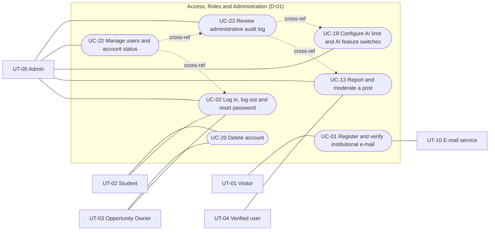
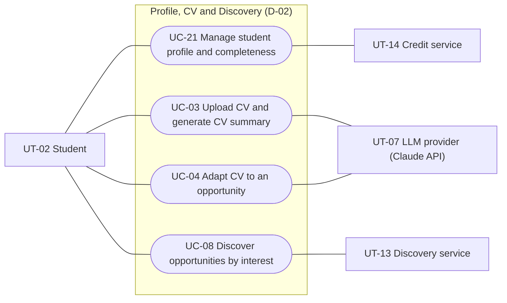
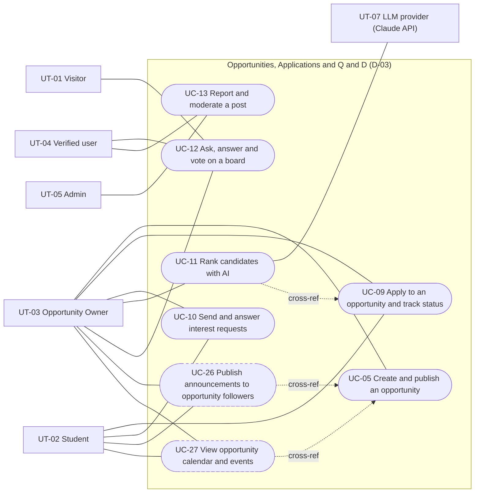
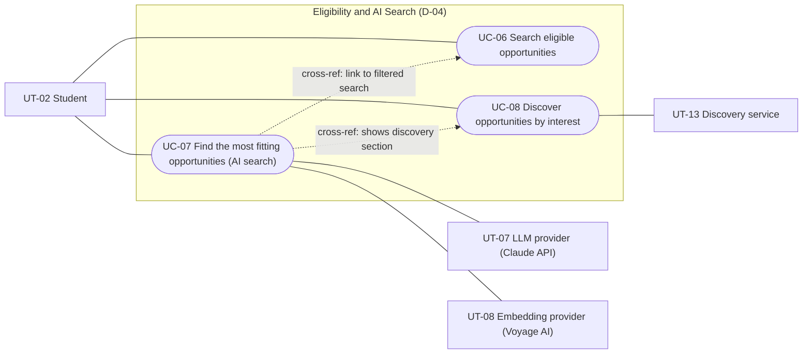
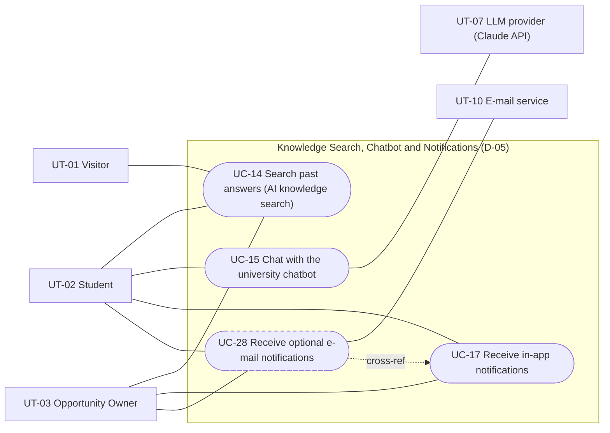
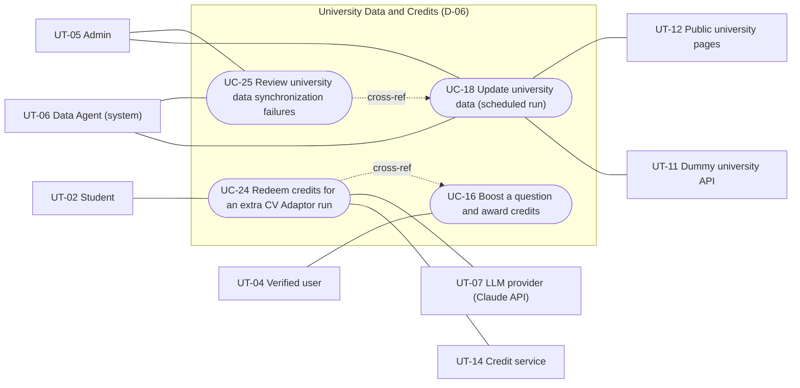

# Software Engineering — Requirements Specification

## Cover Page

| Field | Details |
|---|---|
| **Course** | BLG411E Software Engineering (2026–2027 Fall) |
| **Report name** | Requirements Specification |
| **Project title** | SynapseITU |
| **Group name / number** | The Goats |
| **Group members** | Yavuz Selim Yağlıca — 150220103, Furkan Yalçın — 150220116, Ahmed Said Gülşen — 150220044, Ahmet Yusuf Kurukız — 150240716, Najib Attar — 150220905, Amr Naweel Zuhdi Taweel — 150220937 |
| **Instructor** | Assoc. Prof. Dr. Ayşe Tosun |
| **Submission date** | 8.11.2026 |
| **Document version** | 1.1 baseline + Issue 3 numerical amendment (2026-11-08; working draft) |
| **Repository** | https://github.com/yalcinfu22/SynapseITU |

---

## 1. Introduction

### 1.1 Project

Students and early-career researchers struggle to find research opportunities that fit them (lab positions, research assistantships, MSc/PhD programs, clinical and industry research projects), and opportunity owners struggle to reach suitable candidates. SynapseITU is a web platform that connects students with opportunity owners (academics, lab leaders, clinicians, industry R&D teams). It filters opportunities by eligibility rules and adds an AI search over the opportunities a student is eligible for. It also offers a university chatbot that answers only from platform data, a data agent that keeps university data up to date, Questions & Discussions boards open to everyone with an AI search over past answers, a CV Adaptor that adapts a student's CV to a chosen opportunity, and a credit system that rewards contributions and limits AI use.

### 1.2 Purpose of this document

This document is the Requirements Specification of Project Plan activity **WBS-16.1** (task T-16, deliverable D-09). It states what SynapseITU shall do and the quality conditions it shall meet, and describes the users, scenarios, user stories and use cases behind these requirements. It is the input of the Requirements Analysis (WBS-16.2), the Design Specification (WBS-16.3) and the Test Specification (WBS-16.4). Its Gherkin scenarios (Appendix A) are the acceptance criteria that implementation writes first (test-first, Project Plan Section 4.3).

### 1.3 Conventions

T-##, D-##, WBS-#.#, UC-## and US-## IDs are the same as in the use-case document and Project Plan v1.1; FR-##, NFR-##, UT-## and SC-## are assigned here (SC-01 to SC-28 match UC-01 to UC-28). Priorities: Essential → Must, Desirable → Should, Optional → Could. This revision records concrete default decisions wherever the earlier draft left open policy choices. Missing implementation or Gherkin evidence is identified separately; an assigned rule does not imply that software or tests already exist.

### 1.4 Structure of this document

Section 2.1 lists 69 functional requirements, each with its task, deliverable, priority and verification condition. Section 2.2 lists 28 non-functional requirements based on Project Plan Section 1.4 (MC-01 to MC-15). Section 3.1 describes the user types, Section 3.2 the scenarios and user stories, Section 3.3 the use case diagrams, and Section 3.4 the coverage matrix and the 28 use cases. Appendix A holds the Gherkin scenarios; Appendix B lists the open points.

---

## 2. System Requirements

### 2.1 Functional Requirements

"Gherkin US-##" refers to that user story's scenario in Appendix A (`RequirementsSpec_Appendix_A.md`).

| Requirement ID | Related task ID(s) | Related deliverable ID(s) | Functional requirement (natural language) | Priority | Verification / acceptance condition |
|---|---|---|---|---|---|
| FR-01 | T-01 | D-01 | The system shall let a Visitor register as a Student or an Opportunity Owner with a name, an institutional e-mail and a password. It shall reject an e-mail that is already registered. It shall reject a password that fails the password-strength rule (at least 10 characters). It shall create the new account as unverified and read-only. It shall store the password hashed (NFR-02). It shall send a verification link. Admin accounts are created by the team, not by self-registration. | Must | WBS-1.1 DoD: acceptance tests pass in CI. Gherkin US-01. |
| FR-02 | T-01 | D-01 | The system shall mark an account as verified when its user opens a valid verification link that has not expired and the e-mail domain is on the domain allow-list (for example itu.edu.tr). The verification link expires 24 hours after issue. When the link has expired, the system shall offer a new link. When the e-mail domain is not on the allow-list, the system shall reject the verification, keep the account read-only and show the reason. | Must | WBS-1.2 DoD: acceptance tests pass. A verification e-mail sent from staging reaches a real @itu.edu.tr inbox. Gherkin US-04. |
| FR-03 | T-01 | D-01 | When an unverified user tries to post, apply or send an interest request, the system shall reject the action and show how to verify the account. | Must | WBS-1.2 DoD: acceptance tests pass, including the restrictions for unverified users. Gherkin US-05. |
| FR-04 | T-01, T-02 | D-01 | When the e-mail service is not available during registration, the system shall keep the account unverified and retry the job that sends the e-mail (NFR-18). It shall also let an Admin approve the verification manually (N-08). | Must | SC-FR-04 in Appendix A; WBS-1.2 backend + WBS-2.2 Admin UI, WBS-15.2 E2E (UC-01). |
| FR-05 | T-01 | D-01 | When a user logs in, the system shall check the e-mail and password against the stored password hash. On success, it shall issue an access token and a rotating refresh token, and open the home page for the user's role. The access token lifetime follows NFR-01. When the credentials are wrong, the system shall show a generic error that does not reveal which field is wrong. When an Admin has suspended the account, the system shall block the login and show a suspension message. | Must | WBS-1.1 DoD: acceptance tests pass in CI. Token expiry, refresh rotation and revocation tests pass. Gherkin US-07 (a suspended user cannot log in). |
| FR-06 | T-01 | D-01 | When the access token expires, the system shall rotate the refresh token and issue a new token pair. When the refresh token is expired or already used, the system shall revoke the session and ask the user to log in again. When the user logs out, the system shall revoke the tokens and return the user to the login page. | Must | WBS-1.1 DoD: refresh rotation and revocation tests pass. Gherkin US-02. |
| FR-07 | T-01 | D-01 | When a user selects "Forgot password", the system shall e-mail a single-use reset link. The reset link expires 30 minutes after issue. When the user sets a new password through the link, the system shall revoke all old tokens. | Must | WBS-1.1 DoD: token revocation on password change is tested. Gherkin US-03. |
| FR-08 | T-01 | D-01 | The system shall check the user's role (Student, Opportunity Owner or Admin) on every protected endpoint. This check shall stop Students and Opportunity Owners from reaching admin endpoints or other users' data. The system shall answer a forbidden call with 403. | Must | WBS-1.1 DoD: basic authorization tests pass. Gherkin US-11. |
| FR-09 | T-01, T-03 | D-01, D-02 | When the user confirms the password, the system shall delete the profile, the stored CV file, the CV summary and other personal data. It shall also revoke all tokens, log the deletion without personal data, send a confirmation and return the user to the start page. Remaining posts are shown without personal data. If the password is wrong, the system shall stop the deletion. If the user cancels, nothing changes. If deleting a stored file fails, the system shall retry in the background and show "deletion in progress". | Must | WBS-3.1 DoD: deletion removes the stored file. The consent and deletion acceptance tests (Plan 1.4, Privacy) pass. Gherkin US-06. |
| FR-10 | T-02 | D-01 | The system shall give an Admin a user-management page. The page shall list the users that match the search filters, with each user's role, verification state and suspension state. The page shall let the Admin change a user's role, or suspend or reactivate an account. The system shall apply such a change after the Admin confirms it. When no user matches, the page shows an empty result. When the Admin cancels, the account stays unchanged. When an update fails, the system shall keep the previous role or status and report the failure. | Must | WBS-2.2 DoD: admin acceptance tests pass. Gherkin US-07. |
| FR-11 | T-02 | D-01 | The system shall keep a queue of reports on posts and users. For each report, it shall show the Admin the post, its context, the author's history and the reason. It shall let the Admin hide or remove the post, warn or suspend the author, or dismiss the report. The system shall apply the chosen action and update the report status. When the post is hidden or the author is warned, the system shall notify the author (N-05). When the report is dismissed, the post stays visible. | Must | WBS-2.2 DoD: admin acceptance tests pass on seeded reports. D-03 acceptance: reporting a post passes on staging. WBS-15.2 E2E scenario "report a post and resolve it in the admin panel". Gherkin US-08. |
| FR-12 | T-02 | D-01 | The system shall write an audit-log entry for every completed admin action. The entry records the administrator, the action, the target and the time. This rule also covers dismissals, user-management changes and settings changes. | Must | WBS-2.2 DoD: every admin action is in the audit log. D-01 acceptance. Gherkin US-09. |
| FR-13 | T-02 | D-01 | The system shall give an Admin a read-only audit-log screen. The screen shall show the most recent entries, filter them by action, administrator, target or date, and show the recorded details of a selected entry. When no entry matches, it shows "No matching records". Entries cannot be edited. When the entries cannot be loaded, the screen shows an error and changes no record. | Must | SC-FR-13 in Appendix A; WBS-2.2 Admin-only read-only audit-log viewer (UC-23). |
| FR-14 | T-02 | D-01 | The system shall let an Admin view and change the monthly AI limit and the credit parameters. It shall let the Admin switch each AI feature on or off and view AI usage in read-only form. It shall reject an invalid value. A negative value or a value that is not a number is invalid. When a change is valid, the system shall store it, write it to the audit log and apply it to new requests. | Must | WBS-2.2 DoD: admin acceptance tests pass. Every admin action is in the audit log. Gherkin US-10. |
| FR-15 | T-02 | D-01 | When an AI feature is switched off and a user opens it, the system shall show "this feature is currently unavailable" and make no LLM call. | Must | Gherkin US-10. |
| FR-16 | T-02 | D-01 | The system shall reject every call by a non-admin to an admin, moderation or audit-log endpoint. It shall make no change for such a call. | Must | WBS-2.2 DoD: basic authorization tests confirm that only admins reach the admin endpoints. Gherkin US-11. |
| FR-17 | T-03 | D-02 | The system shall let a verified Student add and edit education, skills, projects, interests and preferences. It shall validate the changed fields. When a required value is missing or invalid, it shall highlight that value and keep the unsaved changes. It shall save valid changes so that later eligibility checks can use them. When saving fails, the system shall keep the entered data and show an error. | Must | WBS-3.1 DoD: acceptance tests pass. Gherkin US-12. |
| FR-18 | T-03, T-11 | D-02, D-06 | The system shall recalculate the profile-completeness percentage each time the profile is saved. The first time the profile meets the completion rule, the system shall award the completion credits exactly once. The completion threshold is at least 80%: at least four of the five profile sections (education, skills, projects, interests and preferences) must be completed; education and skills are mandatory. The initial completion reward is 10 credits (Admin-configurable), awarded only once when the threshold is first met. The profile shows its actual completion percentage, including after a reward, and no duplicate credits are awarded. When saving fails, the system shall not issue a reward. | Must | Gherkin US-14. WBS-11.1 DoD: ledger invariants hold. |
| FR-19 | T-03 | D-02 | Before a CV is uploaded, the system shall show a consent text that names Anthropic, Voyage AI and Langfuse. Without consent, nothing is uploaded or processed. With consent, the system shall store the PDF in private storage and extract its text. The maximum PDF file size is 10 MB. The system shall reject a file that is not a PDF, is larger than the maximum size or has no text that can be extracted. When the CV is replaced or deleted, the system shall delete the stored file and the old summary. | Must | WBS-3.1 DoD: acceptance tests pass, including the consent and private-storage checks. A CV can be uploaded, replaced and deleted. Deleting a CV removes the stored file. Gherkin US-13. |
| FR-20 | T-03 | D-02 | *(Contingent, WBS-3.2)* If CV autofill enters a sprint, the system shall suggest profile fields extracted from the uploaded CV. An LLM extracts these fields into the profile schema. The system shall save the suggested fields only after the Student confirms them. | Could | WBS-3.2 DoD: acceptance tests pass. Nothing is saved without the user's confirmation. Gherkin US-18. |
| FR-21 | T-04 | D-02 | After a CV is stored, the system shall send only the necessary CV text to the LLM. It shall validate the LLM's answer against the JSON schema. It shall remove every skill or interest that is not found in the CV text. It shall save the summary of skills and interests and show it. If the JSON-schema validation fails, the system shall retry once, then show "summary pending" and allow a later retry. If the LLM times out, the CV stays stored, the system marks the summary as pending and a background job retries. | Must | WBS-4.2 DoD: acceptance tests pass. On 10 sample CVs, every skill and interest in the summary appears in the CV. Every output validates against the JSON schema. D-02 acceptance. Gherkin US-15. |
| FR-22 | T-04 | D-02 | When a verified Student selects "Adapt my CV" on an opportunity that has structured requirements, the system shall check the AI allowance and the feature switch. It shall mark every requirement as met, partly met or missing. It shall show concrete suggestions of these kinds: reorder sections, highlight projects and skills, add keywords, reword. Every suggestion shown shall pass JSON-schema validation and the no-fabrication check. The system shall discard a suggestion that fails the check. | Must | WBS-4.1 DoD: every requirement is marked met, partly met or missing. On 10 sample pairs of CV and opportunity, no suggestion adds experience that is not in the CV. Gherkin US-16. |
| FR-23 | T-04 | D-02 | The system shall let the Student accept or reject each suggestion and keep every decision. It shall offer a downloadable CV that contains only the accepted suggestions. When all suggestions are rejected, the downloadable CV is the original CV. The original CV stays unchanged. | Must | WBS-4.1 DoD: the downloaded CV contains only the accepted suggestions. Gherkin US-17. |
| FR-24 | T-04, T-11 | D-02, D-06 | The system shall take one run from the Student's monthly allowance for each CV Adaptor run. When the LLM times out or the feature is switched off, the system shall show an error message and shall not take a run. | Must | SC-FR-24 in Appendix A; WBS-4.1 and WBS-11.1 validate run deduction and failure handling (UC-04). |
| FR-25 | T-05 | D-03 | The system shall let a verified Opportunity Owner create an opportunity. The opportunity has a title, description, institution, deadline and a list of requirements. Each requirement has a type, a threshold, a must-have or plus flag and a weight. The system validates the fields and the requirement schema and shows each error next to its field. It publishes the opportunity as open, or saves it as a draft that Students cannot see. If saving fails, the system keeps the form content and shows an error. | Must | WBS-5.1 DoD: acceptance tests pass and requirements are stored in the structured form of the 14.7 schema. Gherkin US-19. |
| FR-26 | T-05 | D-03 | The system shall let the Owner edit, close or archive an opportunity. A closed or archived opportunity accepts no new applications. It is hidden from the eligible search but stays visible to discovery. | Must | WBS-5.1 DoD: acceptance tests pass. Gherkin US-20. |
| FR-27 | T-05, T-09 | D-03 | When an opportunity is published, the system shall create the opportunity's own Questions & Discussions board. | Must | SC-FR-27 in Appendix A; WBS-5.1 publishes opportunity and WBS-9.1 creates one linked board (UC-05). |
| FR-28 | T-05 | D-03 | *(Contingent, WBS-5.2)* The system should let a verified Owner publish an announcement on an opportunity they own. The system should show the announcement to the opportunity's followers in its announcement feed (N-10). A draft or a cancelled announcement is not published. A publish request from anyone other than the owner is rejected. | Should | WBS-5.2 DoD: acceptance tests pass and every follower sees each new announcement. Gherkin US-27. |
| FR-29 | T-05 | D-03 | *(Contingent, WBS-5.3)* The system should let only the Owner add and edit an opportunity's application, interview and result dates and its events. The system should reject an invalid date. The system should show Students the calendar in date order. If there are no events, it should show an empty calendar with any known deadline. If the calendar service is unavailable, the system keeps the existing events and shows an error. | Should | WBS-5.3 DoD: the dates and events of an opportunity appear in its calendar. Gherkin US-28. |
| FR-30 | T-06 | D-03 | When a Student selects "Apply", the system shall check that the Student is verified and eligible and that the opportunity is open. The system shall then create the application with the status "submitted" and notify the owner. If the Student is unverified or ineligible, the system rejects the Student and shows the reason. If the opportunity is closed, it shows a message. If the Student already applied, it shows the existing application. The AI never applies for a Student. | Must | WBS-6.1 DoD: acceptance tests pass. Gherkin US-21. |
| FR-31 | T-06 | D-03 | The system shall let the Owner move an application through the status workflow. The statuses are submitted, under review, accepted, rejected and withdrawn (N-04); only the Owner may set under review, accepted or rejected, and only the Student may withdraw before acceptance or rejection. The system shall record every change in the application's history, emit the event that notifications use and notify the Student. The Student can withdraw an application before a decision. | Must | WBS-6.1 DoD: every status change emits the event that notifications (12.1) use. Gherkin US-23. |
| FR-32 | T-06 | D-03 | The system shall show the Student "My applications" with the current status and history of every application. | Must | WBS-6.1 DoD: acceptance tests pass. Gherkin US-22. |
| FR-33 | T-06 | D-03 | The system shall let a verified Student or Owner send an interest request, with an optional message, to the other party. The new request is pending and the system notifies the receiver. If the two already have a pending request for the opportunity, the system shows that request instead of a new one. The receiver accepts or declines. The system saves the decision and notifies the sender. An ignored request stays pending, and the sender can withdraw it. | Must | WBS-6.1 DoD: every interest request emits the event that notifications (12.1) use. Gherkin US-24, US-25. |
| FR-34 | T-06 | D-03 | *(Contingent, WBS-6.2)* If real-time chat enters a sprint, the system shall provide a real-time chat next to an active application and interest-request workflow. Only the two parties can see the chat. The chat runs alongside the workflow, not as a later step. | Could | WBS-6.2 DoD: message delivery time meets MC-15 (NFR-28) and messages are visible only to the two parties. Gherkin US-29. |
| FR-35 | T-07 | D-04 | The system shall run a full-text search over opportunities using the Student's keywords and filters. If there are no results, it shows an empty state with a hint to relax the filters. If the search backend fails, it shows the unified error message (NFR-19). | Must | WBS-7.1 DoD: acceptance tests pass. Gherkin US-32. |
| FR-36 | T-07 | D-04 | The system shall check every must-have requirement of each result against the Student's profile. It shall mark the result eligible or not eligible and give one reason for each unmet requirement. When the profile lacks the data for a rule, the system marks the requirement "cannot be checked" and asks the Student to complete the profile. The system offers an "eligible only" view. | Must | WBS-7.1 DoD: every requirement type in the 14.7 schema has a rule test. Gherkin US-33. |
| FR-37 | T-07 | D-04 | The system shall give the AI search (WBS-8.2) access to a Student's eligible pool through one interface. | Must | SC-FR-37 in Appendix A; WBS-7.1 eligible-pool interface consumed by WBS-8.2. |
| FR-38 | T-08 | D-04 | When a verified Student with a CV summary opens "Most fitting for me", the system shall check the monthly AI allowance and the feature switch. It shall then take the eligible pool (FR-37) and shortlist it by embedding similarity to the CV summary. The shortlist contains up to 20 eligible opportunities (or all if fewer than 20 are eligible). The system shall rank the shortlist with the LLM in parallel calls and validate the output against the JSON schema. It shows only eligible opportunities. Each result has a reason and its source opportunity. A result lists at most the missing optional (plus) qualifications. The system shows no must-have gap analysis. If the eligible pool is empty, the system shows a message with a link to the filtered search. If the monthly limit is reached, the system shows the remaining credit options. | Must | WBS-8.2 DoD: outputs validate against the JSON schema and precision@5 beats both baselines (NFR-26). D-04 acceptance: results contain only eligible opportunities and list at most the missing plus qualifications. Gherkin US-34. |
| FR-39 | T-08 | D-04 | If the LLM fails or times out, the AI search shall fall back to the eligible list ranked by embedding similarity. If the embedding API fails, the AI search shall fall back to full-text search over the eligible pool. | Must | WBS-8.2 DoD: the fault-injection test with LLM and embedding timeouts passes (NFR-17). Gherkin US-37. |
| FR-40 | T-08 | D-02, D-04 | The system shall let a Student search with the CV summary. For every result, the system shall show a link to its source opportunity. | Must | WBS-8.3 DoD: every result links to its source opportunity. Gherkin US-35. |
| FR-41 | T-08 | D-02, D-04 | The independent discovery service shall match the Student's interests against all opportunities, whether open or closed, eligible or not. The interests come from the profile or the CV summary. The system shall show the results with status labels and links to the source opportunities. If the Student has no stored interests, the system asks the Student to add interests or upload a CV. If nothing matches, it shows an empty state. If the embedding API times out, the discovery service falls back to full-text search. | Must | WBS-8.3 DoD: the discovery service runs as a separate service, passes its API contract tests and falls back to full-text search when the embedding API times out. D-02 acceptance. Gherkin US-36. |
| FR-42 | T-08 | D-02, D-04 | The AI search page shall show the discovery results in a separate section. It shall get these results through the discovery service's API. The Design Specification fixes the API contract. When the discovery service is off, the page hides that section and the AI search keeps working. | Must | SC-FR-42 in Appendix A; WBS-8.3 discovery API and WBS-8.2 optional discovery UI. |
| FR-43 | T-08 | D-03 | When an Owner selects "Rank with AI" for an opportunity they own, the system shall check the AI switch. It shall rank the candidates with the LLM, using only their CV summaries and the opportunity's requirements. It shall validate the output. It shall show the ranking, with a reason and evidence from the CV summary for each candidate. A candidate without a CV summary is listed as "not ranked", with the reason. The system discards any reason that cites anything outside the CV summary or the requirements. If the LLM fails, the system shows the unranked list and an error message. The AI changes no application status. The UI offers no automatic accept or reject. | Must | WBS-8.4 DoD: every reason refers only to the CV summary and the requirements, the UI offers no automatic accept or reject, and the owner-ranking flow passes end to end on staging. Gherkin US-26. |
| FR-44 | T-08 | D-03 | *(Contingent, WBS-8.5)* Matching should use the profiles of team members who consent. It should never use a profile without consent. | Should | WBS-8.5 DoD: profiles without consent are never used. Gherkin US-31. |
| FR-45 | T-08 | D-03 | *(Contingent, WBS-8.8)* If teammate ratings enter a sprint, the system shall let users accepted to the same opportunity rate each other, once per pair. The system shall never let users rate themselves. The system shall show the ratings to owners as one input when they select candidates. The owner still makes every decision. | Could | WBS-8.8 DoD: only teammates rate each other, once per pair and never themselves. Gherkin US-30. |
| FR-46 | T-09 | D-03 | The system shall provide a general board, one board for every opportunity and one board for every institution. Each board has a Questions tab and a Discussions tab. The system shall let anyone read the boards without an account. | Must | WBS-9.1 DoD: reading a board without an account passes. Gherkin US-38. |
| FR-47 | T-09 | D-03 | The system shall let verified users post questions, discussions and replies. The system publishes them without an AI check. When a Visitor or an unverified user tries to post, the system asks them to log in or verify. | Must | WBS-9.1 DoD: acceptance tests pass. Gherkin US-39. |
| FR-48 | T-09, T-11 | D-03, D-06 | The system shall let verified users upvote or downvote posts. Each user has one vote per post. A second vote changes or withdraws the first vote. The API rejects a user's vote on their own post. Upvotes on answers give credit to the author (FR-56). | Must | WBS-9.1 DoD: the API rejects a user's vote on their own post. Gherkin US-40. |
| FR-49 | T-09, T-11 | D-03, D-06 | The system shall let the asker mark a best answer and give credit to its author. If the question is boosted, the boost also goes to that author (FR-57). The system shall also highlight answers written by the opportunity owner. Only the original asker may select a best answer; a board moderator or Owner cannot select one on the asker's behalf (N-02). | Must | Gherkin US-41. |
| FR-50 | T-09 | D-03 | The system shall show the author's role on every post. The system shall show a member label only on posts by recorded current or former members of that opportunity or institution. | Must | WBS-9.1 DoD: the label appears only for recorded current or former members. Gherkin US-43. |
| FR-51 | T-09, T-02 | D-03, D-01 | The system shall show a report button on every post. When a user reports a post, the system saves the report with its reason and adds it to the admin queue (FR-11). If the same user already reported the post, the system shows a message. Only verified authenticated users may report posts; unverified accounts have read-only access and visitors cannot report (N-03). | Must | WBS-9.1 DoD: reporting a post passes. D-03 acceptance. Gherkin US-42. |
| FR-52 | T-10 | D-05 | The system shall index Questions & Discussions posts with both embeddings and full-text. When any user (Visitor, Student, Owner) types a question, the system shall return the best answer snippets. Each snippet has a valid link that opens the post inside its board. When no snippet is relevant, the system shows "no answer found" and offers to post a new question. When the embedding API times out, the system falls back to full-text search. | Must | WBS-10.1 DoD: every snippet has a valid link to its thread and post. When the embedding API times out, the search falls back to full-text search. D-05 acceptance. Gherkin US-44. |
| FR-53 | T-10 | D-05 | While the chatbot is switched on and AI runs are left, the university chatbot shall accept a logged-in Student's request in Turkish or English. It answers in the same language. It reaches platform data only through defined tools. These tools search, filter and compare opportunities and give program, lab and position details. The chatbot writes the answer only from the tool results, with links to the records it used. It keeps the conversation for follow-up questions. | Must | WBS-10.3 DoD: every answer links to the platform records it used. The chat works in Turkish and English. D-05 acceptance. Gherkin US-45. |
| FR-54 | T-10 | D-05 | When a request is vague, the chatbot shall ask one clarifying question. When the tools return nothing relevant, the chatbot shall reply "not in our data" instead of guessing. When asked for the web or for facts outside the platform, the chatbot explains that it only uses platform data. When the LLM times out, the chatbot shows an error message and keeps the conversation. | Must | WBS-10.3 DoD: a question the data cannot answer gets a "not in our data" reply, not a guess. When the LLM times out, the page shows an error message and keeps the conversation. Gherkin US-46. |
| FR-55 | T-10 | D-05 | *(Contingent, WBS-10.2)* AI features should search and read open-web sources through a tool interface. They should cite the source URL of every web-based answer. This is separate from the chatbot's platform-only rule. | Should | WBS-10.2 DoD: every web-based answer cites its source URL. Gherkin US-50. |
| FR-56 | T-11 | D-06 | The system shall record credits in a ledger for upvoted answers, accepted answers, a complete profile (once) and posts by verified users. The initial Admin-configurable credit rewards are: 2 credits per answer upvote, 5 credits for an accepted answer, 10 credits once for completing a profile, and 1 credit for a post by a verified user. Credits cannot be bought. No one can vote for themselves. | Must | WBS-11.1 DoD: acceptance tests pass. Gherkin US-51. |
| FR-57 | T-11 | D-06 | The system shall let an asker boost their own question with at least 5 credits per boost (initial Admin-configurable minimum) while the question has no accepted answer. The asker may boost the same question again to raise the amount. The system checks the asker's balance. If the balance is too low, the system rejects the boost and shows that the balance is too low. Otherwise, the system reserves the amount in the ledger and shows the boost. When the asker accepts another user's answer, the boost and the acceptance credit go to the answerer, and the system notifies the answerer. When the asker closes the question without accepting an answer, the reserved credits go to the author of the answer with the most upvotes. If no eligible answer has an upvote, the reserved credits go to the author of the earliest eligible answer (creation timestamp, then stable answer ID). If the question has no answer, they go back to the asker. A tie for the highest upvote count is resolved by earliest eligible-answer creation timestamp and then stable answer ID, excluding any answer written by the asker; if no eligible answer exists, reserved credits are refunded to the asker. The API rejects a user's attempt to accept their own answer. | Must | WBS-11.1 DoD: acceptance tests pass. Gherkin US-52. |
| FR-58 | T-11 | D-06 | The credit ledger shall record every credit movement. The ledger shall never allow a negative balance. The ledger shall keep every transfer balanced. | Must | SC-FR-58 in Appendix A; WBS-11.1 rejects negative balances and records balanced transfers. |
| FR-59 | T-11, T-02 | D-06, D-01 | The system shall count each AI run of a Student against the monthly AI limit in the admin settings (initial value: 10 AI runs per student per calendar month, configurable by the Admin). When the limit is reached, the system starts no further run. The CV Adaptor then offers an extra run for credits (FR-60). The AI search then shows the remaining credit options. | Must | WBS-11.1 DoD: acceptance tests pass. Gherkin US-53. |
| FR-60 | T-11, T-04 | D-06, D-02 | When the monthly allowance is used up, the system shall show the credit cost of an extra CV Adaptor run. The admin sets this cost (initial value: 10 credits, Admin-configurable). The system also checks the balance and the feature switch. When the Student confirms and the balance is enough, the system reserves the credits and runs the CV Adaptor. The system charges the credits only when the run succeeds, and shows the new balance. If the balance is too low, no run starts. If the Student declines, nothing is spent. If the AI fails or the feature is disabled, the system releases the reserved credits without a charge. While the ordinary allowance is still available, the system uses it without a credit charge. | Must | Gherkin US-53. WBS-11.1 DoD: the ledger invariants hold. |
| FR-61 | T-12 | D-05 | The system shall create exactly one in-app notification for each event of a type the user has enabled. The system shall also increase the unread counter. The four core event types are application status changes, new answers to the user's questions, interest requests and approaching deadlines; additional events are moderation outcomes, question boosts, deletion confirmation before erasure and opportunity announcements when that contingent feature is enabled (N-05). An approaching deadline is one occurring within the next 48 hours; the same deadline event must not produce duplicate notifications. If creating a notification fails, a background job retries it and the event is not lost. | Must | WBS-12.1 DoD: notifications arrive for the four core event types plus the applicable additional types. D-05 acceptance. Gherkin US-47. |
| FR-62 | T-12 | D-05 | The system shall show the notifications in an inbox, newest first. Each notification links to its object. The system shall let the user open a notification or mark it as read. | Must | SC-FR-62 in Appendix A; WBS-12.1 notification inbox and read state (UC-17). |
| FR-63 | T-12 | D-05 | The system shall let the user switch off each notification type. When a type is switched off, the system creates no notification of that type. | Must | WBS-12.1 DoD: the user can switch off each type. Gherkin US-48. |
| FR-64 | T-12 | D-05 | *(Contingent, WBS-12.2)* If e-mail notifications enter a sprint, the system shall let a user enable e-mail delivery per event type. For an enabled type, the system queues an e-mail that refers to the platform item, alongside the in-app notification. A disabled type produces no e-mail. When the e-mail service is unavailable, the system keeps the in-app notification and retries the e-mail job. | Could | WBS-12.2 DoD: e-mails follow the user's preferences. Gherkin US-49. |
| FR-65 | T-13 | D-06 | The dummy university service shall run on its own, with its own REST API and seed data (programs, labs, positions). | Must | WBS-13.1 DoD: its API contract tests pass. The service runs next to staging. Gherkin US-55. |
| FR-66 | T-13 | D-06 | The data agent shall run on its schedule (once every 24 hours). On each run, the data agent shall fetch data from the dummy university's API and from public university program pages. It extracts records with the LLM and validates them against the JSON schema. It adds new records. It updates and re-indexes changed records. It archives records that were removed at the source. It keeps a source link for every record and writes a run summary. When a record fails validation, the agent skips it, keeps the last good record and logs the reason. | Must | WBS-13.2 DoD: after a scheduled run, a record changed at the source is updated and re-indexed. Every stored record links to its source. D-06 acceptance. Gherkin US-54. |
| FR-67 | T-13 | D-06 | Running the data agent twice shall create no duplicate records. | Must | SC-FR-67 in Appendix A; WBS-13.2 repeated import is idempotent. |
| FR-68 | T-13 | D-06 | When a source is unreachable or blocks the agent, the data agent shall retry with backoff (up to 3 retries with exponential backoff, doubling the interval between successive retries; the initial delay is a deployment configuration). The agent keeps the last good records of that source, continues with the other sources and reports the failure to the Admin. | Must | WBS-13.2 DoD: a failing source is retried and does not stop the other sources. Gherkin US-56. |
| FR-69 | T-13, T-02 | D-06 | The system shall give an Admin a data import status page. The page shows recent runs with their success and failure counts. For a selected failed run or source, the page shows the failure reason, the last successful update and the source link. The page does not modify good records. If the import report cannot be loaded, the system shows an error, keeps the stored university records and logs the report-access failure (N-07). | Must | SC-FR-69 in Appendix A; WBS-13.2 Admin status API + WBS-2.2 UI + WBS-15.2 E2E (UC-25). |

**Functional requirement notes:**

- **N-01 Fixed AI rules.** The AI never accepts or rejects applicants and never applies for a student; every LLM output is validated against a JSON schema; nothing that is not in the CV is added to a CV summary or a CV Adaptor suggestion; chatbot answers come only from platform data; an admin can switch any AI feature off. These rules apply to FR-21, FR-22, FR-30, FR-38, FR-43, FR-53 and FR-66 and are verified through NFR-22 to NFR-25.
- **N-02 Best answer.** FR-49 lets the asker mark a best answer. Decision: only the original asker may select the best answer. Board/Opportunity Owners may answer and moderate as authorized but cannot override the asker's choice (FR-49).
- **N-03 Who may report a post.** Decision: only verified logged-in users may report posts; unverified users remain read-only and anonymous visitors may not. The reporter cannot submit duplicate reports for the same post (FR-51).
- **N-04 Application statuses.** Decision: the application statuses are submitted, under review, accepted, rejected and withdrawn (FR-31). Submitted → under review/accepted/rejected/withdrawn; under review → accepted/rejected/withdrawn; accepted, rejected and withdrawn are terminal. Only Owners decide acceptance/rejection; Students may withdraw before a decision.
- **N-05 Notices outside the four core notification types.** FR-61 covers four core event types (application status, answers, interest requests, approaching deadlines). Some use cases also notify users of other events: UC-13 step 7 (hidden post or warned author), UC-16 step 6 (answerer who received a boost), UC-20 step 5 (deletion confirmation) and UC-26 (announcements). Decision: these are additional in-app event types in WBS-12.1, with the existing per-type notification preference respected where applicable. For account deletion, display and send confirmation only before token revocation or via the confirmed e-mail channel; do not retain deleted personal data to deliver a notification.
- **N-06 Board creation.** FR-27 depends on the boards built in WBS-9.1, which comes after WBS-5.1; FR-27 can be verified only after WBS-9.1 is done.
- **N-07 Admin screens.** Traceability defined in working draft: FR-13/UC-23 → WBS-2.2 (Najib) → SC-FR-13; FR-69/UC-25 → WBS-13.2 (Amr, source/run status API) + WBS-2.2 (Najib, Admin UI) → SC-FR-69; WBS-15.2 tests integration and access controls. Review added effort under WBS-17.5 before changing dates.
- **N-08 Admin-approved verification** (FR-04) appears in UC-01 and as the contingency of risk R-06 in the Project Plan, and is assigned to the WBS activities below. Assignment: WBS-1.2 (Ahmed Said) creates pending manual verification requests after documented delivery failure; WBS-2.2 (Najib) owns the Admin approval/denial interface and audit trail. WBS-15.2 verifies authorization and status changes; scope must be re-estimated.
- **N-09 Values held in the admin settings.** The monthly AI limit, the credit rewards, the boost-related values and the cost of an extra CV Adaptor run are set by the Admin (FR-14) and read by the credit system (WBS-11.1) and every AI feature; the initial monthly AI allowance is 10 runs per student per calendar month; initial rewards are 2 credits per answer upvote, 5 per accepted answer, 10 once on profile completion and 1 per verified-user post; the minimum question boost is 5 credits and an extra CV Adaptor run costs 10 credits. These initial values remain Admin-configurable.
- **N-10 Followers.** FR-28 shows announcements to users who follow an opportunity. Specified for contingent FR-28/WBS-5.2: authenticated verified users can follow or unfollow an opportunity via a Follow control on its details page; followers receive published announcements according to their notification preferences. Unfollowing stops future notices.
- **N-11 Contingent requirements** (FR-20, FR-28, FR-29, FR-34, FR-44, FR-45, FR-55, FR-64) belong to WBS activities outside the baseline; they are implemented only if a sprint takes them in.
- **N-12 Dependencies.** The CV summary (FR-21) feeds the AI search, the CV-summary search and discovery, the candidate ranking and the CV Adaptor. The eligibility engine (FR-36, FR-37) defines the AI search pool. The data agent (FR-66) stores the records that the chatbot (FR-53) answers from. The credit system reads the limits that the admin panel (FR-14) controls. Applications, interest requests and boards emit the events that notifications (FR-61) use.

### 2.2 Non-functional Requirements

The non-functional requirements restate Project Plan Section 1.4 with the agreed working-draft targets and measurement conditions for MC-01 to MC-15. NFR-26 restates the D-04 acceptance criterion.

| Requirement ID | Quality attribute | Non-functional requirement (natural language) | Applies to | Verification / measurement |
|---|---|---|---|---|
| NFR-01 | Security | The system shall issue JWT access tokens with a lifetime of at most 15 minutes (MC-01) together with rotating refresh tokens, and revoke the tokens on logout or password change. | FR-05, FR-06, FR-07 | Token-expiry test of WBS-1.1 in CI against the configured lifetime; refresh-rotation and revocation tests (WBS-1.1 DoD). |
| NFR-02 | Security | The system shall store passwords hashed with Argon2id, as recorded in the WBS-15.3 guideline (MC-02). | FR-01, FR-07 | Algorithm recorded in the WBS-15.3 guideline; checked in the PR security checklist. |
| NFR-03 | Security | The system shall enforce standard access control for the Student, Opportunity Owner and Admin roles on every protected endpoint; detailed role-based access control (permission matrices, role hierarchies) is out of scope. | Whole system; FR-08, FR-16 | Every protected endpoint has a basic authorization test (WBS-15.3 DoD); Gherkin US-11 (403). |
| NFR-04 | Security | The system shall be served over HTTPS only, and secrets shall be kept outside the repository. | Whole system | Production runs over HTTPS (WBS-14.6 DoD, D-07 acceptance); secret handling in the PR security checklist (WBS-15.3). |
| NFR-05 | Security | The system shall have zero open high-severity findings in the OWASP ZAP baseline scan and the dependency audit at code freeze. | Whole system | OWASP ZAP baseline scan and dependency audit in CI (WBS-15.3 DoD); D-08 acceptance. |
| NFR-06 | Privacy (KVKK) | Before processing a CV, the system shall obtain explicit consent that names the LLM provider (Anthropic), the embedding provider (Voyage AI) and the tracing service (Langfuse). It shall keep CVs and profiles in private storage and remove personal data when an account is deleted. | FR-09, FR-19 | Consent and deletion acceptance tests (Plan 1.4); WBS-3.1 DoD (consent and private-storage checks). |
| NFR-07 | Privacy (KVKK) | The system shall send to the LLM, embedding and tracing providers only the fields allowed by the personal-data rules of the WBS-15.3 guideline, mask personal fields in traces and write no personal data to logs. | FR-09, FR-21, FR-22, FR-38, FR-41, FR-43, FR-52, FR-53 | Review of prompts, logs and Langfuse traces: no personal field outside the allowed list. |
| NFR-08 | Performance | The key non-AI API endpoints shall respond within 800 ms at the 95th percentile with 10 concurrent virtual users for 5 minutes; key operations are login, profile retrieval, non-AI opportunity listing/filtering and application submission, with exact API routes documented in the test plan (MC-03). | Non-AI API | k6 or Locust load test on staging (WBS-15.5). |
| NFR-09 | Performance | The AI search shall return its end-to-end result within 20 s at the 95th percentile (MC-04). | FR-38 | Langfuse latency traces on staging over at least 30 representative requests (WBS-15.5). |
| NFR-10 | Performance | The knowledge search shall return its end-to-end result within 5 s at the 95th percentile (MC-05). | FR-52 | Langfuse latency traces on staging over at least 30 representative requests (WBS-15.5). |
| NFR-11 | Performance | The time from a sent chatbot question to its complete answer shall be at most 20 s at the 95th percentile (MC-06). | FR-53 | Langfuse latency traces on staging over at least 30 representative questions (WBS-15.5). |
| NFR-12 | Performance | The Largest Contentful Paint of each main page shall be at most 2.5 s; main pages are landing/home, opportunity list, profile, Questions & Discussions and admin dashboard (MC-07). | Main pages | Lighthouse mobile audit on staging, median LCP of three runs per main page (WBS-15.5). |
| NFR-13 | Usability | Every main page shall render without horizontal scrolling at a phone viewport width of 375 px and a desktop viewport width of 1366 px (MC-08). | Main pages; all user types | Playwright check at both viewports (WBS-15.5; WBS-14.4 DoD). |
| NFR-14 | Usability (accessibility) | Every main page shall reach a Lighthouse accessibility score of at least 90/100 and pass manual keyboard-navigation and form-label checks (MC-09). | Main pages; all user types | Lighthouse accessibility audit plus manual keyboard-navigation and form-label checks on staging (WBS-15.5). |
| NFR-15 | Usability | The mean System Usability Scale (SUS) score from at least 5 representative users after core workflows on staging shall be at least 68 out of 100 (MC-10). | Students, Opportunity Owners | Standard 10-item SUS questionnaire with at least 5 users (WBS-15.5). |
| NFR-16 | Usability (language) | 100% of UI text resources shall exist in both Turkish and English, and the language shall switch at run time (MC-11). | Whole UI; FR-53 | Language completeness check over the WBS-14.4 text resources; WBS-14.4 DoD (both languages switch at run time). |
| NFR-17 | Reliability | If an LLM call fails or exceeds a timeout of 12 s, or an embedding call fails or exceeds a timeout of 4 s, the affected feature shall start its fallback: the AI search falls back to the eligible list ranked by embedding similarity, and searches fall back to full-text search (MC-12). | FR-39, FR-41, FR-52, FR-54 | Fault-injection tests with LLM and embedding-API timeouts (WBS-8.2, 8.3, 10.1, 10.3). |
| NFR-18 | Reliability | A failed background job shall be retried at most 3 times (MC-13). | FR-04, FR-09, FR-21, FR-61, FR-64, FR-68 | Test with a failing background job (WBS-12.1, 13.2). |
| NFR-19 | Reliability | Every API error shall return a unified error format with a user-facing message and be logged without personal data. | Whole system | API error tests. |
| NFR-20 | Reliability | The database shall be backed up daily. | Whole system | Backup restore test (WBS-14.6 DoD: a restore from the latest backup succeeds). |
| NFR-21 | Reliability (availability) | Production availability shall be at least 99.5% of uptime-monitor checks with a healthy HTTP response from the configured application health endpoint, checked every 5 minutes over 7 consecutive days of the final demo/release period; exact start/end timestamps shall be recorded in the test plan before monitoring begins (MC-14). | Production | Uptime monitor on production (WBS-14.6). |
| NFR-22 | AI quality | Every LLM output shall be validated against a JSON schema. | FR-21, FR-22, FR-38, FR-43, FR-66 | Schema-validation tests; WBS-4.2 and WBS-8.2 DoDs. |
| NFR-23 | AI quality | No skill or interest in a CV summary and no experience in a CV Adaptor suggestion shall be absent from the CV, and every candidate-ranking reason shall refer only to the CV summary and the requirements. | FR-21, FR-22, FR-43 | No-fabrication evaluation scripts on labelled sets: 10 sample CVs (WBS-4.2) and 10 CV and opportunity pairs (WBS-4.1); WBS-8.4 DoD. |
| NFR-24 | AI safety | Chatbot answers shall come only from platform data and link to the records used. | FR-53, FR-54 | WBS-10.3 DoD: every answer links to the records used; "not in our data" instead of a guess. |
| NFR-25 | AI safety | Humans shall make every accept or reject decision, the AI shall never apply for a student, and an Admin shall be able to switch any AI feature off. | FR-14, FR-15, FR-30, FR-43 | WBS-8.4 DoD: the UI offers no automatic accept or reject; Gherkin US-10, US-26. |
| NFR-26 | AI quality | On the WBS-15.4 labelled set, the AI search shall reach a higher precision@5 than both the keyword-only and the embedding-only baselines. | FR-38 | Matching evaluation harness in CI (WBS-15.4, WBS-8.2 DoD); D-04 acceptance. |
| NFR-27 | Maintainability | The code shall follow a feature-based module structure with automated tests for every module, lint and formatting in CI, and no direct commits to `main` or `dev`. | Whole system | CI checks and branch protection (WBS-14.2 DoD). |
| NFR-28 | Performance (contingent, WBS-6.2) | If real-time chat enters a sprint, the time from sending a chat message to its display for the other party shall be at most 2 s (MC-15). | FR-34 | Playwright test with two sessions on staging. |

**Non-functional requirement notes / assumptions:**

- **Numerical targets selected for the working draft (Issue 1, 2026-11-08).** MC-01 to MC-15 now have explicit acceptance thresholds and measurement conditions. These are goals, not achieved test results; unrelated policy choices remain open; initial credit-economy values are now specified in FR-18, FR-56, FR-57 and FR-60; approved functional numerical rules are also recorded in FR-01, FR-02, FR-07, FR-18, FR-19, FR-38, FR-59, FR-61, FR-66 and FR-68. A criterion passes only when measured evidence meets its target.
- **Defined measurement scope.** Main pages (NFR-12 to NFR-14): landing/home, opportunity list, profile, Questions & Discussions and admin dashboard (as applicable to the test role). Key non-AI operations (NFR-08): login, profile retrieval, opportunity listing/filtering and application submission; exact routes are captured in the test plan. AI latency percentiles are P95 over at least 30 representative requests per feature. The availability window is seven consecutive days during the final demo/release period; exact timestamps are recorded before testing. "Basic authorization tests" means one authorization test per protected endpoint, without permission matrices or role hierarchies.
- **Measurement environment.** Performance, accessibility and usability are measured on staging (two `t3.small` AWS instances host staging and production, WBS-14.6); availability is measured on production.
- **Measurement activities.** WBS-15.5 runs performance and usability checks (MC-03 to MC-10), including MC-04 to MC-06 AI latency traces; fault-injection tests for MC-12 run inside WBS-8.2, 8.3, 10.1 and 10.3; NFR-05 is checked at code freeze and NFR-21 over the specified seven-day window. WBS-16.4 records each measured result against its target. MC-01, MC-02 and MC-11 to MC-14 retain the implementing-module verification activities; MC-15 is contingent on chat.
- **Supported environment and constraints.** Web interface only (no native Android or iOS apps; responsive layout per NFR-13); Turkish and English only; pre-trained models through APIs (Claude API, Voyage embeddings), no own LLM; credits cannot be bought; no AI moderation of posts before publishing.

---

## 3. Use Cases

### 3.1 User Types

UT-01 to UT-06 are users of the software; UT-07 to UT-12 are external services; UT-13 and UT-14 are platform services that act in use cases.

| User type ID | User type / actor | Description and responsibilities | Goals / typical actions | Related requirement ID(s) |
|---|---|---|---|---|
| UT-01 | Visitor | Not logged in. Can read the Questions & Discussions boards. | Register (UC-01); read boards (UC-12); search past answers (UC-14) | FR-01, FR-46, FR-47, FR-52 |
| UT-02 | Student | Registered user who looks for opportunities. Unverified students have read-only access. | Manage profile and CV, adapt the CV, search and discover opportunities, apply and track applications, send interest requests, use the chatbot, receive notifications, delete the account (UC-02 to UC-04, UC-06 to UC-10, UC-15, UC-17, UC-20, UC-21, UC-24, UC-27, UC-28) | FR-02, FR-03, FR-05 to FR-07, FR-09, FR-17 to FR-24, FR-30, FR-32 to FR-42, FR-53, FR-54, FR-59 to FR-64 |
| UT-03 | Opportunity Owner | Academic, lab leader, clinician or industry R&D member who publishes opportunities and selects candidates. | Publish and manage opportunities, manage application statuses, send and answer interest requests, rank candidates with AI, answer on boards, publish announcements and calendar entries (UC-02, UC-05, UC-09 to UC-12, UC-17, UC-20, UC-26 to UC-28) | FR-01, FR-05 to FR-07, FR-09, FR-25 to FR-29, FR-31, FR-33, FR-43, FR-45, FR-49, FR-61 to FR-64 |
| UT-04 | Verified user | A Student or Opportunity Owner whose institutional e-mail is verified; only verified users post. | Post, answer and vote on boards, report posts, boost questions and earn credits (UC-12, UC-13, UC-16) | FR-03, FR-47 to FR-51, FR-56 to FR-58 |
| UT-05 | Admin | Manages users, reports, moderation and platform settings. | Moderate reports, manage users and roles, configure the AI limit and switches, review the audit log and data-synchronization failures (UC-02, UC-13, UC-19, UC-22, UC-23, UC-25) | FR-04, FR-10 to FR-16, FR-68, FR-69 |
| UT-06 | Data Agent (system actor) | Scheduled background agent that collects university programs, labs and positions. | Run scheduled updates of university data and record the outcome of each source (UC-18, UC-25) | FR-66 to FR-68 |
| UT-07 | LLM provider — Claude API (external service) | Secondary actor that produces CV summaries, CV Adaptor suggestions, rankings, chatbot answers and extracted university records. | Answer schema-validated LLM calls (UC-03, UC-04, UC-07, UC-11, UC-15, UC-24) | FR-21, FR-22, FR-38, FR-39, FR-43, FR-53, FR-54, FR-66 |
| UT-08 | Embedding provider — Voyage AI (external service) | Secondary actor that provides embeddings for shortlisting and search. | Embed CV summaries, questions and posts (UC-07; fallbacks in UC-08, UC-14) | FR-38, FR-39, FR-41, FR-52 |
| UT-09 | Tracing service — Langfuse (external service) | Secondary actor that receives traces of AI calls; named in the CV consent text. | Store traces with personal fields masked | FR-19; NFR-06, NFR-07, NFR-09 to NFR-11 |
| UT-10 | E-mail service (external service) | Sends verification, reset and (optional) notification e-mails. | Deliver e-mails (UC-01, UC-02, UC-28) | FR-01, FR-02, FR-04, FR-07, FR-64 |
| UT-11 | Dummy university API (external service) | Standalone service with seed data that the data agent reads. | Provide programs, labs and positions (UC-18) | FR-65, FR-66 |
| UT-12 | Public university pages (external source) | Public program pages that the data agent reads. | Provide program data (UC-18) | FR-66, FR-68 |
| UT-13 | Discovery service (platform service) | Independent service with its own API that finds opportunities by interest. | Return interest matches regardless of eligibility or status (UC-08) | FR-41, FR-42 |
| UT-14 | Credit service (platform service) | Records credit rewards, reservations and debits. | Award the completion reward once; reserve and commit credits for extra runs (UC-21, UC-24) | FR-18, FR-56 to FR-60 |

**Access or role distinctions:**

- **Visitor vs. registered user.** A Visitor can read every board and use the knowledge search, but cannot post, vote, apply or send requests (FR-46, FR-47, FR-52).
- **Unverified vs. verified.** An unverified Student or Owner has read-only access; only verified users post, apply, send interest requests, vote and report posts (FR-03, FR-47, FR-48, N-03).
- **Admin.** Admin accounts are created by the team, not by self-registration (US-01). Only admins reach the admin, moderation, settings and audit-log endpoints (FR-16). Access control is basic role checking without permission matrices or role hierarchies (NFR-03).
- **Owner vs. Student data.** An Owner ranks and decides only on candidates of opportunities they own (FR-43); only the owner edits an opportunity's announcements and calendar (FR-28, FR-29).
- **Story-only roles.** "The platform owner" (US-05), "the team" (US-11, US-55) and "a course reviewer" (US-09) are story roles, not user types of the software.

### 3.2 User Scenarios

**Personas (P-##):** not defined; each scenario names its user type(s) (Section 3.1).

**SC-01 — Register and verify an institutional e-mail**  
**User type(s):** UT-01 Visitor  
**Related requirements:** FR-01, FR-02, FR-03, FR-04

A Visitor wants to use the platform with full access. They open the registration page, choose Student or Opportunity Owner and enter their name, institutional e-mail and password. The system creates an unverified account, stores the password hashed and sends a verification link; until the link is opened the account is read-only and cannot post, apply or send requests. The Visitor opens the link, the system checks the token and the domain allow-list, and the scenario ends with a verified account and the restrictions lifted.

**SC-02 — Log in, log out and reset a password**  
**User type(s):** UT-02 Student, UT-03 Opportunity Owner, UT-05 Admin  
**Related requirements:** FR-05, FR-06, FR-07, FR-08

A registered user enters e-mail and password. The system checks them against the stored hash, issues an access token (lifetime per NFR-01) and a rotating refresh token, and opens the home page of the user's role. When the access token expires, the system rotates the refresh token and issues a new token pair. The user selects Log out, the tokens are revoked and the login page appears. A user who forgot the password receives a reset link by e-mail, sets a new password, and all old tokens stop working.

**SC-03 — Upload a CV and get a CV summary**  
**User type(s):** UT-02 Student  
**Related requirements:** FR-19, FR-21

A verified Student opens the profile and selects "Upload CV". The system shows a consent text naming Anthropic, Voyage AI and Langfuse; the Student consents and selects a PDF. The system stores the file privately, extracts the text, asks the LLM for skills and interests in a fixed JSON schema and removes every item that is not in the CV. The scenario ends when the Student reviews the saved summary.

**SC-04 — Adapt a CV to an opportunity**  
**User type(s):** UT-02 Student  
**Related requirements:** FR-22, FR-23, FR-24, FR-59, FR-60

A verified Student with an uploaded CV opens an opportunity and selects "Adapt my CV". The system checks the AI allowance and the feature switch, marks each requirement met, partly met or missing and proposes concrete changes that pass the no-fabrication check. The Student accepts some suggestions and rejects others, then selects "Download". The scenario ends with a CV file that contains only the accepted changes, while the original CV stays unchanged.

**SC-05 — Create and publish an opportunity**  
**User type(s):** UT-03 Opportunity Owner  
**Related requirements:** FR-25, FR-26, FR-27

A verified Opportunity Owner selects "New opportunity", enters title, description, institution and deadline, and adds requirements, each with a type, a threshold, a must-have or plus flag and a weight. The system validates the fields and the requirement schema. The Owner selects "Publish"; the system saves the opportunity as open and creates its Questions & Discussions board. Later the Owner closes it, and the system stops new applications and hides it from the eligible search.

**SC-06 — Search eligible opportunities**  
**User type(s):** UT-02 Student  
**Related requirements:** FR-35, FR-36

A Student with a profile opens the search page, enters keywords and sets filters. The system runs a full-text search, checks every must-have requirement of each result against the profile and marks each result eligible or not eligible, with one reason per unmet requirement. The Student switches to "eligible only" and opens a result; the scenario ends with the opportunity detail on screen.

**SC-07 — Find the most fitting opportunities (AI search)**  
**User type(s):** UT-02 Student  
**Related requirements:** FR-37, FR-38, FR-39, FR-40, FR-42, FR-59

A verified Student with a CV summary opens "Most fitting for me". The system checks the AI allowance, takes the eligible pool, shortlists it by embedding similarity to the CV summary and ranks the shortlist with the LLM. It shows the ranked list, each result with its reason and at most the missing optional (plus) qualifications, and the discovery section when that service is on. If the LLM fails, the Student still gets the eligible list ranked by embedding similarity. The Student opens a result or applies.

**SC-08 — Discover opportunities by interest**  
**User type(s):** UT-02 Student  
**Related requirements:** FR-40, FR-41, FR-42

A Student with interests in the profile opens the discovery section. The independent discovery service matches the interests against all opportunities, open or closed, eligible or not. The system shows the results with status labels and links to the source opportunities, and the Student opens one to learn what exists in the area.

**SC-09 — Apply to an opportunity and track its status**  
**User type(s):** UT-02 Student, UT-03 Opportunity Owner  
**Related requirements:** FR-30, FR-31, FR-32, FR-61

An eligible, verified Student selects "Apply" on an open opportunity. The system checks verification, eligibility and open status, creates the application with status "submitted" and notifies the owner. The Owner reviews the application and changes its status; the system saves the change, emits the event and notifies the Student. The Student opens "My applications" and sees every application with its current status and history.

**SC-10 — Send and answer an interest request**  
**User type(s):** UT-02 Student, UT-03 Opportunity Owner  
**Related requirements:** FR-33, FR-61

A verified user, Student or Owner, wants to start contact with the other side and selects "Send interest request" with an optional message. The system creates a pending request and notifies the receiver. The receiver opens the request and accepts or declines it; the system saves the decision and notifies the sender, and both see the result.

**SC-11 — Rank candidates with AI**  
**User type(s):** UT-03 Opportunity Owner  
**Related requirements:** FR-43, FR-31

An Owner with many applicants opens the candidate list of an own opportunity and selects "Rank with AI". The system checks the AI switch, compares each candidate's CV summary with the requirements and shows a ranking with a reason and the CV-summary evidence per candidate. No status changes automatically: the Owner decides on each candidate manually, and the decision is saved as in SC-09.

**SC-12 — Ask, answer and vote on a board**  
**User type(s):** UT-04 Verified user, UT-01 Visitor (read only), UT-03 Opportunity Owner  
**Related requirements:** FR-46, FR-47, FR-48, FR-49, FR-50, FR-56

A verified user opens the board of an opportunity and writes a new question in the Questions tab; the system publishes it with the author's role and, if recorded, the member label. Another user answers; an answer by the opportunity owner is highlighted. Users vote on the answer, and the author earns credits for upvotes. The asker marks a best answer, and its author is credited.

**SC-13 — Report and moderate a post**  
**User type(s):** UT-04 Verified user, UT-05 Admin  
**Related requirements:** FR-51, FR-11, FR-12, FR-16

A user finds a harmful post and selects "Report" with a reason. The system adds the report to the admin queue. An Admin opens the report and sees the post, its context, the author's history and the reason, then chooses an action such as hiding the post. The system applies it, records it in the audit log, updates the report status and notifies the author.

**SC-14 — Search past answers (AI knowledge search)**  
**User type(s):** UT-01 Visitor, UT-02 Student, UT-03 Opportunity Owner  
**Related requirements:** FR-52

A user has a question that may already have been answered. They type it into the knowledge search box. The system searches the indexed posts with embeddings and full-text search and shows the best answer snippets, each linked to its thread and post. The user opens a link and reads the post inside its board instead of asking again.

**SC-15 — Chat with the university chatbot**  
**User type(s):** UT-02 Student  
**Related requirements:** FR-53, FR-54, FR-59

A logged-in Student writes a request in Turkish or English. When the request is vague, the chatbot asks one clarifying question. It then calls its tools over platform data, answers only from the results and links the records it used; when the data has no answer, it says "not in our data". The Student asks a follow-up and the chatbot continues with the conversation so far.

**SC-16 — Boost a question and award credits**  
**User type(s):** UT-04 Verified user (asker, answerer)  
**Related requirements:** FR-57, FR-58, FR-56

An asker with enough credits selects "Boost" on an own question and enters at least 5 credits (the Admin-configurable minimum). The system checks the balance, reserves the amount in the ledger and shows the boost on the question. Another user answers and the asker accepts the answer; the system transfers the boost and the acceptance credit to the answerer and notifies them, and the ledger stays balanced.

**SC-17 — Receive in-app notifications**  
**User type(s):** UT-02 Student, UT-03 Opportunity Owner  
**Related requirements:** FR-61, FR-62, FR-63

An event occurs for a user, such as an application status change. The system checks the user's preferences, creates the notification and increases the unread counter. The user opens the inbox, sees the notifications newest first with links to their objects and marks one as read. Later the user switches the "answers" type off, and the system creates no more notifications of that type.

**SC-18 — Update university data (scheduled run)**  
**User type(s):** UT-06 Data Agent (system scenario); UT-05 Admin notified on failure  
**Related requirements:** FR-65, FR-66, FR-67, FR-68

The scheduler starts a run. For each source, the dummy university's API and public program pages, the Data Agent fetches the data, extracts records and validates them against the JSON schema. It adds new records, updates and re-indexes changed ones, archives those removed at the source, keeps each source link and writes a run summary. A source that cannot be reached is retried and reported to the Admin while the other sources are updated.

**SC-19 — Configure the AI limit and AI feature switches**  
**User type(s):** UT-05 Admin  
**Related requirements:** FR-14, FR-15, FR-16, FR-12

An Admin wants to control the cost and risk of AI features and opens the admin settings. The system shows the current limit, the credit parameters, the feature switches and the AI usage. The Admin switches a feature off; the system validates and saves the change, writes the audit-log entry and applies it to new requests, so a Student who opens that feature sees that it is currently unavailable.

**SC-20 — Delete an account**  
**User type(s):** UT-02 Student, UT-03 Opportunity Owner  
**Related requirements:** FR-09

A user wants their personal data removed (KVKK) and selects "Delete account". The system explains what will be removed and asks for the password. The user confirms; the system deletes the personal data and CV files, revokes the tokens, logs the deletion without personal data, sends a confirmation and returns to the start page. The user can no longer log in.

**SC-21 — Manage the student profile and its completeness**  
**User type(s):** UT-02 Student; UT-14 Credit service  
**Related requirements:** FR-17, FR-18, FR-56

A verified Student opens "My profile" and adds education, skills, projects and interests. The system validates the changes, saves them and recalculates the completeness percentage. The first time the profile meets the completion rule, the system awards 10 completion credits once and the updated profile feeds the next eligibility checks.

**SC-22 — Manage users and account status**  
**User type(s):** UT-05 Admin  
**Related requirements:** FR-10, FR-12, FR-16

An Admin opens the user-management page and filters the accounts. The system lists the matching users with their roles, verification and suspension states. The Admin selects an account and requests a suspension; the system checks the Admin's authorization, the Admin confirms, and the system saves the change, records an audit entry and shows the updated account. The suspended user can no longer log in.

**SC-23 — Review the administrative audit log**  
**User type(s):** UT-05 Admin  
**Related requirements:** FR-13, FR-16

An Admin wants to check past administrative actions and opens "Audit log". The system checks the Admin role and shows the most recent entries. The Admin filters by action and date and selects an entry; the system shows its administrator, action, target and timestamp in a read-only view.

**SC-24 — Redeem credits for an extra CV Adaptor run**  
**User type(s):** UT-02 Student; UT-14 Credit service; UT-07 LLM provider  
**Related requirements:** FR-60, FR-58, FR-59, FR-24

A verified Student has used the monthly CV Adaptor allowance and requests another run. The system shows the initial 10-credit cost (Admin-configurable) and checks the balance and the feature switch. The Student confirms; the system reserves the credits and runs the CV Adaptor. When the run completes, the debit is committed and the new balance is shown; had the run failed, the reservation would have been released without charge.

**SC-25 — Review university data synchronization failures**  
**User type(s):** UT-05 Admin; UT-06 Data Agent  
**Related requirements:** FR-69, FR-68

After a scheduled import in which one source failed, an Admin opens the data import status page. The system shows recent runs with their success and failure counts. The Admin selects the failed source and sees the failure reason, the last successful update and the source link, while the records of the healthy sources stay available.

**SC-26 — Publish an announcement to opportunity followers *(contingent, Desirable)***  
**User type(s):** UT-03 Opportunity Owner; UT-02 Student (follower)  
**Related requirements:** FR-28

A verified Owner opens an own opportunity, selects "New announcement", writes it and selects "Publish". The system validates the content and publishes it on the opportunity page. A follower opens the opportunity and sees the new announcement in the announcement feed.

**SC-27 — View the opportunity calendar and events *(contingent, Desirable)***  
**User type(s):** UT-03 Opportunity Owner; UT-02 Student  
**Related requirements:** FR-29

An Owner adds an interview date to an own opportunity; the system validates the date, the title and the ownership and updates the calendar. A Student opens the opportunity calendar and sees the application deadline, interview date, result date and events in date order.

**SC-28 — Receive optional e-mail notifications *(contingent, Optional)***  
**User type(s):** UT-02 Student, UT-03 Opportunity Owner; UT-10 E-mail service  
**Related requirements:** FR-64

A user opens the notification preferences and enables e-mail for selected event types. When such an event occurs, the system creates the in-app notification and also queues an e-mail. The user checks the mailbox and finds a message that refers to the platform item.

**SC-29 — CV autofill *(contingent, Optional; US-18, no use case)***  
**User type(s):** UT-02 Student  
**Related requirements:** FR-20

A Student has uploaded a CV. The system suggests profile fields from the CV, and they are saved only after the Student confirms them.

**SC-30 — Real-time chat alongside the application *(contingent, Optional; US-29, no use case)***  
**User type(s):** UT-02 Student, UT-03 Opportunity Owner  
**Related requirements:** FR-34

During an active application, one party sends a chat message. The other party sees it within the delivery time of NFR-28 (at most 2 s, if chat is implemented), and nobody else can read it.

**SC-31 — Team-aware matching *(contingent, Desirable; US-31, no use case)***  
**User type(s):** UT-03 Opportunity Owner  
**Related requirements:** FR-44

An Owner's matching considers the profiles of the team members of the opportunity. A team member who has not consented is left out, and that member's profile is not used.

**SC-32 — Teammate ratings *(contingent, Optional; US-30, no use case)***  
**User type(s):** UT-04 Verified user (teammate); UT-03 Opportunity Owner  
**Related requirements:** FR-45

Two users who were accepted to the same opportunity worked together. One rates the other; the rating is stored once, and a second rating of the same person is rejected.

**SC-33 — Open-web access for AI features *(contingent, Desirable; US-50, no use case)***  
**User type(s):** UT-02 Student  
**Related requirements:** FR-55

A Student asks for information beyond the platform. An AI feature answers from open-web sources, and the answer cites its source URL.

#### User Stories Linked to the Project Plan

Each of the 56 user stories shows its priority and proposed story points (to be confirmed by their owners in planning poker, Project Plan Section 3). Internal or technical WBS activities follow, with the reason they have no user story.

| Scenario ID | Project Plan WBS activity ID | User story | Related requirement ID(s) |
|---|---|---|---|
| SC-01 | WBS-1.1 | **US-01** (Essential, 3 pts) As a visitor, I want to register as a Student or Opportunity Owner so that I can use the platform. | FR-01 |
| SC-02 | WBS-1.1 | **US-02** (Essential, 3 pts) As a registered user, I want to log in and log out so that my account stays protected. | FR-05, FR-06 |
| SC-02 | WBS-1.1 | **US-03** (Essential, 2 pts) As a user who forgot the password, I want a reset link by e-mail so that I can regain access. | FR-07 |
| SC-01 | WBS-1.2 | **US-04** (Essential, 3 pts) As a user, I want to verify my school or institution e-mail so that I get full access and my posts are trusted. | FR-02, FR-04 |
| SC-01 | WBS-1.2 | **US-05** (Essential, 2 pts) As the platform owner, I want unverified users to be read-only so that anonymous or fake accounts cannot post or apply. | FR-03 |
| SC-20 | WBS-1.1, WBS-3.1 | **US-06** (Essential, 3 pts) As a user, I want to delete my account so that my personal data is removed (KVKK). | FR-09 |
| SC-22 | WBS-2.2 | **US-07** (Essential, 5 pts) As an admin, I want to list and search users, change roles, and suspend or reactivate accounts so that I can keep the platform safe. | FR-10, FR-05 |
| SC-13 | WBS-2.2 | **US-08** (Essential, 5 pts) As an admin, I want a queue of reported posts and users with actions (hide or remove post, warn or suspend author, dismiss) so that I can resolve complaints. | FR-11 |
| SC-13, SC-22, SC-23 | WBS-2.2 | **US-09** (Essential, 2 pts) As a course reviewer or admin, I want every admin action recorded so that moderation can be checked afterwards. | FR-12, FR-13 |
| SC-19 | WBS-2.2 | **US-10** (Essential, 5 pts) As an admin, I want to set the monthly AI limit and credit parameters and to switch any AI feature off so that cost and risk stay under control. | FR-14, FR-15 |
| SC-02, SC-19, SC-22, SC-23 | WBS-1.1 | **US-11** (Essential, 3 pts) As the team, I want every protected endpoint to check the user's role so that Students and Owners cannot reach admin or other users' data. | FR-08, FR-16 |
| SC-21, SC-03 | WBS-3.1 | **US-12** (Essential, 5 pts) As a student, I want to enter education, skills, projects, interests and preferences so that opportunities can be matched to me. | FR-17 |
| SC-03 | WBS-3.1 | **US-13** (Essential, 3 pts) As a student, I want to upload, replace and delete my CV after giving explicit consent so that I control my personal data. | FR-19 |
| SC-21, SC-03 | WBS-3.1 | **US-14** (Essential, 2 pts) As a student, I want to see how complete my profile is so that I know what to add and can earn credits. | FR-18 |
| SC-03 | WBS-4.2 | **US-15** (Essential, 5 pts) As a student, I want my CV summarised into skills and interests so that the AI search and owners' rankings use correct information. | FR-21 |
| SC-04, SC-24 | WBS-4.1 | **US-16** (Essential, 8 pts) As a student, I want to see which requirements my CV meets, partly meets or misses, with concrete suggestions so that I can apply with a stronger CV. | FR-22, FR-24 |
| SC-04 | WBS-4.1 | **US-17** (Essential, 3 pts) As a student, I want to accept or reject each suggestion and download the adapted CV so that I stay in control. | FR-23 |
| SC-29 | WBS-3.2 *(contingent)* | **US-18** (Optional, 5 pts) As a student, I want my uploaded CV to fill the profile so that I save typing. | FR-20 |
| SC-05 | WBS-5.1 | **US-19** (Essential, 5 pts) As an opportunity owner, I want to publish an opportunity with must-have and plus requirements so that suitable students can find it. | FR-25, FR-27 |
| SC-05 | WBS-5.1 | **US-20** (Essential, 2 pts) As an opportunity owner, I want to close or archive an opportunity so that students stop applying when it is filled. | FR-26 |
| SC-09 | WBS-6.1 | **US-21** (Essential, 3 pts) As a verified student, I want to apply to an opportunity so that the owner can consider me. | FR-30 |
| SC-09 | WBS-6.1 | **US-22** (Essential, 3 pts) As a student, I want to see the status and history of each application so that I know where I stand. | FR-32 |
| SC-09 | WBS-6.1 | **US-23** (Essential, 3 pts) As an opportunity owner, I want to move applications through the status workflow so that candidates are informed. | FR-31 |
| SC-10 | WBS-6.1 | **US-24** (Essential, 3 pts) As a student or an owner, I want to send an interest request to the other side so that we can connect before or without an application. | FR-33 |
| SC-10 | WBS-6.1 | **US-25** (Essential, 2 pts) As a receiver of an interest request, I want to accept or decline it so that I decide who contacts me. | FR-33 |
| SC-11 | WBS-8.4 | **US-26** (Essential, 5 pts) As an opportunity owner, I want an AI ranking of my candidates with reasons so that I review applications faster, while I still decide myself. | FR-43 |
| SC-26 | WBS-5.2 *(contingent)* | **US-27** (Desirable, 3 pts) As an opportunity owner, I want to post announcements so that followers hear updates. | FR-28 |
| SC-27 | WBS-5.3 *(contingent)* | **US-28** (Desirable, 5 pts) As a student, I want application, interview and result dates and events in a calendar so that I do not miss them. | FR-29 |
| SC-30 | WBS-6.2 *(contingent)* | **US-29** (Optional, 5 pts) As a student or an owner, I want a real-time chat next to an active application so that we talk while the process runs. | FR-34 |
| SC-32 | WBS-8.8 *(contingent)* | **US-30** (Optional, 5 pts) As a user who worked in an opportunity team, I want to rate teammates so that owners get one more input when selecting candidates. | FR-45 |
| SC-31 | WBS-8.5 *(contingent)* | **US-31** (Desirable, 5 pts) As an owner, I want matching to consider the profiles of consenting team members so that new members fit the team. | FR-44 |
| SC-06 | WBS-7.1 | **US-32** (Essential, 5 pts) As a student, I want to search opportunities with filters and see which ones I am eligible for so that I do not waste time on those I cannot apply to. | FR-35, FR-36, FR-37 |
| SC-06 | WBS-7.1 | **US-33** (Essential, 3 pts) As a student, I want to see why an opportunity is not open to me so that I know what to improve. | FR-36 |
| SC-07 | WBS-8.2 | **US-34** (Essential, 8 pts) As a student, I want a ranking of the opportunities I am eligible for by fit with my CV so that I find the best match first. | FR-38 |
| SC-07, SC-08 | WBS-8.3 | **US-35** (Essential, 5 pts) As a student, I want to search with my CV summary and see the source of each result so that I can trust it. | FR-40 |
| SC-08 | WBS-8.3 | **US-36** (Essential, 5 pts) As a student, I want to see opportunities that match my interests, whether or not I am eligible and whether they are open or closed, so that I learn what exists. | FR-41, FR-42 |
| SC-07 | WBS-8.2, WBS-14.5 | **US-37** (Essential, 3 pts) As a student, I want a result even when the LLM or the embedding service is down so that the platform stays usable. | FR-39 |
| SC-12 | WBS-9.1 | **US-38** (Essential, 2 pts) As a visitor, I want to read the general, opportunity and institution boards so that I can learn before registering. | FR-46 |
| SC-12 | WBS-9.1 | **US-39** (Essential, 3 pts) As a verified user, I want to post a question or start a discussion on a board so that I get help. | FR-47 |
| SC-12 | WBS-9.1 | **US-40** (Essential, 3 pts) As a verified user, I want to reply to posts and vote on them so that good content rises. | FR-48 |
| SC-12 | WBS-9.1 | **US-41** (Essential, 3 pts) As an asker, I want to mark a best answer, and I want answers of the opportunity owner highlighted so that I find authoritative help. | FR-49 |
| SC-13 | WBS-9.1 | **US-42** (Essential, 2 pts) As a user, I want a report button on every post so that harmful content is reviewed by an admin. | FR-51 |
| SC-12 | WBS-9.1 | **US-43** (Essential, 3 pts) As a reader, I want to see each author's role and a label for current or former members of the opportunity or institution so that I can judge the answer. | FR-50 |
| SC-14 | WBS-10.1 | **US-44** (Essential, 5 pts) As a user, I want answer snippets from past posts, each linked to its post, so that I do not need to ask the same question again. | FR-52 |
| SC-15 | WBS-10.3 | **US-45** (Essential, 8 pts) As a student, I want to ask in Turkish or English which opportunities and graduate programs suit me so that I get help without browsing everything. | FR-53 |
| SC-15 | WBS-10.3 | **US-46** (Essential, 3 pts) As a student, I want the chatbot to ask when my request is vague and to say so when it has no data, so that I am never misled. | FR-54 |
| SC-17, SC-09 | WBS-12.1 | **US-47** (Essential, 5 pts) As a user, I want notifications for application status, answers, interest requests and deadlines so that I react in time. | FR-61, FR-62 |
| SC-17 | WBS-12.1 | **US-48** (Essential, 2 pts) As a user, I want to switch each notification type off so that I only get what matters. | FR-63 |
| SC-28 | WBS-12.2 *(contingent)* | **US-49** (Optional, 3 pts) As a user, I want my notifications also by e-mail so that I see them outside the platform. | FR-64 |
| SC-33 | WBS-10.2 *(contingent)* | **US-50** (Desirable, 5 pts) As a student, I want AI answers that can use open-web sources so that I get information beyond the platform. | FR-55 |
| SC-16, SC-12, SC-21 | WBS-11.1 | **US-51** (Essential, 5 pts) As a user, I want credits for upvoted and accepted answers, a complete profile and posts as a verified user so that contributing is rewarded. | FR-56, FR-58 |
| SC-16 | WBS-11.1 | **US-52** (Essential, 5 pts) As an asker, I want to boost my question with credits so that it gets more attention, and the credits go to the author of the accepted answer. | FR-57, FR-58 |
| SC-24, SC-04, SC-19 | WBS-11.1, WBS-2.2 | **US-53** (Essential, 3 pts) As a student, I want to buy extra CV Adaptor runs with credits when my monthly AI limit is used up so that I can keep working. | FR-59, FR-60 |
| SC-18, SC-25 | WBS-13.2 | **US-54** (Essential, 8 pts) As a student, I want program, lab and position data kept current so that the search and the chatbot show true information. | FR-66, FR-67 |
| SC-18 | WBS-13.1 | **US-55** (Essential, 3 pts) As the team, I want a standalone dummy university API with seed data so that the data agent can be built and shown without a real institution. | FR-65 |
| SC-18, SC-25 | WBS-13.2 | **US-56** (Essential, 2 pts) As an admin, I want to be told when a source fails so that I can act, while the other sources continue. | FR-68, FR-69 |
| — | WBS-14.1 | No user story: technology selection spikes and decision record (internal, T-14). | NFR-22 |
| — | WBS-14.2 | No user story: CI/CD environment setup (internal, T-14). | NFR-27 |
| — | WBS-14.3 | No user story: database baseline (internal, T-14). | — |
| — | WBS-14.4 | No user story: frontend shell and design system (internal, T-14); it carries the layout and language criteria. | NFR-13, NFR-16 |
| — | WBS-14.5 | No user story of its own: AI services foundation (internal, T-14); US-37 relies on its timeouts and fallbacks. | NFR-17, NFR-22 |
| — | WBS-14.6 | No user story: staging deployment and CD (internal, T-14). | NFR-04, NFR-20, NFR-21 |
| — | WBS-14.7 | No user story: database and schema design (internal, T-14); US-19 stores requirements in its structured schema. | — |
| — | WBS-15.1 | No user story: test strategy and automation setup (internal, T-15); it runs the Gherkin scenarios of Appendix A. | — |
| — | WBS-15.2 | No user story: integration and end-to-end suite (internal, T-15). | FR-11, FR-30, FR-56 (critical flows) |
| — | WBS-15.3 | No user story: living security and authorization guideline (internal, T-15). | NFR-02, NFR-03, NFR-05, NFR-07 |
| — | WBS-15.4 | No user story: matching evaluation harness (internal, T-15); US-34 depends on it. | NFR-26 |
| — | WBS-15.5 | No user story: performance and usability checks (internal, T-15). | NFR-08, NFR-12 to NFR-15 |
| — | WBS-15.6 | No user story: stabilization and v1.0 release (internal, T-15). | — |
| — | WBS-16.1 to WBS-16.7 | No user story: course documents, AI usage report, user guide and demo material (T-16, D-09). | — |
| — | WBS-17.1 to WBS-17.5 | No user story: project management (T-17, D-09). | — |

---

### 3.3 Use Case Diagrams

Notation (Mermaid, use-case style): actors are rectangles, use cases are rounded nodes inside the system boundary, solid lines join actors to their use cases, and dashed nodes are contingent (Desirable or Optional) use cases. «include»/«extend» relationships are not modelled here; the UML use case model is part of the Requirements Analysis (WBS-16.2). Dotted "cross-ref" arrows show textual references between use cases; they are not «include» or «extend».

#### 3.3.1 Whole-System Use Case Diagram

```mermaid
flowchart LR
    Visitor["UT-01 Visitor"]
    Student["UT-02 Student"]
    Owner["UT-03 Opportunity Owner"]
    Verified["UT-04 Verified user"]
    Admin["UT-05 Admin"]
    Agent["UT-06 Data Agent (system)"]

    subgraph System["SynapseITU (system boundary)"]
        UC01(["UC-01 Register and verify institutional e-mail"])
        UC02(["UC-02 Log in, log out and reset password"])
        UC03(["UC-03 Upload CV and generate CV summary"])
        UC04(["UC-04 Adapt CV to an opportunity"])
        UC05(["UC-05 Create and publish an opportunity"])
        UC06(["UC-06 Search eligible opportunities"])
        UC07(["UC-07 Find the most fitting opportunities (AI search)"])
        UC08(["UC-08 Discover opportunities by interest"])
        UC09(["UC-09 Apply to an opportunity and track status"])
        UC10(["UC-10 Send and answer interest requests"])
        UC11(["UC-11 Rank candidates with AI"])
        UC12(["UC-12 Ask, answer and vote on a board"])
        UC13(["UC-13 Report and moderate a post"])
        UC14(["UC-14 Search past answers (AI knowledge search)"])
        UC15(["UC-15 Chat with the university chatbot"])
        UC16(["UC-16 Boost a question and award credits"])
        UC17(["UC-17 Receive in-app notifications"])
        UC18(["UC-18 Update university data (scheduled run)"])
        UC19(["UC-19 Configure AI limit and AI feature switches"])
        UC20(["UC-20 Delete account"])
        UC21(["UC-21 Manage student profile and completeness"])
        UC22(["UC-22 Manage users and account status"])
        UC23(["UC-23 Review administrative audit log"])
        UC24(["UC-24 Redeem credits for an extra CV Adaptor run"])
        UC25(["UC-25 Review university data synchronization failures"])
        UC26(["UC-26 Publish announcements to opportunity followers"])
        UC27(["UC-27 View opportunity calendar and events"])
        UC28(["UC-28 Receive optional e-mail notifications"])
    end

    LLM["UT-07 LLM provider (Claude API)"]
    Embed["UT-08 Embedding provider (Voyage AI)"]
    Mail["UT-10 E-mail service"]
    Dummy["UT-11 Dummy university API"]
    Pages["UT-12 Public university pages"]
    Disc["UT-13 Discovery service"]
    Credit["UT-14 Credit service"]

    Visitor --- UC01
    Visitor --- UC12
    Visitor --- UC14
    Student --- UC02
    Student --- UC03
    Student --- UC04
    Student --- UC06
    Student --- UC07
    Student --- UC08
    Student --- UC09
    Student --- UC10
    Student --- UC14
    Student --- UC15
    Student --- UC17
    Student --- UC20
    Student --- UC21
    Student --- UC24
    Student --- UC26
    Student --- UC27
    Student --- UC28
    Owner --- UC02
    Owner --- UC05
    Owner --- UC09
    Owner --- UC10
    Owner --- UC11
    Owner --- UC12
    Owner --- UC14
    Owner --- UC17
    Owner --- UC20
    Owner --- UC26
    Owner --- UC27
    Owner --- UC28
    Verified --- UC12
    Verified --- UC13
    Verified --- UC16
    Admin --- UC02
    Admin --- UC13
    Admin --- UC18
    Admin --- UC19
    Admin --- UC22
    Admin --- UC23
    Admin --- UC25
    Agent --- UC18
    Agent --- UC25

    UC01 --- Mail
    UC28 --- Mail
    UC03 --- LLM
    UC04 --- LLM
    UC07 --- LLM
    UC11 --- LLM
    UC15 --- LLM
    UC24 --- LLM
    UC07 --- Embed
    UC08 --- Disc
    UC21 --- Credit
    UC24 --- Credit
    UC18 --- Dummy
    UC18 --- Pages

    classDef contingent stroke-dasharray: 5 5;
    class UC26,UC27,UC28 contingent;
```

**Whole-system diagram notes:**

- **Actors.** Primary actors are UT-01 to UT-06; secondary actors are the external services UT-07, UT-08, UT-10 to UT-12 and the platform services UT-13 and UT-14. Langfuse (UT-09) has no association because no use case names it as an actor (UC-03 names it only in the consent text). The Student in UC-26 is a follower of the opportunity. The Admin is linked to UC-18 only to be notified on failure.
- **Relationships.** None defined (see above); cross-references are shown in the functionality diagrams below.
- **Coverage.** All 28 use cases are shown; UC-26, UC-27 and UC-28 are contingent. The contingent WBS activities 3.2, 6.2, 8.5, 8.8 and 10.2 have no use case and no node.

#### 3.3.2 Functionality-Specific Use Case Diagram — Access, Roles and Administration (D-01)

**Functionality covered:** T-01, T-02 / FR-01 to FR-16, FR-51 / UC-01, UC-02, UC-13, UC-19, UC-20, UC-22, UC-23  
**Diagram notes:** UC-13 also belongs to D-03 (post reports). The cross-ref arrows are the references given in UC-22 and UC-23.

#### 3.3.3 Functionality-Specific Use Case Diagram — Profile, CV and Discovery (D-02)

**Functionality covered:** T-03, T-04, T-08 (WBS-8.3) / FR-09, FR-17 to FR-24, FR-40 to FR-42 / UC-03, UC-04, UC-08, UC-21  
**Diagram notes:** UC-08 also belongs to D-04. UC-24 (extra CV Adaptor run for credits) belongs to D-06 (Section 3.3.7). The contingent CV autofill (WBS-3.2) has no use case.

#### 3.3.4 Functionality-Specific Use Case Diagram — Opportunities, Applications and Questions & Discussions (D-03)

**Functionality covered:** T-05, T-06, T-08 (WBS-8.4), T-09 / FR-25 to FR-34, FR-43 to FR-51 / UC-05, UC-09 to UC-13, UC-26, UC-27  
**Diagram notes:** UC-11 saves the Owner's decision as in UC-09; UC-26 and UC-27 refer to UC-05. The Visitor only reads boards in UC-12. The contingent real-time chat (WBS-6.2), team-aware matching (WBS-8.5) and teammate ratings (WBS-8.8) have no use case.

#### 3.3.5 Functionality-Specific Use Case Diagram — Eligibility and AI Search (D-04)

**Functionality covered:** T-07, T-08 (WBS-8.2, 8.3) / FR-35 to FR-42 / UC-06, UC-07, UC-08  
**Diagram notes:** UC-07 shows the discovery section of UC-08 when that service is on and links to the filtered search of UC-06 when the eligible pool is empty. The eligible pool of UC-07 comes from the eligibility engine of UC-06 (FR-37).

#### 3.3.6 Functionality-Specific Use Case Diagram — Knowledge Search, Chatbot and Notifications (D-05)

**Functionality covered:** T-10, T-12 / FR-52 to FR-55, FR-61 to FR-64 / UC-14, UC-15, UC-17, UC-28  
**Diagram notes:** UC-28 (Optional) delivers by e-mail the notifications that UC-17 creates. The contingent open-web access (WBS-10.2) has no use case.

#### 3.3.7 Functionality-Specific Use Case Diagram — University Data and Credits (D-06)

**Functionality covered:** T-11, T-13 / FR-56 to FR-60, FR-65 to FR-69 / UC-16, UC-18, UC-24, UC-25  
**Diagram notes:** UC-24 also refers to UC-04 and UC-19; UC-25 reviews the failures that UC-18 records. The Admin is linked to UC-18 only to be notified on failure.

### 3.4 Use Cases

This section specifies the 28 use cases UC-01 to UC-28. Each gives the purpose, actors, pre- and post-conditions, the main flow, and the alternative and exception flows.

#### 3.4.1 Use Case Coverage Matrix

Every task of Project Plan Section 1.3 is listed, with one row per WBS activity (contingent activities included). A "—" in the use case column means the use-case document has no use case for that task: contingent items have user stories only, and T-14 to T-17 are internal engineering and management tasks.

| Project Plan task ID | Functional requirement ID(s) | Use case ID(s) | Scenario ID(s) |
|---|---|---|---|
| T-01 · WBS-1.1 Auth system | FR-01, FR-05, FR-06, FR-07, FR-08, FR-09 | UC-01, UC-02, UC-20 | SC-01, SC-02, SC-20 |
| T-01 · WBS-1.2 Institutional e-mail verification | FR-02, FR-03, FR-04 | UC-01 | SC-01 |
| T-02 · WBS-2.2 Admin panel | FR-10, FR-11, FR-12, FR-13, FR-14, FR-15, FR-16, FR-51, FR-59 | UC-13, UC-19, UC-22, UC-23 (also UC-24) | SC-13, SC-19, SC-22, SC-23 |
| T-03 · WBS-3.1 Profile management | FR-09, FR-17, FR-18, FR-19 | UC-03, UC-20, UC-21 | SC-03, SC-20, SC-21 |
| T-03 · WBS-3.2 CV autofill *(contingent, Optional)* | FR-20 | — (user story US-18 only) | SC-29 |
| T-04 · WBS-4.2 CV summary | FR-21 | UC-03 | SC-03 |
| T-04 · WBS-4.1 CV Adaptor | FR-22, FR-23, FR-24, FR-60 | UC-04, UC-24 | SC-04, SC-24 |
| T-05 · WBS-5.1 Opportunity and requirement management | FR-25, FR-26, FR-27 | UC-05 | SC-05 |
| T-05 · WBS-5.2 Announcements to followers *(contingent, Desirable)* | FR-28 | UC-26 | SC-26 |
| T-05 · WBS-5.3 Opportunity calendar and events *(contingent, Desirable)* | FR-29 | UC-27 | SC-27 |
| T-06 · WBS-6.1 Applications and interest requests | FR-30, FR-31, FR-32, FR-33 | UC-09, UC-10 (also UC-11 step 6) | SC-09, SC-10 |
| T-06 · WBS-6.2 Real-time chat *(contingent, Optional)* | FR-34 | — (user story US-29 only) | SC-30 |
| T-07 · WBS-7.1 Eligibility engine and filtered search | FR-35, FR-36, FR-37 | UC-06, UC-07 | SC-06, SC-07 |
| T-08 · WBS-8.2 AI search: most fitting for me | FR-38, FR-39, FR-42 | UC-07 | SC-07 |
| T-08 · WBS-8.3 CV-summary search and discovery service | FR-40, FR-41, FR-42 | UC-08 (also UC-07) | SC-08 |
| T-08 · WBS-8.4 Candidate ranking for owners | FR-43 | UC-11 | SC-11 |
| T-08 · WBS-8.5 Team-aware matching *(contingent, Desirable)* | FR-44 | — (user story US-31 only) | SC-31 |
| T-08 · WBS-8.8 Teammate ratings *(contingent, Optional)* | FR-45 | — (user story US-30 only) | SC-32 |
| T-09 · WBS-9.1 Questions & Discussions boards | FR-27, FR-46, FR-47, FR-48, FR-49, FR-50, FR-51 | UC-12, UC-13 | SC-12, SC-13 |
| T-10 · WBS-10.1 AI knowledge search with citations | FR-52 | UC-14 | SC-14 |
| T-10 · WBS-10.2 Open-web access *(contingent, Desirable)* | FR-55 | — (user story US-50 only) | SC-33 |
| T-10 · WBS-10.3 University chatbot | FR-53, FR-54 | UC-15 | SC-15 |
| T-11 · WBS-11.1 Credit system | FR-18, FR-24, FR-48, FR-49, FR-56, FR-57, FR-58, FR-59, FR-60 | UC-16, UC-24 (also UC-04, UC-12, UC-19, UC-21) | SC-16, SC-24, SC-21 |
| T-12 · WBS-12.1 In-app notifications | FR-61, FR-62, FR-63 | UC-17 (events from UC-09, UC-10, UC-12) | SC-17 |
| T-12 · WBS-12.2 E-mail notifications *(contingent, Optional)* | FR-64 | UC-28 | SC-28 |
| T-13 · WBS-13.1 Dummy university service | FR-65 | UC-18 | SC-18 |
| T-13 · WBS-13.2 University data agent | FR-66, FR-67, FR-68, FR-69 | UC-18, UC-25 | SC-18, SC-25 |
| T-14 · Platform, CI/CD and cloud deployment (WBS-14.1 to 14.7) | None (engineering task); covered by NFR-04, NFR-13, NFR-16, NFR-17, NFR-20, NFR-21, NFR-22, NFR-27 | — | — |
| T-15 · Testing, evaluation and release (WBS-15.1 to 15.6) | None (engineering task); verifies the FRs and covers NFR-02, NFR-03, NFR-05, NFR-07, NFR-08, NFR-12 to NFR-15, NFR-26 | — | — |
| T-16 · Analysis, design and documentation (WBS-16.1 to 16.7) | None (documentation task) | — | — |
| T-17 · Project management (WBS-17.1 to 17.5) | None (management task) | — | — |

**Coverage summary.**

- **Functional tasks.** T-01 to T-13 each have functional requirements, at least one use case and at least one scenario. Every baseline functional WBS activity is covered by a use case.
- **Contingent activities.** WBS-5.2, 5.3 and 12.2 are covered by UC-26, UC-27 and UC-28. WBS-3.2, 6.2, 8.5, 8.8 and 10.2 have a functional requirement, a user story and a scenario, but no use case.
- **Non-functional tasks.** T-14 to T-17 have no functional requirement and no use case; T-14 and T-15 carry the non-functional requirements.
- **Use cases.** Every use case maps to at least one task, and every FR-01 to FR-69 maps to a task and a deliverable.

#### 3.4.2 UC-01 — Register and Verify Institutional E-mail

| Field | Description |
|---|---|
| **Use case ID** | UC-01 |
| **Use case name** | Register and verify institutional e-mail |
| **Goal / Purpose** | To create an account as a Student or Opportunity Owner and unlock full access by proving an institutional e-mail address. |
| **Actor(s)** | UT-01 Visitor (becomes UT-02 Student or UT-03 Opportunity Owner); UT-10 E-mail service |
| **Related Project Plan task(s)** | T-01 (WBS-1.1, WBS-1.2) |
| **Related functional requirement(s)** | FR-01, FR-02, FR-03, FR-04 |

**Pre-condition(s):**  
The e-mail address is not registered yet. The Visitor can read the mailbox of the address.

**Main success flow:**

1. **Actor:** Opens the registration page and chooses Student or Opportunity Owner.
2. **Actor:** Enters name, institutional e-mail and password.
3. **System:** Validates the input and checks that the e-mail is unused.
4. **System:** Creates the account (unverified), hashes the password and starts a session in read-only mode.
5. **System:** Sends a verification link to the address.
6. **Actor:** Opens the link.
7. **System:** Checks the token validity and that the domain is on the allow-list.
8. **System:** Marks the account verified and shows a confirmation.

**Alternative flows:**

- **A1 — E-mail already used or weak password (branches from step 3):**
  1. The e-mail is already used or the password is too weak (password-strength rule: minimum 10 characters).
  2. The system shows an error message.
  3. The flow returns to step 2.
- **A2 — Expired link (branches from step 7):**
  1. The link has expired (expiry period: 24 hours).
  2. The system offers to send a new link.
  3. The flow returns to step 5.
- **A3 — Domain not on the allow-list (branches from step 7):**
  1. The domain is not on the allow-list.
  2. The system rejects the verification, keeps the account read-only and shows the reason; the use case ends.

**Exception / error flows:**

- **E1 — E-mail service unavailable (occurs at step 5):** The system keeps the account unverified, retries the job and lets an admin approve the verification manually.

**Post-condition(s):**  
An account with the chosen role exists and the password is stored hashed. After a valid link click the account is verified and the restrictions are lifted. Unverified accounts cannot post, apply or send requests.

#### 3.4.3 UC-02 — Log In, Log Out and Reset Password

| Field | Description |
|---|---|
| **Use case ID** | UC-02 |
| **Use case name** | Log in, log out and reset password |
| **Goal / Purpose** | To let a registered user enter and leave the platform safely and recover a lost password. |
| **Actor(s)** | UT-02 Student, UT-03 Opportunity Owner, UT-05 Admin |
| **Related Project Plan task(s)** | T-01 (WBS-1.1) |
| **Related functional requirement(s)** | FR-05, FR-06, FR-07, FR-08 |

**Pre-condition(s):**  
The user has an account.

**Main success flow:**

1. **Actor:** Opens the login page and enters e-mail and password.
2. **System:** Verifies the credentials against the stored hash.
3. **System:** Issues an access token (lifetime per NFR-01) and a refresh token and opens the role-based home page.
4. **Actor:** Uses the platform.
5. **System:** When the access token expires, rotates the refresh token and issues a new pair.
6. **Actor:** Selects Log out.
7. **System:** Revokes the tokens and returns to the login page.

**Alternative flows:**

- **A1 — Wrong credentials (branches from step 2):**
  1. The credentials are wrong.
  2. The system shows a generic error message (no hint which field is wrong).
  3. The flow returns to step 1.
- **A2 — Forgot password (branches from step 1):**
  1. The user selects "Forgot password" and enters the e-mail.
  2. The system sends a single-use reset link (expiry: 30 minutes); the user sets a new password through it.
  3. All old tokens are revoked; the use case ends.
- **A3 — Refresh token expired or already used (branches from step 5):**
  1. The refresh token is expired or already used.
  2. The system revokes the session and asks the user to log in again.

**Exception / error flows:**

- **E1 — Suspended account (occurs at step 2):** The account is suspended by an admin. The system rejects the login and shows a suspension message.

**Post-condition(s):**  
After login the user holds valid tokens and sees the pages of their role. After logout or password change the old tokens no longer work.

#### 3.4.4 UC-03 — Upload CV and Generate CV Summary

| Field | Description |
|---|---|
| **Use case ID** | UC-03 |
| **Use case name** | Upload CV and generate CV summary |
| **Goal / Purpose** | To store the student's CV privately and extract a summary of skills and interests that feeds the AI search and candidate ranking. |
| **Actor(s)** | UT-02 Student (verified); UT-07 LLM provider (Claude API) |
| **Related Project Plan task(s)** | T-03 (WBS-3.1), T-04 (WBS-4.2) |
| **Related functional requirement(s)** | FR-19, FR-21 |

**Pre-condition(s):**  
The Student is logged in and verified.

**Main success flow:**

1. **Actor:** Opens the profile and selects "Upload CV".
2. **System:** Shows the consent text naming Anthropic, Voyage AI and Langfuse.
3. **Actor:** Gives consent and selects a PDF.
4. **System:** Stores the file in private storage and extracts the text.
5. **System:** Calls the LLM with only the necessary text and validates the answer against the JSON schema.
6. **System:** Removes every skill or interest that is not found in the CV text.
7. **System:** Saves the summary and shows it to the Student.
8. **Actor:** Reviews the summary.

**Alternative flows:**

- **A1 — No consent (branches from step 3):**
  1. The Student does not consent.
  2. Nothing is uploaded or processed; the use case ends.
- **A2 — Invalid file (branches from step 4):**
  1. The file is not a PDF, is too large (maximum size: 10 MB) or has no extractable text.
  2. The system shows an error message.
  3. The flow returns to step 3.
- **A3 — Schema validation fails (branches from step 5):**
  1. The LLM answer fails schema validation.
  2. The system retries once; if it fails again, it shows "summary pending" and allows a later retry.
- **A4 — Replace or delete the CV (at any time after step 7):**
  1. The Student replaces or deletes the CV.
  2. The system deletes the stored file and the old summary.

**Exception / error flows:**

- **E1 — LLM timeout (occurs at step 5):** The CV stays stored, the summary is marked pending, and a background job retries (NFR-18).

**Post-condition(s):**  
The CV is stored privately and can be replaced or deleted. A summary exists whose skills and interests all appear in the CV. Personal fields are masked in traces.

#### 3.4.5 UC-04 — Adapt CV to an Opportunity

| Field | Description |
|---|---|
| **Use case ID** | UC-04 |
| **Use case name** | Adapt CV to an opportunity |
| **Goal / Purpose** | To help a student tailor their CV to one chosen opportunity without inventing experience. |
| **Actor(s)** | UT-02 Student; UT-07 LLM provider |
| **Related Project Plan task(s)** | T-04 (WBS-4.1), T-11 (WBS-11.1) |
| **Related functional requirement(s)** | FR-22, FR-23, FR-24, FR-59, FR-60 |

**Pre-condition(s):**  
The Student is verified, has an uploaded CV with extracted text, and has AI runs left this month (or enough credits for an extra run). The opportunity exists and has structured requirements.

**Main success flow:**

1. **Actor:** Opens an opportunity and selects "Adapt my CV".
2. **System:** Checks the AI allowance and the AI-feature switch.
3. **System:** Compares the CV text with each requirement and shows met / partly met / missing.
4. **System:** Generates suggestions and validates them against the JSON schema and the no-fabrication check.
5. **Actor:** Accepts or rejects each suggestion.
6. **System:** Keeps the decision of every suggestion.
7. **Actor:** Selects "Download".
8. **System:** Builds the adapted CV from the accepted suggestions and offers the file.

**Alternative flows:**

- **A1 — Monthly limit reached (branches from step 2):**
  1. The monthly limit (initially 10 AI runs per student per calendar month) is reached.
  2. The system offers an extra run for credits (UC-24); if the balance is too low, it shows a message and the use case ends.
- **A2 — Suggestion fails the no-fabrication check (branches from step 4):**
  1. A suggestion fails the no-fabrication check.
  2. The system discards it and does not show it; the flow continues at step 5.
- **A3 — All suggestions rejected (branches from step 5):**
  1. The Student rejects all suggestions.
  2. The download at step 8 is the original CV.

**Exception / error flows:**

- **E1 — LLM timeout or feature switched off (occurs at step 3):** The system shows an error message and does not charge a run.

**Post-condition(s):**  
Every requirement is marked met, partly met or missing. No accepted suggestion adds experience that is not in the CV. The downloaded CV contains only accepted suggestions; the original CV is unchanged. Each run costs one run of the Student's allowance.

#### 3.4.6 UC-05 — Create and Publish an Opportunity

| Field | Description |
|---|---|
| **Use case ID** | UC-05 |
| **Use case name** | Create and publish an opportunity |
| **Goal / Purpose** | To let an owner publish a research opportunity with structured requirements that the eligibility engine can check. |
| **Actor(s)** | UT-03 Opportunity Owner (verified) |
| **Related Project Plan task(s)** | T-05 (WBS-5.1), T-09 (WBS-9.1) |
| **Related functional requirement(s)** | FR-25, FR-26, FR-27 |

**Pre-condition(s):**  
The owner is logged in and verified.

**Main success flow:**

1. **Actor:** Selects "New opportunity".
2. **System:** Shows the form.
3. **Actor:** Enters the details (title, description, institution, deadline) and adds requirements (type, threshold, must-have or plus, weight).
4. **System:** Validates the fields and the requirement schema.
5. **Actor:** Selects "Publish".
6. **System:** Saves the opportunity as open and creates its board.
7. **Actor:** Later selects "Close" or "Archive".
8. **System:** Stops new applications and hides the opportunity from the eligible search.

**Alternative flows:**

- **A1 — Missing field or invalid threshold (branches from step 4):**
  1. A required field is missing or a threshold is invalid.
  2. The system shows the error next to the field.
  3. The flow returns to step 3.
- **A2 — Save as draft (branches from step 5):**
  1. The owner saves a draft instead of publishing.
  2. The opportunity stays invisible to students.

**Exception / error flows:**

- **E1 — Saving fails (occurs at step 6):** The system keeps the form content and shows an error message.

**Post-condition(s):**  
The opportunity is stored with its requirements in the structured schema and gets its own Questions & Discussions board. An open opportunity is visible in search; a closed or archived one accepts no applications.

#### 3.4.7 UC-06 — Search Eligible Opportunities

| Field | Description |
|---|---|
| **Use case ID** | UC-06 |
| **Use case name** | Search eligible opportunities |
| **Goal / Purpose** | To let a student filter opportunities and see why an opportunity is not open to them. |
| **Actor(s)** | UT-02 Student |
| **Related Project Plan task(s)** | T-07 (WBS-7.1) |
| **Related functional requirement(s)** | FR-35, FR-36, FR-37 |

**Pre-condition(s):**  
The Student is logged in and has a profile.

**Main success flow:**

1. **Actor:** Opens the search page, enters keywords and sets filters.
2. **System:** Runs full-text search with the filters.
3. **System:** Checks every must-have requirement of each result against the profile.
4. **System:** Marks each result eligible or not eligible, with one reason per unmet requirement.
5. **Actor:** Switches the view to "eligible only" or opens a result.
6. **System:** Shows the filtered list or the opportunity detail.

**Alternative flows:**

- **A1 — No result (branches from step 2):**
  1. The search finds nothing.
  2. The system shows an empty state with a hint to relax the filters.
- **A2 — Profile data missing for a rule (branches from step 3):**
  1. The profile lacks data needed for a rule.
  2. The system marks the requirement "cannot be checked" and asks the Student to complete the profile.

**Exception / error flows:**

- **E1 — Search backend fails (occurs at step 2):** The system shows a unified error message; the error is logged without personal data (NFR-19).

**Post-condition(s):**  
The result list shows eligible opportunities, and each ineligible result shows its unmet requirements.

#### 3.4.8 UC-07 — Find the Most Fitting Opportunities (AI Search)

| Field | Description |
|---|---|
| **Use case ID** | UC-07 |
| **Use case name** | Find the most fitting opportunities (AI search) |
| **Goal / Purpose** | To rank only the opportunities a student is eligible for by how well they fit the student's CV. |
| **Actor(s)** | UT-02 Student; UT-07 LLM provider; UT-08 Embedding provider |
| **Related Project Plan task(s)** | T-08 (WBS-8.2, WBS-8.3), T-07 (WBS-7.1), T-04 (WBS-4.2), T-11 (WBS-11.1) |
| **Related functional requirement(s)** | FR-37, FR-38, FR-39, FR-40, FR-42, FR-59 |

**Pre-condition(s):**  
The Student is verified and has a CV summary. AI runs are left this month and the feature is switched on.

**Main success flow:**

1. **Actor:** Opens "Most fitting for me".
2. **System:** Checks the AI allowance and gets the eligible pool.
3. **System:** Shortlists the pool by embedding similarity to the CV summary (shortlist size: up to 20 eligible opportunities).
4. **System:** Ranks the shortlist with the LLM in parallel calls and validates the output.
5. **System:** Shows the ranked list with reasons and the missing plus qualifications, and the discovery section of UC-08 when that service is on.
6. **Actor:** Opens a result or applies.
7. **System:** Shows the opportunity detail.

**Alternative flows:**

- **A1 — Empty eligible pool (branches from step 2):**
  1. The eligible pool is empty.
  2. The system shows a message and a link to the filtered search (UC-06); the use case ends.
- **A2 — Monthly limit reached (branches from step 2):**
  1. The monthly limit is reached.
  2. The system shows the remaining credit options; the use case ends.
- **A3 — Discovery service off (branches from step 5):**
  1. The discovery service is off.
  2. The system hides its section; the rest keeps working.

**Exception / error flows:**

- **E1 — LLM fails or times out (occurs at step 4):** The system falls back to the eligible list ranked by embedding similarity (NFR-17).
- **E2 — Embedding API fails (occurs at step 3):** The system falls back to full-text search over the eligible pool (NFR-17).

**Post-condition(s):**  
Every result is eligible; no ineligible opportunity appears. Every result shows a reason and its source opportunity. The output validated against the JSON schema. There is no must-have gap analysis.

#### 3.4.9 UC-08 — Discover Opportunities by Interest

| Field | Description |
|---|---|
| **Use case ID** | UC-08 |
| **Use case name** | Discover opportunities by interest |
| **Goal / Purpose** | To show students what exists in their areas of interest, even if they are not yet eligible or the opportunity is closed. |
| **Actor(s)** | UT-02 Student; UT-13 Discovery service |
| **Related Project Plan task(s)** | T-08 (WBS-8.3) |
| **Related functional requirement(s)** | FR-40, FR-41, FR-42 |

**Pre-condition(s):**  
The Student has interests in the profile or a CV summary.

**Main success flow:**

1. **Actor:** Opens the discovery section.
2. **System:** Calls the discovery API with the student's interests.
3. **System:** Matches the interests against all opportunities, open or closed, eligible or not.
4. **System:** Shows the results with status labels and links to the source opportunities.
5. **Actor:** Opens a result.
6. **System:** Shows the opportunity detail.

**Alternative flows:**

- **A1 — No interests stored (branches from step 2):**
  1. No interests are stored.
  2. The system asks the Student to add interests or upload a CV; the use case ends.
- **A2 — No match (branches from step 3):**
  1. No opportunity matches.
  2. The system shows an empty state.

**Exception / error flows:**

- **E1 — Embedding API timeout (occurs at step 3):** The system falls back to full-text search (NFR-17).
- **E2 — Discovery service off (occurs at step 2):** The system hides the section; the AI search (UC-07) is not affected.

**Post-condition(s):**  
A list of matching opportunities (open or closed) with links to the sources is shown.

#### 3.4.10 UC-09 — Apply to an Opportunity and Track Status

| Field | Description |
|---|---|
| **Use case ID** | UC-09 |
| **Use case name** | Apply to an opportunity and track status |
| **Goal / Purpose** | To apply to an opportunity and follow the decision of the owner. |
| **Actor(s)** | UT-02 Student, UT-03 Opportunity Owner |
| **Related Project Plan task(s)** | T-06 (WBS-6.1), T-12 (WBS-12.1) |
| **Related functional requirement(s)** | FR-30, FR-31, FR-32, FR-61 |

**Pre-condition(s):**  
The Student is verified; the opportunity is open and the Student has not applied yet.

**Main success flow:**

1. **Actor (Student):** Selects "Apply" on an opportunity.
2. **System:** Checks verification, eligibility and open status.
3. **System:** Creates the application (status: submitted) and notifies the owner.
4. **Actor (Owner):** Reviews the application.
5. **Actor (Owner):** Changes the status (status set: under review, accepted or rejected (submitted is the initial status; only the Student can withdraw before decision)).
6. **System:** Saves the change, emits the event and notifies the Student.
7. **Actor (Student):** Opens "My applications".
8. **System:** Shows every application with its current status and history.

**Alternative flows:**

- **A1 — Unverified or not eligible (branches from step 2):**
  1. The Student is unverified or not eligible.
  2. The system rejects the application with the reason; the use case ends.
- **A2 — Opportunity closed (branches from step 2):**
  1. The opportunity is closed.
  2. The system shows a message; the use case ends.
- **A3 — Already applied (branches from step 1):**
  1. The Student has already applied.
  2. The system shows the existing application.
- **A4 — Withdrawal (any time before a decision):**
  1. The Student withdraws the application before a decision.
  2. The status becomes withdrawn.

**Exception / error flows:**

None.

**Post-condition(s):**  
The application exists with a status; each status change is recorded and notified. The AI never applies or decides.

#### 3.4.11 UC-10 — Send and Answer Interest Requests

| Field | Description |
|---|---|
| **Use case ID** | UC-10 |
| **Use case name** | Send and answer interest requests |
| **Goal / Purpose** | To let either side start contact: a student shows interest in an owner, or an owner shows interest in a student. |
| **Actor(s)** | UT-02 Student, UT-03 Opportunity Owner |
| **Related Project Plan task(s)** | T-06 (WBS-6.1), T-12 (WBS-12.1) |
| **Related functional requirement(s)** | FR-33, FR-61 |

**Pre-condition(s):**  
Both users are verified; no pending request exists between the two for this opportunity.

**Main success flow:**

1. **Actor (sender):** Selects "Send interest request" with an optional message.
2. **System:** Creates the request (pending) and notifies the receiver.
3. **Actor (receiver):** Opens the request.
4. **Actor (receiver):** Accepts or declines.
5. **System:** Saves the decision and notifies the sender.

**Alternative flows:**

- **A1 — Pending request exists (branches from step 2):**
  1. A pending request already exists.
  2. The system shows it instead of creating a new one.
- **A2 — Receiver ignores the request (branches from step 4):**
  1. The receiver ignores the request.
  2. It stays pending and can be withdrawn by the sender.

**Exception / error flows:**

None.

**Post-condition(s):**  
The request is accepted or declined; both parties see its state and are notified.

#### 3.4.12 UC-11 — Rank Candidates with AI

| Field | Description |
|---|---|
| **Use case ID** | UC-11 |
| **Use case name** | Rank candidates with AI |
| **Goal / Purpose** | To help an owner review many applicants quickly while the owner keeps the final decision. |
| **Actor(s)** | UT-03 Opportunity Owner; UT-07 LLM provider |
| **Related Project Plan task(s)** | T-08 (WBS-8.4), T-04 (WBS-4.2), T-06 (WBS-6.1) |
| **Related functional requirement(s)** | FR-43, FR-31 |

**Pre-condition(s):**  
The opportunity belongs to the owner and has applications whose candidates have CV summaries.

**Main success flow:**

1. **Actor:** Opens the candidate list and selects "Rank with AI".
2. **System:** Checks the AI switch and gets the CV summaries and requirements.
3. **System:** Ranks the candidates with the LLM and validates the output.
4. **System:** Shows the ranking with reasons and the CV-summary evidence.
5. **Actor:** Decides on each candidate manually.
6. **System:** Saves the decision as in UC-09.

**Alternative flows:**

- **A1 — Candidate without CV summary (branches from step 3):**
  1. A candidate has no CV summary.
  2. The system lists the candidate as "not ranked" with the reason.
- **A2 — Reason outside the evidence (branches from step 3):**
  1. A reason cites something outside the summary or the requirements.
  2. The system discards the reason.

**Exception / error flows:**

- **E1 — LLM fails (occurs at step 3):** The system shows the unranked list and an error message.

**Post-condition(s):**  
A ranked list with reasons is shown; no application status is changed by the AI. The UI has no automatic accept or reject.

#### 3.4.13 UC-12 — Ask, Answer and Vote on a Board

| Field | Description |
|---|---|
| **Use case ID** | UC-12 |
| **Use case name** | Ask, answer and vote on a board |
| **Goal / Purpose** | To let the community ask and discuss questions in public boards. |
| **Actor(s)** | UT-01 Visitor (read only), UT-04 Verified user, UT-03 Opportunity Owner |
| **Related Project Plan task(s)** | T-09 (WBS-9.1), T-11 (WBS-11.1) |
| **Related functional requirement(s)** | FR-46, FR-47, FR-48, FR-49, FR-50, FR-56 |

**Pre-condition(s):**  
To post or vote, the user is logged in and verified. Reading needs no account.

**Main success flow:**

1. **Actor:** Opens a board and selects the Questions or Discussions tab.
2. **System:** Shows the posts; reading needs no account.
3. **Actor:** Selects "New question" and writes it.
4. **System:** Publishes the post with the author's role and the member label if recorded (no AI check).
5. **Actor (another user):** Writes an answer.
6. **System:** Publishes the answer and highlights it if the author is the opportunity owner.
7. **Actor (users):** Upvote or downvote the answer.
8. **System:** Counts the votes and credits the author 2 credits per answer upvote (initial Admin-configurable value).
9. **Actor (asker):** Marks a best answer (only the original asker may do so; see N-02).
10. **System:** Marks the answer and credits the author the 5-credit acceptance reward (initial Admin-configurable value).

**Alternative flows:**

- **A1 — Unverified user or Visitor (branches from step 4):**
  1. The user is unverified or a Visitor.
  2. The system shows a message to log in or verify; nothing is published.
- **A2 — Self-vote (branches from step 7):**
  1. A user votes on their own post.
  2. The API rejects the vote.
- **A3 — Second vote (branches from step 7):**
  1. A user votes twice on the same post.
  2. The system changes or withdraws the earlier vote instead of adding a second one.

**Exception / error flows:**

None.

**Post-condition(s):**  
The post is visible with the author's role and label; votes are counted once per user; accepted and upvoted answers earn credits.

#### 3.4.14 UC-13 — Report and Moderate a Post

| Field | Description |
|---|---|
| **Use case ID** | UC-13 |
| **Use case name** | Report and moderate a post |
| **Goal / Purpose** | To remove harmful posts through a human review. |
| **Actor(s)** | UT-04 Verified user, UT-05 Admin |
| **Related Project Plan task(s)** | T-02 (WBS-2.2), T-09 (WBS-9.1) |
| **Related functional requirement(s)** | FR-51, FR-11, FR-12, FR-16 |

**Pre-condition(s):**  
The post exists; the reporter is logged in (only verified authenticated users may report; unverified users and Visitors cannot, note N-03).

**Main success flow:**

1. **Actor (user):** Selects "Report" on a post and gives a reason.
2. **System:** Saves the report and adds it to the admin queue.
3. **Actor (Admin):** Opens the queue and a report.
4. **System:** Shows the post, its context, the author history and the reason.
5. **Actor (Admin):** Chooses an action (hide or remove the post, warn or suspend the author, dismiss).
6. **System:** Applies it, records it in the audit log and updates the report status.
7. **System:** Notifies the author when the post is hidden or the author is warned (note N-05).

**Alternative flows:**

- **A1 — Already reported (branches from step 2):**
  1. The user already reported this post.
  2. The system shows a message.
- **A2 — Dismissal (branches from step 5):**
  1. The Admin dismisses the report.
  2. The post stays visible and the dismissal is logged.

**Exception / error flows:**

- **E1 — Non-admin call (occurs at step 3):** A non-admin calls the moderation endpoints; the system rejects the request.

**Post-condition(s):**  
The report is resolved; the action and its admin are in the audit log.

#### 3.4.15 UC-14 — Search Past Answers (AI Knowledge Search)

| Field | Description |
|---|---|
| **Use case ID** | UC-14 |
| **Use case name** | Search past answers (AI knowledge search) |
| **Goal / Purpose** | To answer a question from earlier Questions & Discussions posts instead of asking again. |
| **Actor(s)** | Any user: UT-01 Visitor, UT-02 Student, UT-03 Opportunity Owner |
| **Related Project Plan task(s)** | T-10 (WBS-10.1) |
| **Related functional requirement(s)** | FR-52 |

**Pre-condition(s):**  
Posts are indexed.

**Main success flow:**

1. **Actor:** Enters a question in the knowledge search box.
2. **System:** Embeds the question and searches the indexed posts together with full-text search.
3. **System:** Selects the best answer snippets.
4. **System:** Shows each snippet with the link to its thread and post.
5. **Actor:** Opens a link.
6. **System:** Opens the post inside its board.

**Alternative flows:**

- **A1 — No relevant snippet (branches from step 3):**
  1. No relevant snippet is found.
  2. The system shows "no answer found" and offers to post a new question.

**Exception / error flows:**

- **E1 — Embedding API timeout (occurs at step 2):** The system falls back to full-text search (NFR-17).

**Post-condition(s):**  
Every returned snippet has a valid link to its thread and post.

#### 3.4.16 UC-15 — Chat with the University Chatbot

| Field | Description |
|---|---|
| **Use case ID** | UC-15 |
| **Use case name** | Chat with the university chatbot |
| **Goal / Purpose** | To help a student find suitable opportunities and graduate programs by conversation, in Turkish or English. |
| **Actor(s)** | UT-02 Student; UT-07 LLM provider |
| **Related Project Plan task(s)** | T-10 (WBS-10.3), T-13 (WBS-13.2, data source), T-11 (monthly AI limit) |
| **Related functional requirement(s)** | FR-53, FR-54, FR-59 |

**Pre-condition(s):**  
The Student is logged in; the chatbot is switched on and AI runs are left.

**Main success flow:**

1. **Actor:** Writes a request in Turkish or English.
2. **System:** Detects the language and decides whether the request is clear enough.
3. **System:** Calls the tools over platform data (search, filter and compare opportunities; program, lab and position details).
4. **System:** Writes the answer from the tool results only and adds links to the records used.
5. **Actor:** Asks a follow-up.
6. **System:** Uses the conversation so far and repeats steps 2–4.

**Alternative flows:**

- **A1 — Vague request (branches from step 2):**
  1. The request is vague (for example "find me something good").
  2. The system asks one clarifying question and waits; the flow returns to step 1.
- **A2 — Nothing relevant in the data (branches from step 3):**
  1. The tools return nothing relevant.
  2. The system replies "not in our data" and does not guess.
- **A3 — Request outside the platform (branches from step 4):**
  1. The Student asks for the web or for facts outside the platform.
  2. The system explains that the chatbot only uses platform data.

**Exception / error flows:**

- **E1 — LLM timeout (occurs at step 4):** The system shows an error message and keeps the conversation.

**Post-condition(s):**  
The answer cites platform records, or states that the data does not contain the answer; the conversation is kept.

#### 3.4.17 UC-16 — Boost a Question and Award Credits

| Field | Description |
|---|---|
| **Use case ID** | UC-16 |
| **Use case name** | Boost a question and award credits |
| **Goal / Purpose** | To reward helpful contributions and let users attract answers by spending credits. |
| **Actor(s)** | UT-04 Verified user (asker, answerer) |
| **Related Project Plan task(s)** | T-11 (WBS-11.1) |
| **Related functional requirement(s)** | FR-56, FR-57, FR-58 |

**Pre-condition(s):**  
The asker has enough credits and the question has no accepted answer yet.

**Main success flow:**

1. **Actor (asker):** Selects "Boost" on their question and enters at least 5 credits (initial Admin-configurable minimum).
2. **System:** Checks the balance and reserves the amount in the ledger.
3. **System:** Shows the boost on the question.
4. **Actor:** Another user answers; the asker accepts the answer.
5. **System:** Transfers the boost to the answerer and adds the acceptance credit.
6. **System:** Notifies the answerer.

**Alternative flows:**

- **A1 — Balance too low (branches from step 2):**
  1. The balance is too low.
  2. The system rejects the boost with a message showing the balance.
- **A2 — Question closed without an accepted answer (branches from step 4):**
  1. The asker closes the question without accepting an answer.
  2. The reserved credits go to the author of the answer with the most upvotes (ties: earliest eligible answer by timestamp, then stable answer ID; the asker's own answer is excluded).
  3. If no answer has an upvote, they go to the author of an answer (earliest eligible answer by creation timestamp, then stable answer ID; if no eligible answer exists, credits are refunded to the asker).
  4. If the question has no answer, they go back to the asker.
- **A3 — Accepting one's own answer (branches from step 4):**
  1. The asker tries to accept their own answer.
  2. The API rejects it.
- **A4 — Raising the boost (branches from step 3):**
  1. Before an answer is accepted, the asker boosts the same question again with at least 5 additional credits.
  2. The system checks the balance, reserves the extra amount and shows the new total. The flow continues at step 4.

**Exception / error flows:**

None.

**Post-condition(s):**  
The ledger records every movement and all transfers balance; the reserved credits always end with exactly one recipient: the accepted answerer, or the recipient defined in A2. Users earn credits for upvoted and accepted answers, a complete profile and posts by verified users (initial Admin-configurable rewards: +2 per answer upvote, +5 per accepted answer, +10 once for profile completion and +1 per verified-user post). No one can vote for themselves and no balance can become negative.

#### 3.4.18 UC-17 — Receive In-App Notifications

| Field | Description |
|---|---|
| **Use case ID** | UC-17 |
| **Use case name** | Receive in-app notifications |
| **Goal / Purpose** | To inform users about events that need their attention. |
| **Actor(s)** | UT-02 Student, UT-03 Opportunity Owner |
| **Related Project Plan task(s)** | T-12 (WBS-12.1); event sources T-06 (WBS-6.1), T-09 (WBS-9.1) |
| **Related functional requirement(s)** | FR-61, FR-62, FR-63 |

**Pre-condition(s):**  
The user is logged in.

**Main success flow:**

1. **System:** Receives an event (application status change, answer, interest request, deadline).
2. **System:** Checks the user's preferences.
3. **System:** Creates the notification and increases the unread counter.
4. **Actor:** Opens the inbox.
5. **System:** Shows the notifications, newest first, with links to the objects.
6. **Actor:** Opens a notification or marks it as read.
7. **System:** Updates the read state.
8. **Actor:** Switches a type off in the preferences.
9. **System:** Stops creating notifications of that type.

**Alternative flows:**

- **A1 — Type switched off (branches from step 2):**
  1. The type is switched off.
  2. No notification is created.

**Exception / error flows:**

- **E1 — Creation fails (occurs at step 3):** The background job retries (NFR-18); the event is not lost.

**Post-condition(s):**  
Each event of an enabled type produces exactly one notification in the inbox. Core event types (others: N-05): application status changes, new answers to the user's questions, interest requests and approaching deadlines ("approaching": within 48 hours of the deadline).

#### 3.4.19 UC-18 — Update University Data (Scheduled Run)

| Field | Description |
|---|---|
| **Use case ID** | UC-18 |
| **Use case name** | Update university data (scheduled run) |
| **Goal / Purpose** | To keep the programs, labs and positions of universities up to date without manual work. |
| **Actor(s)** | UT-06 Data Agent (system); UT-05 Admin (notified on failure); UT-11 Dummy university API; UT-12 Public university pages |
| **Related Project Plan task(s)** | T-13 (WBS-13.1, WBS-13.2) |
| **Related functional requirement(s)** | FR-65, FR-66, FR-67, FR-68 |

**Pre-condition(s):**  
The schedule is active (frequency: once every 24 hours) and the sources are configured.

**Main success flow:**

1. **System:** The scheduler starts a run.
2. **System:** For each source, fetches the data.
3. **System:** Extracts records (LLM extraction) and validates them against the JSON schema.
4. **System:** Compares them with the database: adds new records, updates changed ones and archives records removed at the source.
5. **System:** Re-indexes changed records for search and saves the source link.
6. **System:** Writes a run summary.

**Alternative flows:**

- **A1 — Record fails validation (branches from step 3):**
  1. A record fails validation.
  2. The system skips it, keeps the last good record and logs the reason.
- **A2 — Run started twice (at step 1):**
  1. A run is started twice.
  2. The second run creates no duplicates.

**Exception / error flows:**

- **E1 — Source unreachable or blocking (occurs at step 2):** The system retries with backoff (parameters: up to 3 retries with exponential backoff (doubling delays)), keeps the last good records, continues with the other sources and reports the failure to the admin.

**Post-condition(s):**  
Stored records match their sources; no duplicates exist after repeated runs; a failing source does not stop the others. Every record keeps a link to its source.

#### 3.4.20 UC-19 — Configure AI Limit and AI Feature Switches

| Field | Description |
|---|---|
| **Use case ID** | UC-19 |
| **Use case name** | Configure AI limit and AI feature switches |
| **Goal / Purpose** | To let an admin control the cost and risk of AI features. |
| **Actor(s)** | UT-05 Admin |
| **Related Project Plan task(s)** | T-02 (WBS-2.2), T-11 (WBS-11.1) |
| **Related functional requirement(s)** | FR-14, FR-15, FR-16, FR-12 |

**Pre-condition(s):**  
The user is logged in with the Admin role.

**Main success flow:**

1. **Actor:** Opens the admin settings.
2. **System:** Shows the current limit, the credit parameters, the feature switches and the AI usage.
3. **Actor:** Changes a value or switches a feature off.
4. **System:** Validates the value.
5. **System:** Saves it, writes the audit-log entry and applies it to new requests.

**Alternative flows:**

- **A1 — Invalid value (branches from step 4):**
  1. The value is invalid (negative or not a number).
  2. The system shows an error.
  3. The flow returns to step 3.
- **A2 — Switched-off feature used (after step 5):**
  1. A student uses a switched-off feature.
  2. The system shows "this feature is currently unavailable".

**Exception / error flows:**

- **E1 — Non-admin call (any step):** A non-admin calls an admin endpoint; the system rejects the request.

**Post-condition(s):**  
The new setting is stored, applies to new requests and is in the audit log. The credit system and every AI feature read these settings. Initial monthly AI limit: 10 runs per student per calendar month; credit parameters: +2 credits per answer upvote, +5 for an accepted answer, +10 once for a completed profile, +1 per verified-user post, minimum boost 5 credits, and extra CV Adaptor run cost 10 credits; all initial values are Admin-configurable.

#### 3.4.21 UC-20 — Delete Account

| Field | Description |
|---|---|
| **Use case ID** | UC-20 |
| **Use case name** | Delete account |
| **Goal / Purpose** | To let users remove their personal data (KVKK). |
| **Actor(s)** | UT-02 Student, UT-03 Opportunity Owner |
| **Related Project Plan task(s)** | T-01 (WBS-1.1), T-03 (WBS-3.1) |
| **Related functional requirement(s)** | FR-09 |

**Pre-condition(s):**  
The user is logged in.

**Main success flow:**

1. **Actor:** Selects "Delete account".
2. **System:** Explains what will be removed and asks for the password.
3. **Actor:** Confirms.
4. **System:** Deletes the personal data and CV files, revokes the tokens and logs the deletion without personal data.
5. **System:** Sends a confirmation and returns to the start page.

**Alternative flows:**

- **A1 — Cancel (branches from step 3):**
  1. The user cancels.
  2. Nothing changes.
- **A2 — Wrong password (branches from step 2):**
  1. The password is wrong.
  2. The system shows an error and stops.

**Exception / error flows:**

- **E1 — Stored file deletion fails (occurs at step 4):** The system retries in the background and shows "deletion in progress".

**Post-condition(s):**  
Personal data and stored CV files are gone; the user cannot log in; posts that stay are shown without personal data.

#### 3.4.22 UC-21 — Manage Student Profile and Completeness

| Field | Description |
|---|---|
| **Use case ID** | UC-21 |
| **Use case name** | Manage student profile and completeness |
| **Goal / Purpose** | To allow students to maintain the profile used by opportunity search and eligibility checks. |
| **Actor(s)** | UT-02 Student; UT-14 Credit service |
| **Related Project Plan task(s)** | T-03 (WBS-3.1), T-11 (WBS-11.1) |
| **Related functional requirement(s)** | FR-17, FR-18, FR-56 |

**Pre-condition(s):**  
The Student is logged in and verified.

**Main success flow:**

1. **Actor:** Opens "My profile" and edits education, skills, projects or interests.
2. **System:** Shows the existing information and validates the changed fields.
3. **Actor:** Selects "Save profile".
4. **System:** Saves the changes and recalculates the completeness percentage.
5. **Actor:** Reviews the updated profile.
6. **System:** When the completion threshold (80% across five sections, including education and skills) is first reached, awards credits once (initial amount: 10 credits, Admin-configurable) and updates the eligibility inputs.

**Alternative flows:**

- **A1 — Missing or invalid value (branches from step 2):**
  1. A required value is missing or invalid.
  2. The system highlights the field and keeps the unsaved changes for correction.
- **A2 — Reward already received (branches from step 6):**
  1. The Student has previously received the completion reward.
  2. The system shows the actual profile-completion percentage without issuing duplicate credits.

**Exception / error flows:**

- **E1 — Saving fails (occurs at step 4):** The system preserves the entered data, shows an error and does not issue a completion reward.

**Post-condition(s):**  
Valid profile changes are stored; completeness is updated; the completion reward, if earned, is recorded once.

#### 3.4.23 UC-22 — Manage Users and Account Status

| Field | Description |
|---|---|
| **Use case ID** | UC-22 |
| **Use case name** | Manage users and account status |
| **Goal / Purpose** | To let administrators search users, change roles and handle suspensions in a controlled way. |
| **Actor(s)** | UT-05 Admin |
| **Related Project Plan task(s)** | T-02 (WBS-2.2), T-01 (WBS-1.1) |
| **Related functional requirement(s)** | FR-10, FR-12, FR-16 |

**Pre-condition(s):**  
The actor is authenticated as an Admin and the target user exists.

**Main success flow:**

1. **Actor:** Opens the user-management page and enters search filters.
2. **System:** Lists the matching users with their roles, verification and suspension states.
3. **Actor:** Selects an account and requests a role or status change.
4. **System:** Confirms that the Admin is authorized and validates the requested change.
5. **Actor:** Confirms the action.
6. **System:** Saves the change, records an audit entry and shows the updated account.

**Alternative flows:**

- **A1 — No match (branches from step 2):**
  1. No users match the filters.
  2. The system displays an empty result and allows different filters.
- **A2 — Cancel (branches from step 5):**
  1. The Admin cancels.
  2. The account is kept unchanged.

**Exception / error flows:**

- **E1 — Non-admin attempt (occurs at step 4):** The system returns access denied and makes no changes.
- **E2 — Update fails (occurs at step 6):** The system keeps the previous role or status and reports the failure.

**Post-condition(s):**  
The selected account has its updated role or status, and the change is available in the audit log.

#### 3.4.24 UC-23 — Review Administrative Audit Log

| Field | Description |
|---|---|
| **Use case ID** | UC-23 |
| **Use case name** | Review administrative audit log |
| **Goal / Purpose** | To allow administrators to review a reliable history of administrative actions. |
| **Actor(s)** | UT-05 Admin |
| **Related Project Plan task(s)** | T-02 (WBS-2.2) |
| **Related functional requirement(s)** | FR-13, FR-16 |

**Pre-condition(s):**  
The actor is authenticated as an Admin; the audit-log service is available.

**Main success flow:**

1. **Actor:** Opens "Audit log".
2. **System:** Checks the Admin role and displays the most recent entries.
3. **Actor:** Filters by action, administrator, target or date.
4. **System:** Retrieves the matching records with actor, action, target and timestamp.
5. **Actor:** Selects an entry.
6. **System:** Shows its recorded details in a read-only view.

**Alternative flows:**

- **A1 — No match (branches from step 4):**
  1. No entries match the filters.
  2. The system shows "No matching records".

**Exception / error flows:**

- **E1 — Non-admin access (occurs at step 2):** A non-admin tries to access the log; the system rejects the request.
- **E2 — Retrieval fails (occurs at step 4):** The system shows an error without altering the audit records.

**Post-condition(s):**  
Matching audit entries are shown unchanged. Entries are created by the admin operations themselves and cannot be edited from this screen.

#### 3.4.25 UC-24 — Redeem Credits for an Extra CV Adaptor Run

| Field | Description |
|---|---|
| **Use case ID** | UC-24 |
| **Use case name** | Redeem credits for an extra CV Adaptor run |
| **Goal / Purpose** | To let students use earned platform credits when the monthly CV Adaptor allowance is exhausted. |
| **Actor(s)** | UT-02 Student; UT-14 Credit service; UT-07 LLM provider |
| **Related Project Plan task(s)** | T-11 (WBS-11.1), T-02 (WBS-2.2), T-04 (WBS-4.1) |
| **Related functional requirement(s)** | FR-60, FR-58, FR-59, FR-24 |

**Pre-condition(s):**  
The Student is verified, the CV Adaptor feature is on, and the ordinary monthly allowance is exhausted.

**Main success flow:**

1. **Actor:** Requests an extra CV Adaptor run.
2. **System:** Displays the current credit cost (initially 10 credits, Admin-configurable) and checks the balance and the feature switch.
3. **Actor:** Confirms spending the credits.
4. **System:** Authorizes the extra run and reserves the required credits.
5. **Actor:** Reviews the resulting adaptation suggestions.
6. **System:** On successful completion, commits the debit in the ledger and shows the new balance.

**Alternative flows:**

- **A1 — Balance too low (branches from step 2):**
  1. The balance is too low.
  2. The system shows the cost and the balance and does not start the AI run.
- **A2 — Student declines (branches from step 3):**
  1. The Student declines.
  2. No credit is spent.
- **A3 — Allowance still available (branches from step 2):**
  1. The ordinary allowance is still available.
  2. The system uses it without a credit charge.

**Exception / error flows:**

- **E1 — AI execution fails or feature disabled (occurs at step 4 or 5):** The system releases any reservation and does not charge the Student.

**Post-condition(s):**  
A successful extra run is charged once in the credit ledger; an unsuccessful run is not charged.

#### 3.4.26 UC-25 — Review University Data Synchronization Failures

| Field | Description |
|---|---|
| **Use case ID** | UC-25 |
| **Use case name** | Review university data synchronization failures |
| **Goal / Purpose** | To help administrators identify failed university data sources without interrupting successful imports. |
| **Actor(s)** | UT-05 Admin; UT-06 Data Agent (system) |
| **Related Project Plan task(s)** | T-13 (WBS-13.2), T-02 (WBS-2.2) (N-07) |
| **Related functional requirement(s)** | FR-69, FR-68 |

**Pre-condition(s):**  
A scheduled import has run and generated a run summary or failure event.

**Main success flow:**

1. **Actor:** Opens the data import status page.
2. **System:** Shows recent runs and their success and failure counts.
3. **Actor:** Selects a failed run or source.
4. **System:** Shows the failed source, the failure reason and the last successful update.
5. **Actor:** Reviews the failure and its source link.
6. **System:** Keeps the failure status available for later checks and does not change good records.

**Alternative flows:**

- **A1 — No failures (branches from step 2):**
  1. No sources failed.
  2. The system shows the successful run summaries.

**Exception / error flows:**

- **E1 — Report cannot be loaded (occurs at step 4):** The system shows an error, retains the stored university records and logs the report-access failure.

**Post-condition(s):**  
The Admin can see the failed source and its error summary; healthy source updates remain available.

#### 3.4.27 UC-26 — Publish Announcements to Opportunity Followers *(contingent)*

| Field | Description |
|---|---|
| **Use case ID** | UC-26 |
| **Use case name** | Publish announcements to opportunity followers |
| **Goal / Purpose** | To let opportunity owners share updates with people following an opportunity. |
| **Actor(s)** | UT-03 Opportunity Owner; UT-02 Student (follower) |
| **Related Project Plan task(s)** | T-05 (WBS-5.2, contingent) |
| **Related functional requirement(s)** | FR-28 |

**Pre-condition(s):**  
The Owner is verified and owns the opportunity. Users follow it through the Follow control on its details page (N-10).

**Main success flow:**

1. **Actor (Owner):** Opens an owned opportunity and selects "New announcement".
2. **System:** Shows the announcement editor.
3. **Actor (Owner):** Enters the announcement and selects "Publish".
4. **System:** Validates the content and publishes it on the opportunity page.
5. **Actor (follower):** Opens the opportunity.
6. **System:** Displays the new announcement in the announcement feed.

**Alternative flows:**

- **A1 — Draft or cancel (branches from step 3):**
  1. The Owner saves a draft or cancels.
  2. The text is not published.
- **A2 — No followers (branches from step 5):**
  1. No one follows the opportunity.
  2. The announcement stays visible on its page.

**Exception / error flows:**

- **E1 — Publish by a non-owner (occurs at step 4):** The system rejects the request.

**Post-condition(s):**  
The announcement is attached to the opportunity and visible to its followers.

#### 3.4.28 UC-27 — View Opportunity Calendar and Events *(contingent)*

| Field | Description |
|---|---|
| **Use case ID** | UC-27 |
| **Use case name** | View opportunity calendar and events |
| **Goal / Purpose** | To display application dates and relevant events in one place. |
| **Actor(s)** | UT-02 Student; UT-03 Opportunity Owner |
| **Related Project Plan task(s)** | T-05 (WBS-5.3, contingent) |
| **Related functional requirement(s)** | FR-29 |

**Pre-condition(s):**  
An opportunity exists; only its Owner may create or edit calendar entries.

**Main success flow:**

1. **Actor (Owner):** Adds or updates an event or date for an owned opportunity.
2. **System:** Validates the date, the title and the opportunity ownership.
3. **Actor (Owner):** Saves the entry.
4. **System:** Stores it and updates the opportunity calendar.
5. **Actor (Student):** Opens the opportunity calendar.
6. **System:** Displays the application deadlines, interview dates, result dates and events in date order.

**Alternative flows:**

- **A1 — No events (branches from step 5):**
  1. The opportunity has no events.
  2. The system shows an empty calendar with any known deadline.
- **A2 — Invalid date (branches from step 2):**
  1. The date is invalid.
  2. The system requests a correction before saving; the flow returns to step 1.

**Exception / error flows:**

- **E1 — Calendar service unavailable (occurs at step 4):** The system keeps the existing events and shows an error.

**Post-condition(s):**  
Saved entries appear in the opportunity calendar; merely viewing them does not change the application workflow.

#### 3.4.29 UC-28 — Receive Optional E-mail Notifications *(contingent)*

| Field | Description |
|---|---|
| **Use case ID** | UC-28 |
| **Use case name** | Receive optional e-mail notifications |
| **Goal / Purpose** | To allow users to receive selected platform notifications in their e-mail inbox. |
| **Actor(s)** | UT-02 Student; UT-03 Opportunity Owner; UT-10 E-mail service |
| **Related Project Plan task(s)** | T-12 (WBS-12.2, contingent; WBS-12.1) |
| **Related functional requirement(s)** | FR-64 |

**Pre-condition(s):**  
The user has a registered e-mail address; the optional e-mail service is enabled.

**Main success flow:**

1. **Actor:** Opens the notification preferences and enables e-mail for selected event types.
2. **System:** Saves the e-mail delivery preferences.
3. **System:** An application status, answer, interest request or deadline event occurs.
4. **System:** Checks the user preference, creates the in-app notification and queues the e-mail.
5. **Actor:** Checks the e-mail inbox.
6. **System:** Delivers a message referring to the corresponding platform item.

**Alternative flows:**

- **A1 — E-mail disabled (branches from step 4):**
  1. The event type or e-mail delivery is disabled.
  2. No e-mail is queued.

**Exception / error flows:**

- **E1 — E-mail service unavailable (occurs at step 6):** The system keeps the in-app notification and retries the e-mail job (NFR-18).

**Post-condition(s):**  
Enabled events are queued for e-mail delivery; disabled event types create no e-mail message.

---

## Appendix A — Gherkin Acceptance Scenarios

The Gherkin acceptance scenarios of all 56 user stories (US-01 to US-56) and of FR-04, 13, 24, 27, 37, 42, 58, 62, 67 and 69 (SC-FR-##) are provided in the separate file `RequirementsSpec_Appendix_A.md`, which is part of this Requirements Specification.

---

## Appendix B — Open Points

This is the single list of open points in this document.

**Resolved and remaining team decisions (Issue 1):**

- Security numbers resolved: minimum password length 10 characters; verification link 24 hours; password-reset link 30 minutes; access-token lifetime at most 15 minutes (MC-01); password hashing Argon2id (MC-02).
- Approved values resolved: maximum CV size 10 MB, profile-completion threshold 80% across five sections, AI allowance 10 monthly runs, candidate shortlist up to 20, deadline reminder 48 hours, data import every 24 hours and up to 3 retries with exponential backoff. Credit values approved for the working draft: +2 per answer upvote, +5 per accepted answer, +10 on first profile completion, +1 per verified-user post, 10 credits for an extra CV Adaptor run, and minimum 5-credit question boosts. All are Admin-configurable.
- Rules resolved: application status set (N-04), who may mark a best answer (N-02), whether Visitors may vote, whether unverified users may report (N-03), notices outside the four core notification types (N-05), which answer receives a closed question's boost when no answer has an upvote, and how a tie for the most upvotes is resolved (FR-57).
- Quality thresholds MC-03 to MC-15 are now specified. Implementation-specific exact API paths and calendar dates for the seven-day monitoring window must be recorded in the WBS-16.4 test plan before testing.

