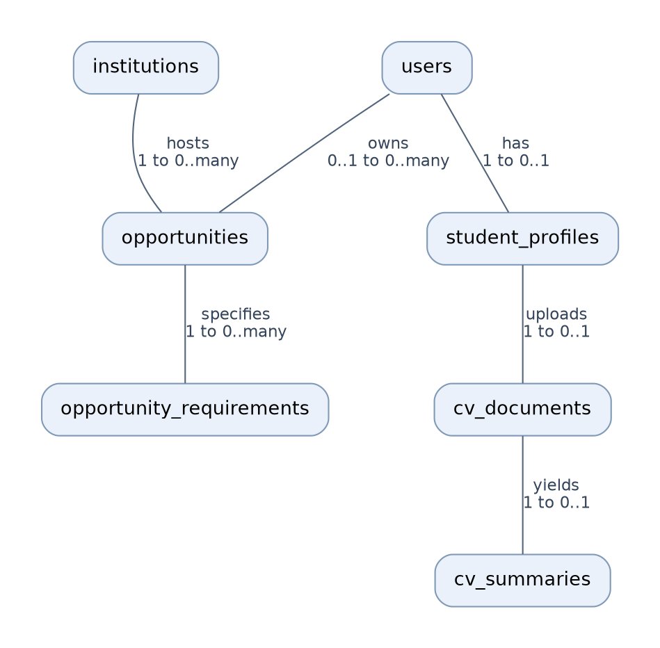
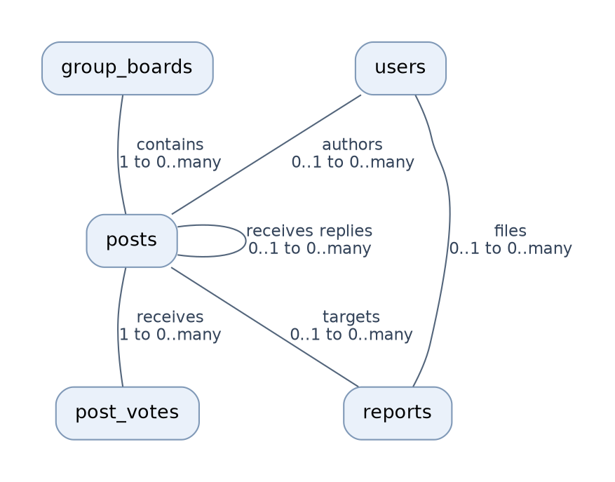
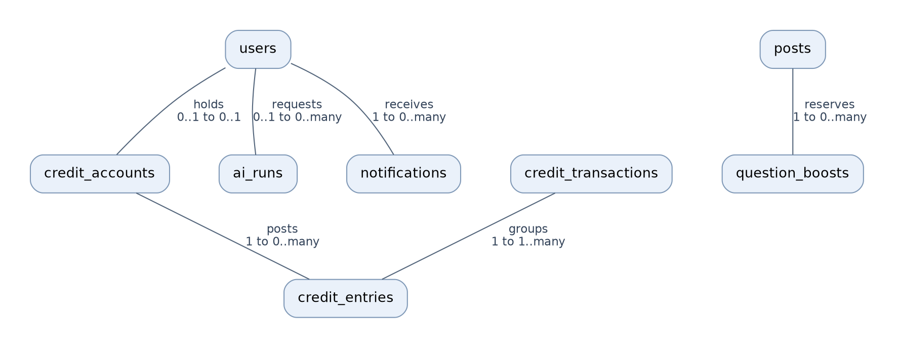
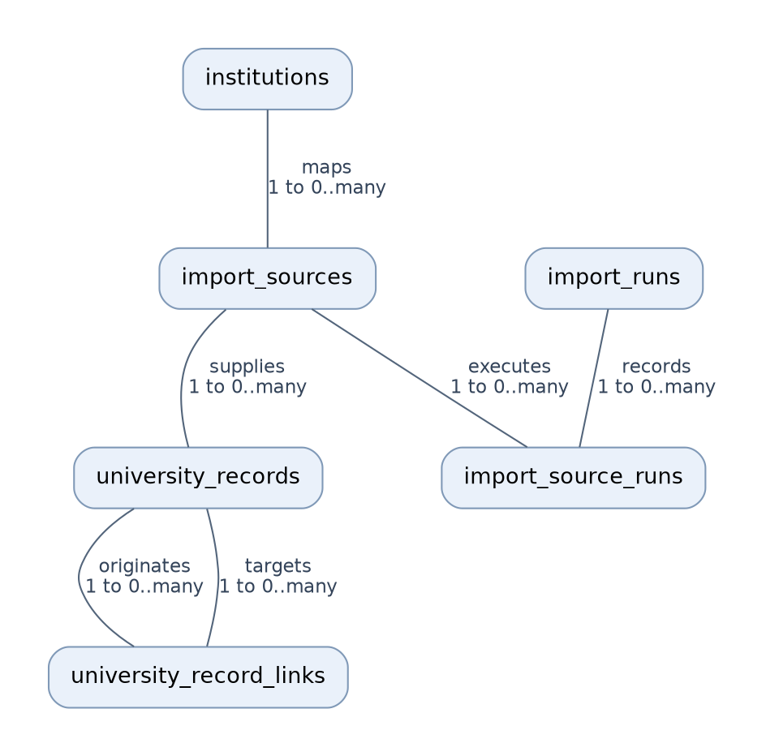
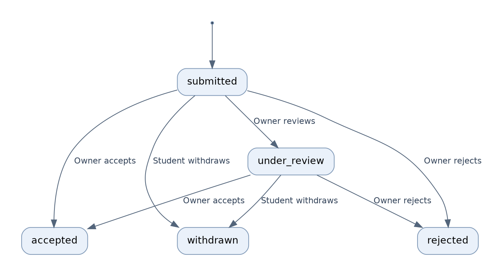
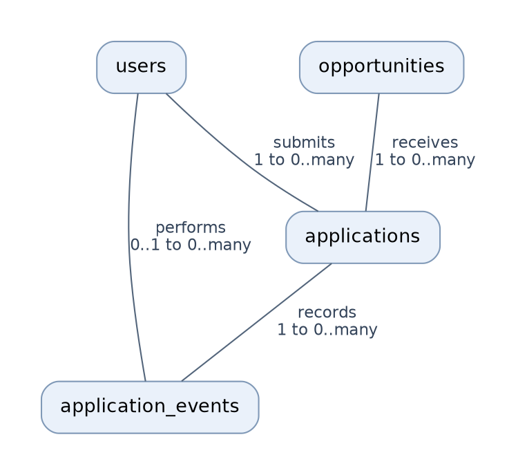
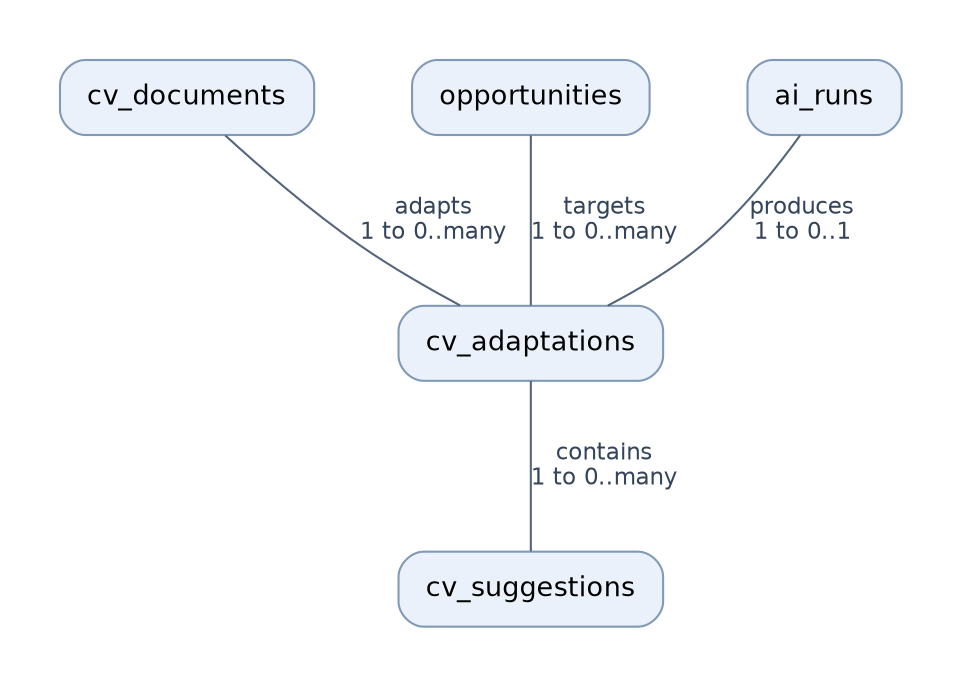

# WBS-14.7 · SynapseITU schema design

**Version 2 · 17 November 2026 · Proposed for module-owner review**

This logical design covers the Essential modules in the locally available Requirements Specification. Implementation details and proposed defaults are made explicit so owners can review the shared contract before WBS-14.3.

Use PostgreSQL, snake_case plural tables, UUID surrogate IDs, timestamptz for instants, date for source deadlines supplied as dates and integer credits. In the tables below, an entity has an `id` primary key unless a composite key is stated. Fields and foreign keys are required unless marked optional. Foreign keys restrict deletion by default. Explicit deletion rules appear below.

For the relationship diagrams, **1** means exactly one, **0..1** means optional, and **0..many** means any number. Read each connection from its first table to its second table.

## Identity, profile and opportunities

[Open full-size diagram](diagrams/identity-profile-opportunities.png)

| Table | Fields and constraints |
|---|---|
| institutions | name, optional website; use a reviewed source identity mapping for imports |
| institution_domains | domain PK, institution FK; normalize domain; uniqueness applies across institutions |
| users | normalized unique email, name, password_hash, role (student, owner, admin), optional institution FK, optional verified_at and suspended_at |
| auth_tokens | user FK, unique token digest, purpose (verify, reset, refresh), expires_at, optional consumed_at and revoked_at, optional refresh family ID |
| student_profiles | user_id PK/FK, education, skills, projects, interests, preferences, updated_at. Store five schema-validated structured sections with empty defaults. Derive completion percentage on save. |
| cv_documents | student_profile FK unique, private storage key unique, size_bytes (positive and within upload limit), consent version and consent timestamp, upload timestamp |
| cv_summaries | cv_document FK unique, status (pending, ready), optional schema-validated summary, updated_at. Ready requires a summary. |
| opportunities | optional owner FK, institution FK, title, description, deadline, status (draft, open, closed, archived), created_at, updated_at. Null owner is reserved for retained or system-managed records. |
| opportunity_requirements | opportunity FK, rule_type, typed threshold payload, must_have, weight >= 0. Validate payload per rule and confirm the rule vocabulary with Eligibility. |
| applications | opportunity FK, student FK, status (submitted, under_review, accepted, rejected, withdrawn), created_at; unique opportunity/student pair |
| application_events | application FK, optional actor FK, previous and new status (previous optional on submission), occurred_at |
| interest_requests | opportunity FK, student FK, owner FK, initiator side, optional message, status (pending, accepted, declined, withdrawn), timestamps; partial unique pending request per opportunity/student/owner trio |
| cv_adaptations | student FK, CV document FK, opportunity FK, AI run FK unique, validated requirement assessment, created_at |
| cv_suggestions | adaptation FK, ordinal, validated payload, decision (pending, accepted, rejected); unique adaptation/ordinal pair |

A user row holds login and common identity fields. A student profile extends that row through its shared primary key. The profile relationship from users is zero or one, and each profile has exactly one user. The field sections exist for students only. Role changes and suspension must enforce authorization in the service. Keep opportunity writes, board creation and publication in one transaction. Apply eligibility, deadline, role and status rules before inserting an application. Lock the application row while updating status and recording its history and notification event.

## Community and moderation

[Open full-size diagram](diagrams/community-moderation.png)

| Table | Fields and constraints |
|---|---|
| group_boards | scope (general, institution, opportunity), optional institution and opportunity FKs; check exactly the corresponding scope target; one row per scope target and one general row via partial unique indexes |
| posts | board FK, optional author FK, optional parent FK, kind (question, discussion, reply), optional question_state, title optional for replies, body, visibility, created_at, updated_at. Parent and reply share board via composite FK; require a parent for replies only. |
| post_votes | PK (post_id, voter_id), both FKs, value in (-1, 1), updated_at |
| accepted_answers | question_id PK/FK, answer_id unique FK, accepted_at. Composite reference to posts(id, parent_id) enforces that the answer replies to this question. |
| memberships | user FK, optional institution and opportunity FKs, start date, optional end date. Exactly one scope target, end date >= start date. |
| reports | optional reporter FK, optional post FK, optional target_user FK, reason, status, created_at, optional resolved_at. Open reports have exactly one target. One unresolved report per reporter/target via partial unique indexes. |
| admin_audit_events | optional admin FK, action, target type, opaque target reference, allow-listed details, occurred_at. Application admin access is read-only. |

For voting and answer acceptance, validate ownership, role and post type within the transaction. Serialize operations against the question when accepting an answer, closing or changing its boost. Derive community labels from membership at the agreed point in time. Preserve posts on account deletion with an anonymous author and scrub identifying content according to FR-09.

## Credits, AI use and notifications

[Open full-size diagram](diagrams/credits-ai-notifications.png)

| Table | Fields and constraints |
|---|---|
| credit_accounts | optional unique user FK for personal accounts, kind (user, treasury, escrow), integer balance; user and escrow balances >= 0. System accounts use stable keys. |
| credit_transactions | unique idempotency key, movement kind, occurred_at |
| credit_entries | transaction FK, account FK, signed nonzero amount, created_at; unique transaction/account pair |
| question_boosts | question FK, escrow account FK unique, reservation transaction FK unique, optional settlement transaction FK, amount > 0, state (reserved, paid, refunded) |
| app_settings | key PK, JSON value with validation by key, updated_at |
| ai_runs | optional user FK, feature, idempotency key, optional quota month, state, funding (allowance, credits, unmetered), optional reservation and settlement transaction FKs, created_at, optional finished_at; unique user/feature/idempotency key |
| ai_monthly_usage | PK (user_id, month_start), reserved_count and used_count >= 0; FK to user |
| outbox_events | unique event key, topic, validated payload, created_at, optional sent_at, attempt_count >= 0 |
| notification_preferences | PK (user_id, event_type), enabled |
| notifications | recipient FK, event key, type, object reference, created_at, optional read_at; unique recipient/event key |

Write a balanced transaction through a single posting path. Lock affected accounts in stable ID order, reject overdrafts and commit entries with balance changes. Validate entry count and zero sum before commit using a deferred constraint trigger or a restricted posting function with direct entry writes disabled. Use stable event keys for profile completion, posts and acceptance. Confirm the vote-toggle reward policy before implementing rewards. Reserve AI allowance or credits atomically before starting work. On success, settle the reservation exactly once. On failure, release it. Write notification events in the same transaction as their originating changes, and deduplicate delivery by recipient/event key.

## University records and retrieval

[Open full-size diagram](diagrams/university-imports.png)

| Table | Fields and constraints |
|---|---|
| import_sources | institution FK, stable unique source key, source type, base URL, enabled, optional last_success_at |
| import_runs | trigger, started_at, optional finished_at, outcome |
| import_source_runs | run FK, source FK, status, attempts, inserted/updated/archived/skipped/error counts (>= 0), optional error reason, timestamps; unique run/source pair |
| import_record_errors | source run FK, optional record type and external ID, reason, occurred_at |
| university_records | source FK, record type (program, lab, position), external ID, name, description, source URL, optional source_updated_at, payload hash, type-validated payload, optional archived_at; unique source/type/external ID |
| university_record_links | from_record FK, relation (position_lab, position_program), to_record FK; PK (from_record_id, relation). Resolve source-scoped IDs and validate kind and institution before writing links. |

Use each dummy record's `id` as the external ID and map `university_id` to the source institution. Positions require a lab and may reference a program. Load programs and labs before positions. For public pages, use persistent source-specific keys. Update changed rows, preserve old rows on invalid input and archive only after a complete authoritative snapshot for the relevant source and kind. Track IDs observed even if payload validation fails. A failed source keeps its last good records and advances neither its success watermark nor archival state. Imported positions enter the searchable university catalogue. Review promotion into application-enabled opportunities with the module owner.

## Search, integrity and deletion

| Table or query | Index or design |
|---|---|
| Opportunities, visible posts and active university records | GIN over per-table tsvector generated from searchable text using an explicit configuration. Start with simple for mixed Turkish and English and validate with the search team. |
| Semantic retrieval | Dedicated opportunity, post and university record embedding tables with a record FK, embedding_model, content hash and vector(1024). Composite PK (record_id, embedding_model). Optional HNSW cosine index after measuring representative data. Filter by model and matching content revision. |
| Work queues | Partial indexes on pending outbox events and open reports, plus chronological indexes for runs and source results |
| User and owner screens | Composite indexes on application student/time and opportunity/status, notifications recipient/time and unread subset, credit entries account_id plus transaction history ordering, posts board/time |
| Foreign keys | Index referencing columns used for joins and deletion checks where no existing index covers them |

Treat search output, search eligibility and chatbot responses as derived data. Apply visibility and access checks during retrieval, including when falling back to full-text search. Remove or suppress stale embeddings when the source changes and enqueue regeneration with a content revision check.

Cascade disposable credentials, profile and CV-dependent metadata, votes and notification preferences where appropriate. Revoke sessions and enqueue private file deletion before removing the corresponding storage reference. Keep file cleanup idempotent and persist its job until the object is removed. For retained community or accounting records, null personal references and remove identifying fields or payloads. Account deletion with outstanding boosts or reserved credits requires a settlement policy. Review audit and ledger retention and deletion semantics with the owning teams before implementing those migrations.

## Implementation contract

The [data contract](data-contract.md) fixes proposed field types, missing lifecycle values, relationship enforcement and transaction boundaries. The module tables above and this contract must be reviewed together. A database check validates the values in its own row. Cross-row rules require a foreign key, unique constraint, transaction or trigger as specified.

## Application workflow

[Open full-size diagram](diagrams/application-workflow.png)

The service authorizes the actor and locks the application before changing status. Final decisions and withdrawals are terminal in this proposal. Insert application history and its outbox event within the same commit.

## Additional relationship detail

[Open full-size diagram](diagrams/applications-history.png)

[Open full-size diagram](diagrams/cv-adaptations.png)
