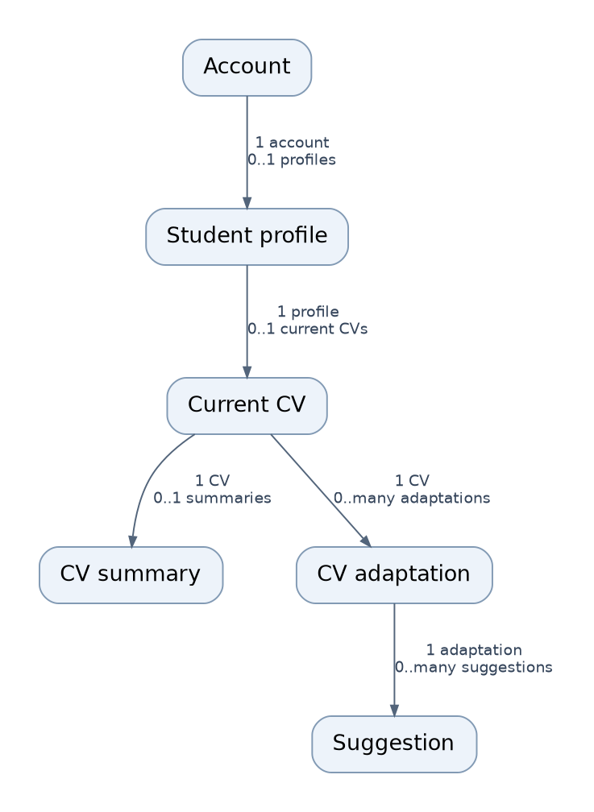
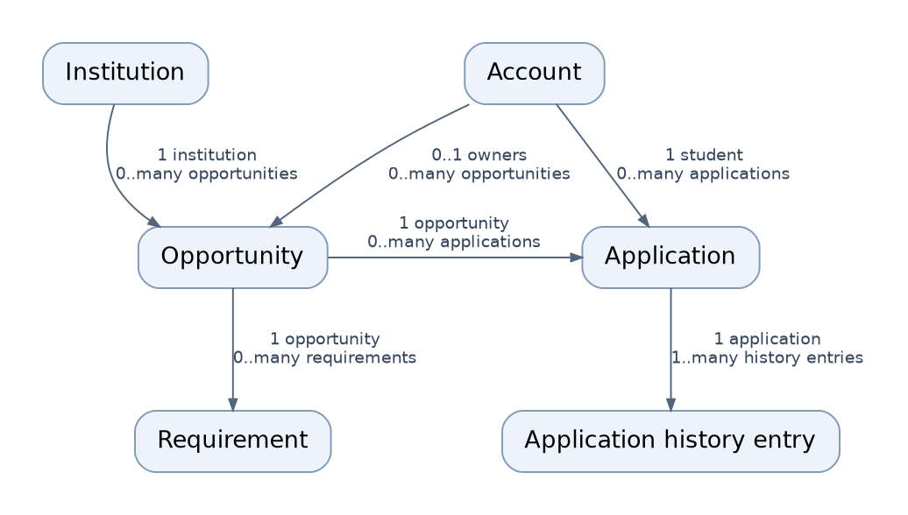
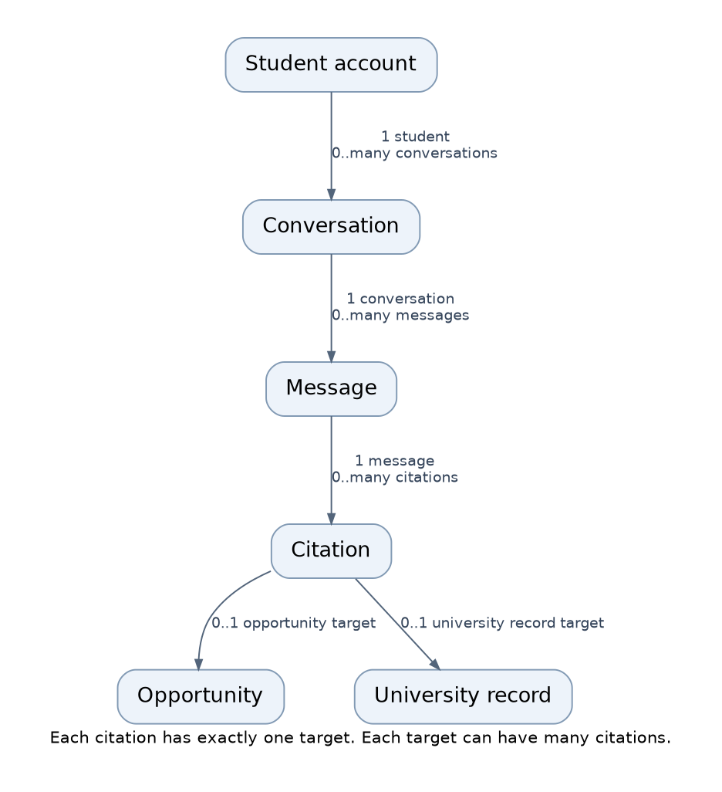

# Requirements Analysis · Domain and data model

**WBS-16.2 · Amr's contribution · 18 November 2026 · Draft for review**

## 1. Purpose and source of truth

SynapseITU connects students with academic opportunities and supports the process through structured profiles, CV assistance, discussions and university information. This section identifies the information the system must retain, the relationships between that information and the business rules governing it.

The model is based on the [17 November schema proposal](../database-design/schema-design.md) and the Requirements Specification at local Git revision 6895e09. It describes the domain information and observable rules needed for the Requirements Analysis document.

The conversation entities below are proposed conceptual entities supporting the context-preservation requirements in FR-53 and FR-54. Their detailed storage design requires confirmation by the responsible module owners. This section is the data-model contribution to the team's Requirements Analysis submission due on 23 November.

## 2. Actors and account identity

| Actor | Relationship to stored data |
|---|---|
| Visitor | Reads public boards and knowledge-search results without requiring an account record |
| Student | Uses a registered account with academic profile, applications, CV information and student AI allowance |
| Opportunity Owner | Uses a registered account to manage owned opportunities and review candidates |
| Admin | Uses a team-created account to manage users, reports, configuration and audit views |
| University Data Agent | Runs scheduled imports and records outcomes for each source |

The current proposal assigns one role to an account. A student profile extends the account using the same identifier and stores the five academic sections. Common identity information remains in the account. Role changes and the possibility of simultaneous roles require an explicit decision before changing that model.

## 3. Core entities and their information

| Domain entity | Main information | Logical schema mapping |
|---|---|---|
| Account | Name, unique email, role, verification and suspension state | users, auth_tokens |
| Institution | Name, website and recognized institutional domains | institutions, institution_domains |
| Student profile | Education, skills, projects, interests, preferences and completion state | student_profiles |
| CV document | Private file reference, size, upload time and recorded consent | cv_documents |
| CV summary | Processing state and validated skills and interests from one CV | cv_summaries |
| CV adaptation | Assessment against one opportunity and decisions on individual suggestions | cv_adaptations, cv_suggestions |
| Opportunity | Title, description, institution, owner, deadline and publication status | opportunities |
| Requirement | Rule type, threshold, must-have or plus classification and weight | opportunity_requirements |
| Application | Student, opportunity, current status and recorded changes | applications, application_events |
| Interest request | Opportunity, student, owner, initiating party, message and decision | interest_requests |
| Board | General, institution or opportunity scope | group_boards |
| Post | Question, discussion or reply, author, content, visibility and parent | posts |
| Vote and accepted answer | Voter's choice and the answer chosen by the asker | post_votes, accepted_answers |
| Membership | User's current or former association with an institution or opportunity | memberships |
| Report and audit event | Reporter, target, reason, resolution and administrative action history | reports, admin_audit_events |
| Credit account and movement | Spendable or reserved balance and traceable credit movements | credit_accounts, credit_transactions, credit_entries |
| Question boost | Question, reserved amount and settlement outcome | question_boosts |
| AI request and allowance | Requesting user, feature, state, funding and monthly consumption | ai_runs, ai_monthly_usage |
| Configuration | Monthly limit, reward amounts, feature switches and other validated settings | app_settings |
| Notification | Recipient, event, referenced object, creation and read state | notifications, notification_preferences, outbox_events |
| University source and record | Source identity, original identifier, program/lab/position data and provenance | import_sources, university_records, university_record_links |
| Import execution | Run timing, source outcomes, record counts and failure reasons | import_runs, import_source_runs, import_record_errors |
| Chatbot conversation | Student's ordered messages and the platform records cited in answers | Proposed chatbot_conversations, chatbot_messages, chatbot_message_sources |

Eligibility results, search rankings, discovery results and candidate rankings are derived from stored inputs. A candidate ranking uses the applicant's CV summary and the opportunity requirements, with evidence for each reason. It does not alter application status. The baseline does not specify permanent ranking-history tables.

## 4. Relationships and cardinalities

The following views show selected domain relationships. Each connection labels how many records can participate at its ends. The accompanying tables define the reading in both directions. They are conceptual views for analysis; the logical schema supplies the full field-level definitions.

### 4.1 Accounts, profiles and CVs

| Relationship | Meaning |
|---|---|
| Account–profile | An account has at most one student profile; a profile belongs to exactly one account |
| Profile–CV | A profile has at most one current CV; a CV belongs to exactly one profile |
| CV–summary | A CV has at most one summary record; each summary describes exactly one CV |
| CV–adaptation | A CV can support multiple adaptations; each adaptation references one CV and one opportunity |
| Adaptation–suggestion | An adaptation can produce multiple suggestions; each decision belongs to one suggestion |

A pending summary may exist while generation is incomplete. A ready summary contains validated information supported by its CV. Replacing the CV invalidates its old summary. Profile editing and summary extraction have separate origins; optional CV autofill requires student confirmation under FR-20.

### 4.2 Opportunities and participation

| Relationship | Meaning |
|---|---|
| Institution–opportunity | An institution hosts many opportunities; each opportunity identifies one institution |
| Account–opportunity | An owner can manage many opportunities; a retained or system-managed opportunity can have no owner reference in the proposal |
| Opportunity–requirement | An opportunity carries a list of requirements; each requirement belongs to one opportunity |
| Account–application | A student can submit many applications; each application identifies one student |
| Opportunity–application | An opportunity can receive many applications; each application identifies one opportunity |
| Application–history | Each successful status change is recorded against its application |

The student/opportunity pair uniquely identifies an application. A pending interest request identifies one student, one owner and one opportunity, regardless of which party initiated it. New applications require an authorized student and an open, eligible opportunity. Publicly visible closed or archived opportunities remain available to discovery.

### 4.3 Community information

| Relationship | Meaning |
|---|---|
| Scope–board | The platform provides a general board and institution/opportunity boards. Publication creates the opportunity board. |
| Board–post | A board contains many posts; each post belongs to one board |
| Post–reply | A question or discussion can receive many replies; a reply references its parent in the same board |
| Account–vote–post | A user has at most one current vote on a post; a post can receive votes from many users |
| Question–accepted answer | A question has at most one accepted answer; that answer must reply to the question |
| Account–report–target | A report identifies its reporter and one post or user target. The reporter can differ from the targeted user. |
| Account–membership–scope | A recorded membership connects a user with an institution or opportunity and its relevant dates |

Retained public posts may have an anonymous author after account deletion. Only the asker can accept an answer, and self-acceptance is prohibited. Under FR-51, a repeat post report by the same user is rejected even if the prior report has been resolved.

### 4.4 Credits, allowance and notifications

A personal credit account belongs to a user. Credit history records every movement, and transfers preserve the total amount between the source and destination. Reserved boost funds are associated with a boost and settled once. The model requires nonnegative balances under FR-58.

An AI request identifies its feature and its reservation outcome. Monthly allowance belongs to one student and one calendar month. A successful paid CV Adaptor run consumes its reserved credits; a failed run releases them. A notification belongs to one recipient and one event, with a uniqueness rule preventing duplicate delivery for that pair.

### 4.5 University information and chatbot context

An institution can have several import sources. One overall import execution has one recorded outcome for each processed source. A source supplies many records, identified by source, record kind and external ID. A position references a required lab and an optional program in the current dummy API contract.

A proposed conversation belongs to one student and contains ordered messages. An assistant message can cite several platform records. Every citation targets exactly one opportunity or one university record. A timeout preserves earlier messages and the user's request. Access to conversation history is restricted to its owner through the application service.

Conversation information participates in account deletion under FR-09. The proposed conversation and citation entities make the information required for follow-up questions and source attribution explicit.

## 5. Business rules

| Rule | Required behavior | Source |
|---|---|---|
| Identity and permissions | Emails are unique. New accounts are unverified. Posting, applying and sending interest requests require verification. Protected actions enforce role and ownership. | FR-01–08 |
| Profile completion | Four of five valid sections including education and skills qualify for the first completion reward. Later edits recalculate the percentage without awarding it again. | FR-17–18 |
| CV lifecycle | Obtain consent before upload or processing. Accept text-extractable PDFs within the 10 MB limit. Remove the previous file and summary on replacement. | FR-19, FR-21 |
| CV assistance | Store each suggestion decision and export only accepted changes. Suggestions must be grounded in the CV. Failed or disabled runs consume no allowance. | FR-22–24 |
| Publication | Owners can save drafts or publish. Drafts are hidden from students. Closed or archived opportunities reject new applications. | FR-25–27 |
| Applications | Repeated application requests return the existing application. Owners decide review/accept/reject; students can withdraw before a decision. Changes retain history and generate notification events. | FR-30–32 |
| Interest requests | Repeated pending requests between the same parties for an opportunity return the existing request. The receiver accepts/declines and the sender can withdraw. | FR-33 |
| Eligibility | Check every must-have rule. Missing profile data produces cannot be checked. AI search uses the eligible pool; discovery can show public opportunities regardless of eligibility or open/closed status. | FR-35–42 |
| Candidate ranking | Use CV summaries and requirements as evidence. Candidates without summaries remain unranked. Human owners decide application outcomes. | FR-43 |
| Discussions | Verified users post and vote. Reject self-votes and self-accepted answers. Membership labels require recorded membership. | FR-46–50 |
| Reports and moderation | Verified users report posts, with no duplicate post report per reporter. Record administrative actions and their outcome. | FR-11–13, FR-51 |
| Knowledge and chatbot answers | Return links to source posts or platform records. Preserve chat context through follow-ups and provider timeouts. | FR-52–54 |
| Credits | Record every movement, preserve balanced transfers and prevent negative balances. | FR-56–58 |
| AI spending | Use available monthly allowance first. After it is exhausted, charge a confirmed extra CV Adaptor run only on success. | FR-59–60 |
| Notifications | Honor event-type preferences, deliver one notification per recipient/event and retry failures. Deadline reminders use the 48-hour window. | FR-61–63 |
| Imports | Run every 24 hours, validate records, preserve source URLs, update changed content and avoid duplicates. Failed sources preserve last good records and permit other sources to continue. | FR-65–69 |

On question closure without an accepted answer, the boost goes to the eligible answer with the most upvotes. Break ties by earliest creation time and then stable answer ID. If no eligible answer has an upvote, use the earliest eligible answer. Exclude the asker's own answers; refund when none is eligible. These rules are already specified in FR-57.

Initial configurable values are 2 credits per answer upvote, 5 per accepted answer, 10 for first profile completion and 1 per verified-user post. Minimum boosts cost 5 credits, the monthly allowance is 10 runs and an extra CV Adaptor run costs 10 credits.

## 6. Data lifecycle and failure behavior

| Event | Required data outcome |
|---|---|
| Profile save fails | Keep previously stored profile data and issue no completion reward |
| CV extraction times out | Retain the CV and pending summary state for a retry |
| CV replaced or removed | Remove obsolete file/summary references and finish private-file cleanup with retry support |
| Application status changes | Commit status, history and event together |
| AI request fails | Preserve the failure state and release its reservation exactly once |
| Import record fails validation | Log its error and preserve that record's last good version |
| Source snapshot is incomplete | Preserve records whose absence cannot be established reliably |
| Complete source snapshot omits a record | Archive that source record and update search visibility |
| Content changes | Exclude obsolete embeddings until vectors for the new content revision are available |
| Account deletion | Revoke credentials, erase personal profile/CV/chat data and anonymize retained posts; finish failed file deletion through a durable retry |

The outcome of account deletion for active applications, reports, boosts and AI reservations needs confirmation with the responsible module owners. The data model must preserve the required deletion behavior and consistent credit movements together.

## 7. Requirements coverage and implementation mapping

| Requirement group | Model elements | Implementation activity |
|---|---|---|
| FR-01–08 | Account, token lifecycle and verification | WBS-1.1, 1.2 |
| FR-09 | Account and personal-data deletion across dependent records | WBS-3.1 and affected module owners |
| FR-10–16 | User administration, reports, audit events and settings | WBS-2.2 |
| FR-17–19, 21–24 | Profile, CV, summary, adaptation and suggestion decisions | WBS-3.1, 4.2, 4.1, 11.1 |
| FR-25–27, 30–33 | Opportunity, requirements, board, application history and interest request | WBS-5.1, 6.1, 9.1 |
| FR-35–43 | Eligibility, summary-based search, discovery and candidate ranking inputs | WBS-7.1, 8.2, 8.3, 8.4 |
| FR-46–52 | Posts, votes, accepted answers, membership, reporting and searchable content | WBS-9.1, 10.1, 2.2 |
| FR-53–54 | Proposed conversation, messages, citations and authorized platform records | WBS-10.3 |
| FR-56–60 | Credit history, boosts, AI runs, monthly use and settings | WBS-11.1 |
| FR-61–63 | Notifications, preferences and durable events | WBS-12.1 |
| FR-65–69 | Dummy API contract, catalogue, sources, run results and record errors | WBS-13.1, 13.2 |

Contingent requirements are FR-20, 28–29, 34, 44–45, 55 and 64. Their features include CV autofill, announcements, calendar, real-time chat, team-profile matching, teammate ratings, open-web tools and optional email notifications. They require additional modeling when scheduled. In particular, chatbot conversation storage supports the Essential university chatbot; real-time chat between applicants and owners is a separate contingent feature.

## 8. Review examples

These examples describe expected outcomes for design review. They have not been executed as application tests.

| Scenario | Expected outcome |
|---|---|
| Student uploads a replacement CV | The current document changes and the old summary is removed; new processing creates the replacement summary |
| Student presses Apply twice | One application remains for that student and opportunity |
| Student reports a post again after resolution | The system indicates that the post was already reported by that student |
| Profile reaches 80%, later falls below it, then reaches 80% again | The actual percentage changes but the completion reward occurs once |
| Student spends the last available credits through competing requests | Affordable reservations succeed and the personal balance never becomes negative |
| A source times out while another succeeds | The failing source retains its last good records and the successful source's updates remain available |
| Chatbot request times out | Prior messages and the user's new message remain available for follow-up or retry |
| A candidate has no CV summary | Candidate ranking shows not ranked with a reason; application status is unchanged |

